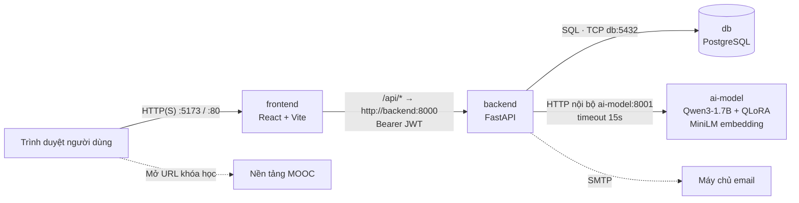

# BUSINESS ANALYSIS DOCUMENT
## Dự án EduMentor AI
---

# 1. Bối cảnh và vấn đề thực tiễn

Sự phát triển của các nền tảng học trực tuyến như Coursera, Udemy và edX mang đến nguồn tri thức phong phú, nhưng cũng khiến người học, đặc biệt là người mới bắt đầu, khó lựa chọn khóa học và xác định các kỹ năng tiên quyết để đạt được mục tiêu nghề nghiệp.

Bên cạnh đó, quá trình tự học lập trình thường gặp trở ngại do lỗi cú pháp, khái niệm phức tạp và thiếu sự hỗ trợ kịp thời khi gỡ lỗi.

# 2. Mục tiêu dự án

EduMentor AI hướng đến các mục tiêu sau:

- **Cá nhân hóa lộ trình học tập:** Phân tích mục tiêu nghề nghiệp và kỹ năng hiện có để đề xuất lộ trình học tập cùng các khóa học phù hợp.
- **Hỗ trợ tự học lập trình:** Cung cấp trợ lý AI có khả năng giải thích kiến thức, hỗ trợ gỡ lỗi và tạo bài tập thực hành.
- **Theo dõi tiến trình học tập:** Lưu trữ lộ trình, trạng thái học tập và kết quả ôn tập để người học theo dõi quá trình phát triển kỹ năng.

# 3. Phạm vi dự án (Project Scope)

## 3.1. Phạm vi thực hiện (In Scope)

- **Quản lý khóa học và kỹ năng:** Lưu trữ, tìm kiếm và hiển thị thông tin khóa học, kỹ năng và mối quan hệ tiên quyết giữa các kỹ năng.
- **Gợi ý lộ trình học tập:** Phân tích mục tiêu bằng ngôn ngữ tự nhiên, kết hợp kỹ năng hiện có và dữ liệu lịch sử để xây dựng lộ trình cá nhân hóa.
- **Gợi ý khóa học:** Đề xuất các khóa học phù hợp với từng kỹ năng trong lộ trình.
- **Trợ lý gia sư AI:** Hỗ trợ giải thích kiến thức, phân tích lỗi lập trình coding.
- **Ôn tập và theo dõi tiến trình:** Cung cấp câu hỏi trắc nghiệm dựa trên kỹ năng có trong khóa học, lưu kết quả ôn tập và theo dõi trạng thái học tập.
- **Quản lý dữ liệu người dùng:** Lưu trữ hồ sơ, lộ trình và lịch sử học tập để hỗ trợ cá nhân hóa.

## 3.2. Phạm vi không thực hiện (Out of Scope)

- Phát triển ứng dụng di động độc lập.
- Xây dựng hoặc lưu trữ nội dung video bài giảng của các nền tảng bên ngoài.
- Tự động đăng ký hoặc thanh toán khóa học thay người dùng.
- Đào tạo lại mô hình liên tục theo thời gian thực.
- Triển khai hệ thống ở quy mô thương mại lớn với khả năng mở rộng và độ sẵn sàng cấp doanh nghiệp.

# 4. Các bên liên quan và vai trò người dùng


## 4.1. Vai trò người dùng (User Roles)

EduMentor AI xác định hai vai trò người dùng chính: **Người dùng
(User)** và **Quản trị viên (Admin)**.

### 4.1.1. Người dùng (User)

Người dùng là người học sử dụng EduMentor AI để xác định mục tiêu nghề nghiệp, tạo lộ trình học tập cá nhân hóa, tìm kiếm khóa học phù hợp và nhận hỗ trợ học tập từ AI.

Người dùng có thể: 
- Đăng ký đăng nhập tài khoản và quản lý hồ sơ cá nhân. 
- Gửi mục tiêu nghề nghiệp hoặc mục tiêu dự án thông qua System Consultant. 
- Tạo, xem và quản lý các lộ trình học tập của bản thân. -
- Khám phá các kỹ năng trong lộ trình và xem các khóa học được đề xuất. 
- Lưu khóa học để xem sau (bookmark) hoặc cập nhật trạng thái khóa học thành đang học (ongoing), đã hoàn thành (completed) hoặc đã từ bỏ (abandon). 
- Tương tác với AI Tutor để đặt câu hỏi, hiểu các khái niệm và nhận hỗ trợ lập trình. 
- Thực hiện bài đánh giá kỹ năng và xem lịch sử, kết quả đánh giá. 
- Xem và quản lý hồ sơ kỹ năng cùng lịch sử học tập cá nhân.

### 4.1.2. Quản trị viên (Admin)
Quản trị viên chịu trách nhiệm quản lý dữ liệu nền và cấu hình cần thiết để EduMentor AI hoạt động nhất quán.

Quản trị viên có thể: 
- Quản lý Khóa học. 
- Quản lý các mối quan hệ giữa kỹ năng, bao gồm kỹ năng tiên quyết, kỹ năng liên quan và kỹ năng mở rộng. 
- Quản lý dữ liệu khóa học và mối quan hệ giữa khóa học với kỹ năng. 
- Tạo và duy trì các mẫu lộ trình học tập cơ sở, bao gồm các nút kỹ năng và mối quan hệ giữa chúng. 
- Kiểm tra và quản lý dữ liệu lịch sử về lộ trình học tập được sử dụng bởi hệ thống đề xuất.
- Trả lời quản lý feedback của học viên (Câu trả lời từ feedback có thể được gửi về mail). 

Quyền quản trị phải được giới hạn cho các tài khoản được cấp phép. Người dùng thông thường không được phép chỉnh sửa dữ liệu dùng chung của hệ thống hoặc lộ trình riêng của người dùng khác.

## 4.2. Các bên liên quan (Stakeholders)

| Bên liên quan | Mối quan tâm hoặc trách nhiệm |
|---------------|------------------------------|
| Người học / Người dùng cuối | Sử dụng lộ trình học tập, đề xuất khóa học, gia sư AI và bài đánh giá kỹ năng để hỗ trợ mục tiêu học tập cá nhân. |
| Nhóm dự án / Nhóm phát triển | Phân tích, thiết kế, xây dựng, kiểm thử và bảo trì giao diện, backend, cơ sở dữ liệu, thành phần AI và logic đề xuất. |
| Quản trị viên hệ thống | Duy trì danh mục kỹ năng, đồ thị kỹ năng, dữ liệu khóa học, mẫu lộ trình và các bộ dữ liệu hỗ trợ. |
| Nhà cung cấp khóa học / Nền tảng MOOC | Cung cấp link khóa học và trang khóa học bên ngoài mà EduMentor AI liên kết đến. Nhà cung cấp vẫn chịu trách nhiệm về nội dung, đăng ký, giá và dịch vụ học tập trên nền tảng của họ. |
| Mô hình AI / LLM | Trong phạm vi nguyên mẫu hiện tại, nhóm dự án dự kiến thử nghiệm mô hình mã nguồn mở từ Hugging Face và tinh chỉnh bằng QLoRA trên Google Colab nếu tài nguyên GPU miễn phí khả dụng. |
| Giảng viên hướng dẫn / Người đánh giá học thuật | Đánh giá phạm vi, yêu cầu, quá trình triển khai và kết quả dự án phục vụ mục đích học thuật. |

## 4.3. Nguyên tắc phân quyền và truy cập

-   **Tách biệt dữ liệu người dùng:** Người dùng chỉ được xem và chỉnh
    sửa hồ sơ, lộ trình học tập, trạng thái theo dõi khóa học và lịch sử
    đánh giá của chính mình.
-   **Phân quyền quản trị:** Chỉ tài khoản Admin được ủy quyền mới có
    thể chỉnh sửa danh mục dùng chung, quan hệ kỹ năng, mẫu lộ trình cơ
    sở và dữ liệu quản trị.
-   **Ranh giới với dịch vụ bên ngoài:** EduMentor AI cung cấp liên kết
    đến các nhà cung cấp khóa học bên ngoài nhưng không trực tiếp quản
    lý việc đăng ký học hoặc nội dung khóa học của họ.

# 5. QUY TRÌNH NGHIỆP VỤ VÀ USE CASES

## 5.1. Quy trình nghiệp vụ tổng quát (General Business Workflow)

EduMentor AI hỗ trợ người dùng xây dựng lộ trình học tập cá nhân hóa và tìm kiếm các khóa học phù hợp. Hệ thống cho ra các kĩ năng cần thiết cho mục tiêu người dùng từ LLM, danh mục kỹ năng, mối quan hệ giữa các kỹ năng, dữ liệu khóa học và dữ liệu lộ trình học tập trong quá khứ để hỗ trợ quá trình đề xuất.

Quy trình nghiệp vụ tổng quát bao gồm các bước sau:

**Bước 1: Cung cấp mục tiêu học tập**

Người dùng nhập mục tiêu nghề nghiệp hoặc mục tiêu học tập thông qua AI Consultant, chẳng hạn như trở thành Backend Developer hoặc AI Engineer..

**Bước 2: Phân tích mục tiêu**

Hệ thống phân tích yêu cầu của người dùng để xác định các kỹ năng liên quan đến mục tiêu. Kết quả phân tích được đối chiếu với danh mục kỹ năng hiện có nhằm hạn chế việc đề xuất những kỹ năng không tồn tại trong hệ thống.

**Bước 3: Xây dựng lộ trình học tập**

Hệ thống sử dụng các kỹ năng đã xác định, mối quan hệ giữa các kỹ năng và dữ liệu lộ trình học tập trước đó để xây dựng lộ trình đề xuất. Lộ trình được tổ chức thành các nút kỹ năng có liên kết với nhau, giúp người dùng hiểu được cấu trúc và mối quan hệ giữa các nội dung học tập.

**Bước 4: Lưu và quản lý lộ trình**

Sau khi được tạo, lộ trình được lưu vào hệ thống để người dùng có thể xem lại và tiếp tục sử dụng trong những lần truy cập sau. Người dùng có thể xem các kỹ năng trong lộ trình mà không bắt buộc phải học theo một thứ tự cố định.

**Bước 5: Khám phá khóa học**

Khi người dùng chọn một kỹ năng trong lộ trình, hệ thống hiển thị các khóa học liên quan từ cơ sở dữ liệu. Các khóa học được sắp xếp theo mức độ phù hợp với kỹ năng, mục tiêu học tập, đánh giá. Người dùng sau đó được dẫn đến trang khóa học của nhà cung cấp bên ngoài để tìm hiểu thêm và đăng ký học.

**Bước 6: Hỗ trợ học tập và theo dõi tiến độ**

Trong quá trình học, người dùng có thể yêu cầu AI Tutor giải thích khái niệm, hỗ trợ lập trình, gỡ lỗi hoặc cung cấp bài tập củng cố. Người dùng cũng có thể cập nhật trạng thái học tập của khóa học và thực hiện bài đánh giá kỹ năng nếu có nhu cầu khi người dùng đã đánh dấu học xong.


## 5.2. Danh sách Use Cases (Use Case List)

EduMentor AI có hai tác nhân chính tương tác trực tiếp với hệ thống là **User** và **Admin**.

| Use Case ID | Use Case Name | Actor | Description |
|---|---|---|---|
| UC-01 | Register and Log In | User | Đăng ký tài khoản và đăng nhập hệ thống. |
| UC-02 | Manage Profile | User | Xem và cập nhật thông tin cá nhân, kỹ năng hiện có và thông tin học tập. |
| UC-03 | Submit Learning Goal | User | Nhập mục tiêu nghề nghiệp hoặc mục tiêu học tập thông qua AI Consultant. |
| UC-04 | Generate Learning Path | User | Yêu cầu hệ thống phân tích mục tiêu và tạo lộ trình học tập cá nhân hóa. |
| UC-05 | View and Manage Learning Paths | User | Xem lại, lựa chọn và quản lý các lộ trình học tập đã lưu. |
| UC-06 | Explore Skills and Courses | User | Chọn kỹ năng trong lộ trình và xem các khóa học được đề xuất. |
| UC-07 | Track Learning Progress | User | Lưu khóa học để học sau hoặc cập nhật trạng thái học tập. |
| UC-08 | Interact with AI Tutor | User | Đặt câu hỏi, yêu cầu giải thích, hỗ trợ. |
| UC-09 | Review a Skill | User | Thực hiện bài đánh giá kỹ năng và nhận kết quả phản hồi. |
| UC-10 | View Review History | User | Xem kết quả đánh giá kỹ năng trong quá khứ. |
| UC-11 | Manage Skill Catalogue | Admin | Thêm, xem, cập nhật và quản lý danh mục kỹ năng. |
| UC-12 | Manage Skill Relationships | Admin | Quản lý các mối quan hệ giữa kỹ năng, bao gồm quan hệ tiên quyết và quan hệ mở rộng. |
| UC-13 | Manage Course Catalogue | Admin | Quản lý thông tin khóa học và mối liên kết giữa khóa học với kỹ năng. |
| UC-14 | Manage Learning Path Templates | Admin | Quản lý các lộ trình mẫu và cấu trúc kỹ năng được sử dụng làm dữ liệu nền. |
| UC-15 | Manage Historical Learning Data | Admin | Hỗ trợ quản lý hoặc kiểm tra dữ liệu lịch sử phục vụ hệ thống đề xuất theo quyền được cấp. |

*Lưu ý: Danh sách trên là danh sách Use Case dự kiến. Các Use Case sẽ được xác nhận và điều chỉnh theo phạm vi triển khai thực tế của dự án.*

## 5.3. Đặc tả các Use Cases chính (Detailed Use Case Specifications)

### UC-03: Submit Learning Goal

**Actor:** User

**Preconditions:**
- Người dùng đã đăng nhập vào hệ thống.
- AI Consultant có thể được truy cập.

**Main Flow:**
1. Người dùng mở AI Consultant.
2. Người dùng nhập mục tiêu nghề nghiệp hoặc mục tiêu học tập.
3. Người dùng cung cấp thêm thông tin nếu hệ thống yêu cầu làm rõ mục tiêu.
4. Người dùng gửi yêu cầu.
5. Hệ thống tiếp nhận và chuyển yêu cầu sang quy trình phân tích mục tiêu.

**Alternative Flow:**
- Nếu thông tin chưa đủ rõ ràng, hệ thống yêu cầu người dùng cung cấp thêm thông tin.
- Nếu yêu cầu không thuộc phạm vi hỗ trợ, hệ thống thông báo giới hạn và hướng dẫn người dùng điều chỉnh yêu cầu.

**Postconditions:**
- Yêu cầu học tập được tiếp nhận để xử lý.
- Không có lộ trình mới được xác nhận là hoàn tất chỉ dựa trên việc gửi yêu cầu.

### UC-04: Generate Learning Path

**Actor:** User

**Preconditions:**
- Người dùng đã đăng nhập.
- Người dùng đã cung cấp mục tiêu học tập hợp lệ.
- Danh mục kỹ năng và dữ liệu nền cần thiết có sẵn.

**Main Flow:**
1. Người dùng yêu cầu tạo lộ trình học tập.
2. Hệ thống phân tích mục tiêu và xác định các kỹ năng liên quan.
3. Hệ thống đối chiếu kết quả với danh mục kỹ năng.
4. Hệ thống sử dụng mối quan hệ giữa các kỹ năng để xác định cấu trúc lộ trình phù hợp.
5. Hệ thống sử dụng dữ liệu lộ trình trong quá khứ để hỗ trợ quá trình đề xuất.
6. Hệ thống tạo và hiển thị lộ trình học tập.
7. Hệ thống lưu lộ trình để người dùng có thể truy cập lại.

**Alternative Flow:**
- Nếu không xác định được các kỹ năng phù hợp, hệ thống thông báo kết quả và cho phép người dùng điều chỉnh mục tiêu.
- Nếu kết quả phân tích chứa kỹ năng không hợp lệ, hệ thống phải kiểm tra và xử lý kết quả trước khi lưu lộ trình.
- Nếu quá trình tạo lộ trình thất bại, hệ thống thông báo lỗi và cho phép người dùng thử lại.

**Postconditions:**
- Một lộ trình mới được lưu khi quá trình tạo thành công.
- Lộ trình được liên kết với người dùng tương ứng.
- Lộ trình có thể được truy cập lại trong các phiên sử dụng sau.

### UC-05: View and Manage Learning Paths

**Actor:** User

**Preconditions:**
- Người dùng đã đăng nhập.

**Main Flow:**
1. Người dùng mở khu vực quản lý lộ trình.
2. Hệ thống hiển thị các lộ trình thuộc tài khoản người dùng.
3. Người dùng chọn một lộ trình.
4. Hệ thống hiển thị mục tiêu, cấu trúc và các kỹ năng trong lộ trình.
5. Người dùng lựa chọn kỹ năng muốn tìm hiểu hoặc tiếp tục khám phá khóa học.

**Alternative Flow:**
- Nếu người dùng chưa có lộ trình nào, hệ thống cung cấp tùy chọn tạo lộ trình mới.
- Nếu lộ trình không còn khả dụng, hệ thống thông báo trạng thái tương ứng.

**Postconditions:**
- Người dùng có thể xem lại lộ trình đã lưu và lựa chọn nội dung muốn học.

### UC-06: Explore Skills and Courses

**Actor:** User

**Preconditions:**
- Người dùng đã đăng nhập.
- Kỹ năng được lựa chọn tồn tại trong hệ thống.

**Main Flow:**
1. Người dùng mở một lộ trình.
2. Người dùng chọn một nút kỹ năng.
3. Hệ thống hiển thị thông tin của kỹ năng.
4. Hệ thống truy xuất các khóa học liên quan đến kỹ năng đó.
5. Hệ thống sắp xếp và hiển thị các khóa học theo mức độ phù hợp.
6. Người dùng xem thông tin khóa học và lựa chọn khóa học muốn tìm hiểu.
7. Hệ thống cung cấp liên kết đến trang khóa học của nhà cung cấp bên ngoài.

**Alternative Flow:**
- Nếu chưa có khóa học phù hợp, hệ thống thông báo và không hiển thị kết quả giả.
- Nếu liên kết khóa học không còn khả dụng, hệ thống thông báo khi phát hiện được tình trạng này.

**Postconditions:**
- Người dùng có thể tìm thấy các khóa học liên quan đến kỹ năng đã chọn.
- Việc truy cập hoặc đăng ký khóa học được thực hiện trên nền tảng của nhà cung cấp bên ngoài.

### UC-08: Interact with AI Tutor

**Actor:** User

**Preconditions:**
- Người dùng đã đăng nhập.
- Dịch vụ AI Tutor khả dụng.

**Main Flow:**
1. Người dùng mở AI Tutor.
2. Người dùng gửi câu hỏi hoặc yêu cầu hỗ trợ học tập.
3. Hệ thống tiếp nhận nội dung và ngữ cảnh hội thoại liên quan.
4. AI Tutor tạo phản hồi phù hợp với yêu cầu.
5. Hệ thống hiển thị phản hồi cho người dùng.
6. Người dùng có thể tiếp tục hội thoại, yêu cầu giải thích thêm, hỗ trợ gỡ lỗi hoặc bài tập củng cố.

**Alternative Flow:**
- Nếu yêu cầu chưa rõ ràng, hệ thống có thể đề nghị người dùng làm rõ.
- Nếu dịch vụ AI không khả dụng, hệ thống thông báo lỗi thay vì tạo phản hồi thành công giả.
- Nếu yêu cầu nằm ngoài khả năng hỗ trợ, hệ thống giải thích giới hạn phù hợp.

**Postconditions:**
- Hội thoại được duy trì trong phiên tương ứng theo thiết kế của hệ thống.
- Người dùng nhận được hỗ trợ học tập mà không bắt buộc phải hoàn thành một kỹ năng hoặc khóa học trước đó.

### UC-09: Review a Skill

**Actor:** User

**Preconditions:**
- Người dùng đã đăng nhập.
- Kỹ năng được chọn có đủ dữ liệu để tạo bài đánh giá.

**Main Flow:**
1. Người dùng chọn chức năng đánh giá kỹ năng.
2. Người dùng lựa chọn kỹ năng muốn đánh giá.
3. Hệ thống tạo bài đánh giá dựa trên dữ liệu câu hỏi liên quan đến kỹ năng.
4. Người dùng trả lời các câu hỏi.
5. Hệ thống đánh giá câu trả lời theo tiêu chí tương ứng.
6. Hệ thống hiển thị điểm số, phản hồi.
7. Hệ thống lưu kết quả đánh giá vào lịch sử của người dùng.

**Alternative Flow:**
- Nếu không đủ dữ liệu để tạo bài đánh giá, hệ thống thông báo cho người dùng.
- Nếu người dùng thoát trước khi hoàn thành, hệ thống xử lý phiên đánh giá theo quy tắc được xác định trong yêu cầu chức năng.

**Postconditions:**
- Kết quả đánh giá được lưu khi bài đánh giá hoàn tất.
- Người dùng có thể xem lại kết quả trong lịch sử đánh giá.
- Việc đánh giá là tự nguyện và không phải điều kiện bắt buộc để tiếp tục học tập.

## 5.4. Quy trình quản trị hệ thống (Administrative Workflow)

Admin chịu trách nhiệm quản lý các dữ liệu nền cần thiết để EduMentor AI hoạt động ổn định và tạo ra các đề xuất có ý nghĩa.

Quy trình quản trị gồm các hoạt động chính:

1. **Quản lý danh mục kỹ năng:** Thêm mới, cập nhật và kiểm tra thông tin kỹ năng.
2. **Quản lý quan hệ giữa kỹ năng:** Thiết lập, cập nhật và kiểm tra các mối quan hệ giữa những kỹ năng nhằm hỗ trợ việc xây dựng cấu trúc lộ trình.
3. **Quản lý khóa học:** Cập nhật thông tin khóa học, liên kết bên ngoài và kỹ năng liên quan.
4. **Quản lý lộ trình mẫu:** Tạo và cập nhật cấu trúc lộ trình nền phục vụ hoạt động quản lý và tham khảo.

Hệ thống cần kiểm tra dữ liệu trước khi lưu các thay đổi có thể ảnh hưởng đến hoạt động đề xuất. Chỉ tài khoản được cấp quyền Admin mới được phép thực hiện các thao tác quản trị dữ liệu dùng chung.

## 5.5. Quy tắc nghiệp vụ tổng quát (General Business Rules)

- **BR-01 — Quyền sở hữu dữ liệu:** Người dùng chỉ được xem và quản lý dữ liệu cá nhân thuộc phạm vi quyền của mình.
- **BR-02 — Tính hợp lệ của kỹ năng:** Các kỹ năng được lưu trong lộ trình phải được đối chiếu với danh mục kỹ năng của hệ thống.
- **BR-03 — Tính linh hoạt của lộ trình:** Lộ trình có vai trò hướng dẫn; người dùng không bắt buộc phải tuân thủ một thứ tự học cố định.
- **BR-04 — Tính tự nguyện của đánh giá:** Người dùng có thể học tập mà không cần thực hiện bài đánh giá kỹ năng.
- **BR-05 — Phạm vi khóa học:** EduMentor AI quản lý thông tin và liên kết khóa học, không trực tiếp cung cấp nội dung hoặc xử lý việc đăng ký học trên nền tảng bên ngoài.
- **BR-06 — Quyền quản trị:** Chỉ Admin được phép thay đổi dữ liệu nền dùng chung như danh mục kỹ năng, quan hệ kỹ năng, dữ liệu khóa học và lộ trình mẫu.
- **BR-07 — Kiểm soát kết quả AI:** Kết quả do AI tạo ra phải được kiểm tra theo các quy tắc của hệ thống trước khi được lưu hoặc sử dụng làm dữ liệu đầu vào cho các bước tiếp theo.
- **BR-08 — Lưu trữ dữ liệu học tập:** Dữ liệu lịch sử chỉ được sử dụng trong phạm vi mục đích đã xác định và phải tuân thủ các quy tắc về quyền truy cập dữ liệu.

# 6. YÊU CẦU CHỨC NĂNG (FUNCTIONAL REQUIREMENTS)

## 6.1. Quản lý tài khoản và hồ sơ người dùng (Account and User Profile Management)

**FR-01 — Đăng ký tài khoản**

Hệ thống phải cho phép người dùng tạo tài khoản bằng các thông tin đăng ký được yêu cầu. Hệ thống phải kiểm tra tính hợp lệ của dữ liệu và ngăn chặn việc đăng ký bằng thông tin định danh đã được sử dụng.

**FR-02 — Đăng nhập và đăng xuất**

Hệ thống phải cho phép người dùng đăng nhập bằng thông tin xác thực hợp lệ và đăng xuất khỏi phiên làm việc hiện tại.

**FR-03 — Quản lý hồ sơ cá nhân**

Hệ thống phải cho phép người dùng xem và cập nhật các thông tin cá nhân được hỗ trợ, bao gồm những thông tin liên quan đến mục tiêu nghề nghiệp và quá trình học tập.

**FR-04 — Quản lý kỹ năng hiện có**

Hệ thống phải cho phép người dùng kiểm tra các kỹ năng hiện có của mình. Các kỹ năng được lựa chọn phải được đối chiếu với danh mục kỹ năng của hệ thống.

## 6.2. Phân tích mục tiêu và xây dựng lộ trình học tập (Goal Analysis and Learning Path Generation)

**FR-05 — Tiếp nhận mục tiêu học tập**

Hệ thống phải cung cấp giao diện AI Consultant để người dùng nhập mục tiêu nghề nghiệp hoặc mục tiêu học tập bằng ngôn ngữ tự nhiên.

**FR-06 — Phân tích mục tiêu và xác định kỹ năng**

Hệ thống phải phân tích yêu cầu của người dùng để xác định danh sách kỹ năng liên quan đến mục tiêu. Kết quả phải được đối chiếu với danh mục kỹ năng hiện có trước khi sử dụng trong quá trình xây dựng lộ trình.

**FR-07 — Làm rõ yêu cầu chưa đầy đủ**

Khi mục tiêu của người dùng chưa đủ rõ ràng để tạo ra một lộ trình phù hợp, hệ thống phải cho phép yêu cầu người dùng cung cấp thêm thông tin hoặc điều chỉnh yêu cầu.

**FR-08 — Tạo lộ trình học tập cá nhân hóa**

Hệ thống phải tạo lộ trình học tập dựa trên các yếu tố phù hợp với phạm vi dự án, bao gồm:
- Mục tiêu học tập của người dùng.
- Các kỹ năng liên quan được xác định từ yêu cầu.
- Danh mục kỹ năng và mối quan hệ giữa các kỹ năng.
- Dữ liệu lộ trình học tập trong quá khứ.
- Thông tin kỹ năng hiện có của người dùng, khi phù hợp.

Lộ trình phải thể hiện các kỹ năng liên quan đến mục tiêu và cấu trúc quan hệ giữa chúng.

**FR-09 — Lưu trữ lộ trình học tập**

Hệ thống phải cho phép lưu lộ trình được tạo thành công và liên kết lộ trình với tài khoản người dùng tương ứng.

**FR-10 — Xem và quản lý lộ trình đã lưu**

Hệ thống phải cho phép người dùng xem danh sách lộ trình của mình, lựa chọn một lộ trình và xem thông tin chi tiết của lộ trình đó.

**FR-11 — Hỗ trợ khám phá lộ trình linh hoạt**

Hệ thống phải cho phép người dùng lựa chọn và khám phá các kỹ năng trong lộ trình mà không bắt buộc phải hoàn thành tất cả kỹ năng trước đó. Các mối quan hệ giữa kỹ năng đóng vai trò hướng dẫn quá trình học tập.

## 6.3. Quản lý kỹ năng và đề xuất khóa học (Skill Exploration and Course Recommendation)

**FR-12 — Hiển thị thông tin kỹ năng**

Khi người dùng lựa chọn một kỹ năng trong lộ trình, hệ thống phải hiển thị tên của kỹ năng và các mối quan hệ liên quan đã được lưu trong hệ thống.

**FR-13 — Truy xuất khóa học theo kỹ năng**

Hệ thống phải truy xuất các khóa học có liên quan đến kỹ năng được người dùng lựa chọn từ cơ sở dữ liệu khóa học.

**FR-14 — Xếp hạng khóa học được đề xuất**

Hệ thống phải sắp xếp các khóa học theo mức độ phù hợp với kỹ năng đang được lựa chọn và mục tiêu học tập của người dùng.

Việc xếp hạng có thể sử dụng thông tin mô tả khóa học, mức độ liên quan đến mục tiêu dữ liệu lịch sử học tập phù hợp và mức độ đánh giá từ người dùng khác.

**FR-15 — Hiển thị thông tin khóa học**

Hệ thống phải cung cấp các thông tin khóa học hiện có, bao gồm tên khóa học, nhà cung cấp, mô tả, liên kết truy cập và các thông tin bổ sung nếu được lưu trữ.

**FR-16 — Truy cập khóa học bên ngoài**

Hệ thống phải cung cấp liên kết để người dùng truy cập trang khóa học bên ngoài. Việc đăng ký, thanh toán và truy cập nội dung khóa học được thực hiện riêng trên nền tảng đó.

## 6.4. Theo dõi tiến độ học tập (Learning Progress Tracking)

**FR-17 — Lưu khóa học để xem lại**

Hệ thống phải cho phép người dùng lưu các khóa học quan tâm để truy cập lại trong tương lai.

**FR-18 — Cập nhật trạng thái học tập**

Hệ thống phải cho phép người dùng cập nhật trạng thái khóa học theo các trạng thái được hỗ trợ, chẳng hạn như đã lưu, đang học, đã hoàn thành hoặc đã từ bỏ.

**FR-19 — Xem lịch sử học tập**

Hệ thống phải cho phép người dùng xem các thông tin tiến độ học tập được ghi nhận trong tài khoản của mình.

## 6.5. Trợ lý học tập AI (AI Tutor)

**FR-20 — Hỗ trợ hội thoại học tập**

Hệ thống phải cung cấp AI Tutor cho phép người dùng gửi câu hỏi và nhận phản hồi liên quan đến nội dung học tập.

**FR-21 — Duy trì ngữ cảnh hội thoại**

Hệ thống phải duy trì ngữ cảnh cần thiết trong một phiên hội thoại để AI Tutor có thể sử dụng các trao đổi trước đó khi trả lời câu hỏi tiếp theo.

**FR-22 — Giải thích kiến thức và hỗ trợ lập trình**

AI Tutor phải hỗ trợ giải thích khái niệm, làm rõ nội dung khó hiểu, phân tích đoạn mã và hỗ trợ xác định nguyên nhân lỗi lập trình khi phù hợp.

**FR-23 — Tạo bài tập củng cố**

Hệ thống phải cho phép AI Tutor tạo bài tập củng cố liên quan đến chủ đề vừa được thảo luận nhằm giúp người dùng luyện tập kiến thức.

## 6.6. Đánh giá kỹ năng và lịch sử đánh giá (Skill Review and Review History)

**FR-24 — Tạo bài đánh giá kỹ năng**

Hệ thống phải cho phép người dùng chủ động yêu cầu bài đánh giá cho một kỹ năng được hỗ trợ. Câu hỏi phải liên quan đến kỹ năng được lựa chọn.

**FR-25 — Hỗ trợ các dạng câu hỏi đánh giá**

Hệ thống phải hỗ trợ các dạng câu hỏi phù hợp với phạm vi triển khai, chẳng hạn như câu hỏi trắc nghiệm và câu hỏi đánh giá kiến thức hoặc kỹ năng lập trình.

**FR-26 — Đánh giá câu trả lời**

Hệ thống phải đánh giá câu trả lời theo tiêu chí tương ứng với từng dạng câu hỏi. Đối với câu hỏi trắc nghiệm có đáp án xác định, hệ thống phải xác định tính đúng sai dựa trên đáp án được lưu trữ. Đối với câu hỏi cần đánh giá nội dung, hệ thống phải sử dụng tiêu chí đánh giá phù hợp.

**FR-27 — Cung cấp kết quả và phản hồi**

Sau khi hoàn thành bài đánh giá, hệ thống phải hiển thị kết quả cho người dùng, bao gồm điểm số và phản hồi phù hợp với khả năng đánh giá của hệ thống.

**FR-28 — Lưu lịch sử đánh giá**

Hệ thống phải lưu kết quả của các bài đánh giá đã hoàn thành, liên kết chúng với người dùng và kỹ năng tương ứng, đồng thời cho phép người dùng xem lại lịch sử đánh giá.

**FR-29 — Tổng hợp kết quả đánh giá**

Hệ thống phải cho phép người dùng xem các kết quả đánh giá trước đây và tính điểm trung bình từ những kết quả hợp lệ khi có đủ dữ liệu.

## 6.7. Quản trị dữ liệu hệ thống (System Data Administration)

**FR-30 — Quản lý danh mục kỹ năng**

Hệ thống phải cho phép Admin thêm, xem, cập nhật và quản lý các bản ghi kỹ năng dùng chung.

**FR-31 — Quản lý mối quan hệ giữa các kỹ năng**

Hệ thống phải cho phép Admin tạo, xem, cập nhật và xóa các mối quan hệ giữa kỹ năng theo những loại quan hệ được hệ thống hỗ trợ.

**FR-32 — Quản lý danh mục khóa học**

Hệ thống phải cho phép Admin thêm, xem, cập nhật và xóa thông tin khóa học theo quyền được cấp.

**FR-33 — Quản lý liên kết giữa khóa học và kỹ năng**

Hệ thống phải cho phép Admin quản lý mối liên kết giữa các khóa học và những kỹ năng tương ứng để phục vụ việc truy xuất và đề xuất khóa học.

**FR-34 — Quản lý lộ trình học tập mẫu**

Hệ thống phải cho phép Admin quản lý các lộ trình mẫu và cấu trúc kỹ năng nền được sử dụng cho mục đích tham khảo hoặc hỗ trợ hoạt động đề xuất.

**FR-35 — Kiểm tra dữ liệu lịch sử**

Hệ thống phải hỗ trợ các chức năng quản lý dữ liệu lịch sử cần thiết cho hệ thống đề xuất, bao gồm kiểm tra tính hợp lệ của dữ liệu và xử lý các bản ghi không hợp lệ theo quyền được cấp.

## 6.8. Quản lý dữ liệu lịch sử và hỗ trợ hệ thống đề xuất (Historical Data and Recommendation Support)

**FR-36 — Lưu trữ lộ trình được tạo**

Khi lộ trình học tập được tạo thành công, hệ thống phải lưu thông tin lộ trình và cấu trúc kỹ năng tương ứng để phục vụ việc truy cập lại và hỗ trợ phân tích dữ liệu lịch sử.

**FR-37 — Cung cấp dữ liệu cho hệ thống đề xuất**

Hệ thống phải cung cấp dữ liệu kỹ năng, khóa học và lộ trình lịch sử hợp lệ cho thành phần đề xuất theo phạm vi dữ liệu được phép sử dụng.

**FR-38 — Kiểm tra tính hợp lệ của kết quả AI**

Trước khi lưu hoặc sử dụng kết quả do AI tạo ra, hệ thống phải kiểm tra kết quả theo các quy tắc nghiệp vụ liên quan, bao gồm tính hợp lệ của kỹ năng và cấu trúc dữ liệu đầu ra.

**FR-39 — Hỗ trợ cập nhật dữ liệu phục vụ đề xuất**

Hệ thống phải hỗ trợ việc bổ sung dữ liệu lộ trình mới được tạo thành công vào tập dữ liệu lịch sử. Việc sử dụng dữ liệu mới để cập nhật mô hình hoặc điều chỉnh thuật toán đề xuất phải tuân theo quy trình cập nhật được xác định trong thiết kế hệ thống.

**6.9. Kiểm soát truy cập và bảo vệ dữ liệu (Access Control and Data Protection)**

**FR-40 — Phân quyền theo vai trò**

Hệ thống phải phân biệt quyền truy cập giữa User và Admin. Chỉ Admin được phép thực hiện các thao tác quản trị dữ liệu dùng chung.

**FR-41 — Bảo vệ dữ liệu cá nhân**

Hệ thống phải kiểm tra quyền truy cập trước khi cho phép xem hoặc thay đổi hồ sơ, lộ trình cá nhân, tiến độ học tập, phiên hội thoại và lịch sử đánh giá.

**FR-42 — Kiểm tra dữ liệu đầu vào**

Hệ thống phải xác thực dữ liệu đầu vào của các chức năng theo những quy tắc tương ứng trước khi xử lý hoặc lưu trữ.

**FR-43 — Thông báo lỗi nghiệp vụ**

Khi một thao tác không thể hoàn thành do dữ liệu không hợp lệ, không đủ dữ liệu hoặc dịch vụ phụ thuộc không khả dụng, hệ thống phải cung cấp thông báo phù hợp và không được thông báo thành công khi thao tác thực tế thất bại.

**FR-44 — Quản lý Access Token**

Sau khi xác thực người dùng thành công, hệ thống phải cấp Access Token để cho phép người dùng truy cập các tài nguyên được bảo vệ theo quyền hạn của tài khoản. Hệ thống phải xác thực token và kiểm tra các thông tin phân quyền cần thiết khi xử lý những yêu cầu cần đăng nhập. Token hết hạn, không hợp lệ hoặc bị thu hồi phải bị từ chối.

**FR-45 — Quản lý Refresh Token**

Hệ thống phải cung cấp cơ chế sử dụng Refresh Token để cấp Access Token mới mà không yêu cầu người dùng đăng nhập lại mỗi khi Access Token hết hạn. Hệ thống phải xác thực Refresh Token và từ chối token đã hết hạn, không hợp lệ hoặc bị thu hồi.

**FR-46 — Làm mới Token và kết thúc phiên đăng nhập**

Hệ thống phải hỗ trợ làm mới token và vô hiệu hóa Refresh Token hoặc phiên đăng nhập tương ứng khi người dùng đăng xuất. Nếu triển khai cơ chế xoay vòng Refresh Token (Refresh Token Rotation), Refresh Token đã sử dụng thành công phải không thể tiếp tục được sử dụng; hệ thống phải xử lý trường hợp token cũ bị sử dụng lại theo chính sách bảo mật của phiên đăng nhập.
# 7. YÊU CẦU PHI CHỨC NĂNG (NON-FUNCTIONAL REQUIREMENTS)

## 7.1. Hiệu năng hệ thống (System Performance)

**NFR-01 — Thời gian phản hồi của hệ thống**

Đối với các thao tác thông thường như xem hồ sơ, truy xuất lộ trình đã lưu, xem thông tin kỹ năng và truy xuất danh sách khóa học, hệ thống nên đạt thời gian phản hồi không quá 2 giây trong điều kiện thử nghiệm thông thường.

**NFR-02 — Thời gian xử lý tác vụ AI**

Các chức năng sử dụng AI, bao gồm phân tích mục tiêu, tạo lộ trình, hội thoại với AI Tutor và tạo bài đánh giá, phải cung cấp trạng thái xử lý phù hợp trong thời gian chờ.

Mục tiêu ban đầu là hoàn thành phần lớn yêu cầu AI trong vòng 15 giây, không bao gồm trường hợp dịch vụ bên ngoài gặp sự cố hoặc yêu cầu có độ phức tạp cao. Thời gian thực tế phải được đo lường trong quá trình kiểm thử.

**NFR-03 — Hiệu quả truy xuất dữ liệu**

Hệ thống phải sử dụng các phương pháp truy xuất dữ liệu phù hợp để hạn chế thời gian chờ khi tìm kiếm kỹ năng, khóa học và lộ trình đã lưu. Các truy vấn thường xuyên sử dụng cần được xem xét tối ưu hóa khi cần thiết.

## 7.2. Bảo mật và kiểm soát truy cập (Security and Access Control)

**NFR-04 — Bảo mật xác thực**

Thông tin xác thực của người dùng phải được bảo vệ bằng các phương pháp phù hợp. Mật khẩu không được lưu dưới dạng văn bản thuần (plaintext) mà phải được lưu dưới dạng băm an toàn.

**NFR-05 — Phân quyền truy cập**

Hệ thống phải kiểm tra quyền truy cập ở phía máy chủ đối với các chức năng và tài nguyên được bảo vệ. Việc ẩn giao diện quản trị ở phía frontend không được xem là biện pháp phân quyền duy nhất.

**NFR-06 — Cô lập dữ liệu người dùng**

Người dùng không được phép truy cập hoặc sửa đổi dữ liệu cá nhân của người dùng khác thông qua việc thay đổi ID, tham số yêu cầu hoặc các phương thức truy cập khác.

**NFR-07 — Bảo vệ dữ liệu truyền tải**

Các kết nối qua mạng công cộng trong môi trường triển khai phải sử dụng HTTPS để bảo vệ dữ liệu truyền tải giữa client và server.

**NFR-08 — Bảo vệ thông tin nhạy cảm**

Các thông tin như mật khẩu, khóa API, token xác thực và thông tin cấu hình nhạy cảm không được ghi trực tiếp vào mã nguồn công khai hoặc log ứng dụng không được bảo vệ.

## 7.3. Độ tin cậy và xử lý lỗi (Reliability and Error Handling)

**NFR-09 — Xử lý lỗi có kiểm soát**

Khi xảy ra lỗi từ cơ sở dữ liệu, mô hình AI hoặc dịch vụ bên ngoài, hệ thống phải xử lý lỗi có kiểm soát và trả về thông báo phù hợp. Thông báo lỗi không được làm lộ thông tin nội bộ như thông tin xác thực, cấu trúc nhạy cảm của cơ sở dữ liệu hoặc stack trace cho người dùng cuối.

**NFR-10 — Tính nhất quán của dữ liệu**

Các thao tác ghi dữ liệu quan trọng, bao gồm lưu lộ trình, cập nhật tiến độ và lưu kết quả đánh giá, phải bảo đảm dữ liệu được lưu ở trạng thái nhất quán. Nếu thao tác thất bại, hệ thống không được ghi nhận kết quả thành công khi dữ liệu chưa được lưu hợp lệ.

**NFR-11 — Khả năng phục hồi khi dịch vụ AI gặp sự cố**

Nếu dịch vụ AI không khả dụng hoặc vượt quá thời gian chờ cho phép, hệ thống phải thông báo trạng thái phù hợp và cho phép người dùng thử lại khi điều kiện cho phép. Sự cố của dịch vụ AI không được làm mất các dữ liệu đã lưu thành công trước đó.

**NFR-12 — Tính toàn vẹn của dữ liệu**

Hệ thống phải áp dụng các ràng buộc phù hợp ở tầng cơ sở dữ liệu để hạn chế bản ghi trùng lặp không mong muốn, khóa ngoại không hợp lệ và các mối quan hệ dữ liệu không nhất quán.

## 7.4. Tính dễ sử dụng và trải nghiệm người dùng (Usability and User Experience)

**NFR-13 — Giao diện nhất quán**

Giao diện phải có bố cục, cách trình bày thông tin và cách sử dụng thành phần giao diện nhất quán giữa các chức năng chính.

**NFR-14 — Dễ hiểu đối với người học**

Các thông tin về lộ trình, kỹ năng, khóa học và kết quả đánh giá phải được trình bày rõ ràng để người dùng có thể hiểu và sử dụng mà không cần kiến thức kỹ thuật chuyên sâu.

**NFR-15 — Phản hồi trạng thái thao tác**

Đối với các thao tác mất thời gian xử lý, hệ thống phải hiển thị trạng thái phù hợp như đang tải, đang xử lý, thành công hoặc thất bại. Người dùng cần được thông báo khi hệ thống chưa hoàn tất yêu cầu.

**NFR-16 — Tính linh hoạt trong học tập**

Giao diện không được tạo ra các rào cản không cần thiết buộc người dùng phải tuân thủ một thứ tự học cố định. Người dùng phải có khả năng chuyển đổi giữa các kỹ năng và chức năng được phép truy cập.

## 7.5. Khả năng tương thích (Compatibility)

**NFR-17 — Tương thích trình duyệt**

Hệ thống phải hỗ trợ các phiên bản ổn định hiện hành của những trình duyệt phổ biến được lựa chọn trong phạm vi kiểm thử, bao gồm Google Chrome và Microsoft Edge.

**NFR-18 — Thiết kế giao diện đáp ứng**

Giao diện phải có khả năng thích ứng với các kích thước màn hình máy tính và thiết bị di động ở mức phù hợp với phạm vi prototype. Các chức năng chính không được bị che khuất hoặc trở nên không thể sử dụng do thay đổi kích thước màn hình.

**NFR-19 — Tương thích tích hợp dịch vụ**

Các thành phần frontend, backend, cơ sở dữ liệu và dịch vụ AI phải trao đổi dữ liệu theo các giao diện và định dạng đã xác định. Khi thay đổi một thành phần, các thành phần liên quan phải được kiểm tra để hạn chế lỗi tích hợp.

## 7.6. Khả năng bảo trì và mở rộng (Maintainability and Extensibility)

**NFR-20 — Phân tách thành phần hệ thống**

Mã nguồn phải được tổ chức thành các thành phần có trách nhiệm rõ ràng, hạn chế sự phụ thuộc không cần thiết giữa quản lý người dùng, quản lý kỹ năng, đề xuất khóa học và các chức năng AI.

**NFR-21 — Khả năng mở rộng danh mục kỹ năng**

Việc bổ sung kỹ năng hoặc mối quan hệ giữa các kỹ năng phải được thực hiện thông qua cơ chế quản lý dữ liệu phù hợp, không yêu cầu sửa đổi mã nguồn cho từng kỹ năng mới trong các trường hợp thông thường.

**NFR-22 — Khả năng mở rộng danh mục khóa học**

Hệ thống phải cho phép bổ sung khóa học và nhà cung cấp mới thông qua việc cập nhật dữ liệu và các thành phần tích hợp cần thiết, hạn chế việc phụ thuộc vào các giá trị được mã hóa cố định trong chương trình.

**NFR-23 — Khả năng thay đổi mô hình AI**

Thiết kế hệ thống nên hạn chế sự phụ thuộc trực tiếp của nghiệp vụ vào một mô hình AI cụ thể. Việc thay thế mô hình hoặc chuyển đổi giữa mô hình chạy cục bộ và dịch vụ API nên được thực hiện thông qua một lớp tích hợp phù hợp khi khả thi.

**NFR-24 — Khả năng kiểm thử**

Các thành phần nghiệp vụ quan trọng, bao gồm xác thực dữ liệu đầu vào, xây dựng lộ trình, xếp hạng khóa học và đánh giá câu trả lời, phải được tổ chức theo cách hỗ trợ kiểm thử độc lập.

## 7.7. Chất lượng và tính nhất quán của kết quả AI (AI Output Quality and Consistency)

**NFR-25 — Tính hợp lệ của kết quả AI**

Kết quả AI được sử dụng trong các quy trình nghiệp vụ phải tuân thủ định dạng đầu ra đã xác định. Các kết quả không hợp lệ phải được phát hiện và xử lý trước khi sử dụng hoặc lưu trữ.

**NFR-26 — Tính phù hợp của kỹ năng được đề xuất**

Các kỹ năng được trích xuất từ mục tiêu người dùng phải có liên quan đến yêu cầu và khớp với các kỹ năng hợp lệ trong danh mục. Chất lượng của chức năng này phải được đánh giá bằng tập dữ liệu kiểm thử độc lập.

**NFR-27 — Chất lượng xếp hạng khóa học**

Các khóa học được xếp hạng phải có mức độ liên quan hợp lý với kỹ năng được lựa chọn. Chất lượng đề xuất phải được đánh giá bằng các chỉ số phù hợp, chẳng hạn như Precision@K hoặc NDCG@K khi có dữ liệu đánh giá đủ tin cậy.

**NFR-28 — Tính nhất quán của phản hồi AI Tutor**

AI Tutor nên cung cấp phản hồi phù hợp với ngữ cảnh hội thoại và chủ đề học tập. Các nội dung không chắc chắn hoặc không thể xác minh cần được xử lý thận trọng, đặc biệt khi đưa ra kết luận về tính đúng sai của mã nguồn hoặc câu trả lời.

**NFR-29 — Tính minh bạch của kết quả đánh giá**

Kết quả đánh giá kỹ năng phải có phản hồi phù hợp với câu trả lời và tiêu chí đánh giá. Hệ thống không được khẳng định một câu trả lời là chính xác chỉ dựa trên việc mô hình AI tạo ra nhận xét khẳng định.

## 7.8. Quyền riêng tư và quản lý dữ liệu (Privacy and Data Management)

**NFR-30 — Giới hạn sử dụng dữ liệu**

Dữ liệu cá nhân và dữ liệu học tập chỉ được truy cập, lưu trữ và sử dụng trong phạm vi cần thiết cho các chức năng đã xác định và theo quyền được cấp.

**NFR-31 — Kiểm soát dữ liệu gửi đến dịch vụ AI**

Trước khi gửi dữ liệu đến dịch vụ AI bên ngoài, hệ thống phải xác định dữ liệu cần thiết cho yêu cầu và hạn chế truyền các thông tin cá nhân không cần thiết.

**NFR-32 — Chất lượng dữ liệu lịch sử**

Dữ liệu lịch sử được sử dụng cho hệ thống đề xuất là dữ liệu giả lập. Các bản ghi thiếu thông tin quan trọng, sai cấu trúc hoặc không đáp ứng tiêu chí sử dụng phải được xử lý trước khi đưa vào quy trình huấn luyện hoặc đánh giá mô hình..

**NFR-33 — Khả năng truy vết dữ liệu**

Hệ thống nên lưu các thông tin cần thiết để xác định nguồn gốc và thời điểm ghi nhận của dữ liệu lộ trình được sử dụng trong hệ thống đề xuất, nhằm hỗ trợ kiểm tra chất lượng và xử lý dữ liệu khi cần thiết.

## 7.9. Khả năng triển khai và giới hạn tài nguyên (Deployment and Resource Constraints)

**NFR-34 — Khả năng triển khai prototype**

Hệ thống phải có hướng dẫn cấu hình và triển khai đủ để các thành viên dự án có thể thiết lập môi trường chạy thử theo quy trình thống nhất.

**NFR-35 — Quản lý tài nguyên AI**

Các mô hình AI và dịch vụ phụ thuộc phải được lựa chọn phù hợp với tài nguyên phần cứng, ngân sách và giới hạn triển khai của dự án. Những tác vụ tốn tài nguyên như huấn luyện hoặc tinh chỉnh mô hình nên được tách khỏi quá trình phục vụ yêu cầu thông thường khi cần thiết.

**NFR-36 — Khả năng giám sát và chẩn đoán**

Hệ thống nên ghi nhận các thông tin vận hành cần thiết như lỗi xử lý, thời gian phản hồi và trạng thái gọi dịch vụ AI, đồng thời tránh ghi lại dữ liệu nhạy cảm không cần thiết.

**NFR-37 — Lưu trữ và truyền tải Token an toàn**

Access Token và Refresh Token phải được lưu trữ và truyền tải bằng các cơ chế phù hợp với vai trò bảo mật của từng loại token. Token không được để lộ trong log ứng dụng, URL hoặc các kênh không cần thiết khác. Refresh Token phải được bảo vệ chặt chẽ hơn vì nó có thể được sử dụng để cấp Access Token mới.

**NFR-38 — Thời hạn và thu hồi Token**

Hệ thống xác thực phải hỗ trợ thời hạn sử dụng token và cơ chế thu hồi Refresh Token. Thời hạn của token phải có khả năng cấu hình phù hợp với yêu cầu bảo mật của môi trường triển khai. Hệ thống phải ngăn Refresh Token đã hết hạn hoặc bị thu hồi được sử dụng để làm mới phiên đăng nhập.

**NFR-39 — Hạn chế nguy cơ đánh cắp và tái sử dụng Token**

Hệ thống nên triển khai các biện pháp phù hợp để giảm nguy cơ đánh cắp và tái sử dụng token trái phép, bao gồm lưu trữ Refresh Token an toàn, sử dụng HTTPS trong môi trường triển khai và áp dụng cơ chế xoay vòng Refresh Token hoặc biện pháp phát hiện việc tái sử dụng token tương đương khi được hỗ trợ.

# 8. ĐỀ XUẤT GIẢI PHÁP AI VÀ HỆ THỐNG GỢI Ý (PROPOSED AI AND RECOMMENDATION SYSTEM SOLUTIONS)

## 8.1. Tổng quan giải pháp

EduMentor AI đề xuất kết hợp mô hình ngôn ngữ lớn (LLM), đồ thị kỹ năng (Skill Graph), hệ thống gợi ý khóa học (Recommendation System) và truy xuất tăng cường bằng dữ liệu (Retrieval-Augmented Generation — RAG).

Các thành phần AI được phân chia nhiệm vụ cụ thể nhằm giảm độ phức tạp và giúp hệ thống dễ kiểm tra, mở rộng:

- **AI Consultant:** Phân tích mục tiêu học tập và trích xuất danh sách kỹ năng phù hợp.
- **Skill Graph:** Biểu diễn mối quan hệ giữa các kỹ năng và hỗ trợ xây dựng lộ trình.
- **Recommendation System:** Xếp hạng khóa học theo mức độ liên quan với kỹ năng và mục tiêu người dùng.
- **AI Tutor:** Hỗ trợ giải thích kiến thức, giải đáp câu hỏi và gỡ lỗi lập trình.
- **Skill Review:** Tạo hoặc truy xuất câu hỏi đánh giá kỹ năng bằng RAG, sau đó chấm điểm và lưu kết quả.

## 8.2. AI Consultant — Phân tích mục tiêu và trích xuất kỹ năng

### 8.2.1. Mô hình đề xuất

Dự án đề xuất sử dụng **Qwen3-1.7B** làm mô hình nền (Base Model) cho AI Consultant, kết hợp phương pháp fine-tuning QLoRA để điều chỉnh mô hình theo nhiệm vụ của hệ thống.

Thông số mô hình theo tài liệu chính thức:

| Thuộc tính | Giá trị |
|---|---|
| Loại mô hình | Causal Language Model |
| Số tham số | 1.7B |
| Tham số không bao gồm embedding | 1.4B |
| Số lớp (Layers) | 28 |
| Attention Heads | 16 Q Heads, 8 KV Heads |
| Context Length | 32.768 tokens |

Nguồn tham khảo: [Qwen3-1.7B Model Card](https://huggingface.co/Qwen/Qwen3-1.7B).

Việc lựa chọn mô hình có quy mô tương đối nhỏ nhằm giảm yêu cầu tài nguyên so với các mô hình lớn hơn. Tuy nhiên, khả năng chạy và fine-tune thực tế vẫn cần được kiểm thử trên phần cứng triển khai.

### 8.2.2. Phương pháp huấn luyện QLoRA

QLoRA (Quantized Low-Rank Adaptation) kết hợp lượng tử hóa mô hình với phương pháp LoRA để giảm tài nguyên cần thiết khi fine-tune. Thay vì cập nhật toàn bộ tham số của mô hình, phương pháp này chủ yếu huấn luyện các adapter bổ sung.

Quy trình dự kiến:

1. Chuẩn bị dữ liệu mục tiêu học tập và danh sách kỹ năng tương ứng.
2. Chuyển dữ liệu thành định dạng JSONL phục vụ Supervised Fine-Tuning (SFT).
3. Tải mô hình Qwen3-1.7B và cấu hình QLoRA.
4. Huấn luyện adapter trên tập dữ liệu đã chuẩn bị.
5. Đánh giá mô hình trên tập kiểm thử độc lập.
6. Tích hợp mô hình vào backend để phân tích mục tiêu người dùng.

### 8.2.3. Định dạng dữ liệu huấn luyện

Mỗi dòng JSONL chứa một mẫu huấn luyện gồm mục tiêu đầu vào, loại mục tiêu và danh sách kỹ năng mong đợi.

Ví dụ:

```jsonl
{"prompt":"I want to work in data infrastructure and pipeline development.","goal_type":"career","completion":["Python Programming","SQL","Extraction, Transformation And Loading (ETL)","Apache Spark","Data Warehouse"]}
{"prompt":"How can I break into the field of data analytics?","goal_type":"career","completion":["SQL","Data Analysis","Data Visualization","Exploratory Data Analysis","Microsoft Excel"]}
```

Trong đó:

- `prompt`: Mục tiêu học tập hoặc nghề nghiệp do người dùng cung cấp.
- `goal_type`: Phân loại mục tiêu, ví dụ `career` hoặc `learning`.
- `completion`: Danh sách kỹ năng mong đợi cho mục tiêu đầu vào.

Dữ liệu huấn luyện cần đa dạng về cách diễn đạt, loại mục tiêu và độ khó. Danh sách kỹ năng đầu ra phải được đối chiếu với danh mục kỹ năng của EduMentor AI nhằm hạn chế kỹ năng trùng lặp hoặc không tồn tại.

Định dạng trên là cấu trúc dữ liệu đề xuất. Trong bước tiền xử lý, dữ liệu cần được chuyển sang định dạng hội thoại hoặc định dạng đầu vào/đầu ra phù hợp với công cụ fine-tuning được lựa chọn.

### 8.2.4. Kiểm tra và xác thực đầu ra

Sau khi nhận mục tiêu, mô hình tạo danh sách kỹ năng dự kiến. Backend sẽ:

- Kiểm tra cấu trúc và kiểu dữ liệu đầu ra.
- Đối chiếu tên kỹ năng với danh mục kỹ năng trong cơ sở dữ liệu.
- Loại bỏ hoặc xử lý các kỹ năng trùng lặp.
- Xử lý các kỹ năng không xác định được thay vì tự động chấp nhận.
- Chỉ chuyển danh sách hợp lệ sang bước xây dựng lộ trình.

## 8.3. Skill Graph — Đồ thị kỹ năng

Skill Graph biểu diễn kỹ năng dưới dạng các nút (Nodes) và quan hệ giữa chúng dưới dạng các cạnh (Edges).

Mỗi nút đại diện cho một kỹ năng. Các cạnh mô tả những loại quan hệ sau:

- **Prerequisite:** Kỹ năng cần có trước khi học kỹ năng khác.
- **Related Skill:** Kỹ năng có liên quan đến kỹ năng hiện tại.
- **Extension Skill:** Kỹ năng mở rộng hoặc chuyên sâu hơn.

Đồ thị hỗ trợ hệ thống xác định cấu trúc kỹ năng hợp lý, xây dựng lộ trình học tập và phát hiện các quan hệ tiên quyết không hợp lệ.

### Personalized Learning Graph

Lộ trình học tập được xây dựng từ danh sách kỹ năng do AI Consultant đề xuất, kết hợp với Learning Path Templates, Skill Relations và dữ liệu lịch sử phù hợp. Quá trình xây dựng đồ thị cá nhân hóa gồm các bước sau:

**Bước 1: Xây dựng đồ thị ban đầu**

AI Consultant phân tích mục tiêu của người dùng và đề xuất danh sách kỹ năng cốt lõi. Hệ thống kết hợp danh sách này với Learning Path Templates và Skill Relations để xây dựng đồ thị kỹ năng ban đầu.

**Bước 2: Truy xuất và lọc lộ trình lịch sử**

Hệ thống sử dụng mô hình embedding để biểu diễn mục tiêu của người dùng và các lộ trình lịch sử thành vector. Độ tương đồng giữa mục tiêu và từng lộ trình được tính bằng Cosine Similarity:

`sim_i = cosine_similarity(q, p_i)`

Trong đó:

- `q`: Vector biểu diễn mục tiêu học tập của người dùng.
- `p_i`: Vector biểu diễn lộ trình lịch sử thứ `i`.
- `sim_i`: Điểm tương đồng giữa mục tiêu của người dùng và lộ trình lịch sử thứ `i`.

Hệ thống sử dụng ngưỡng tương đồng `τ` để loại bỏ những lộ trình có mức độ liên quan thấp. Chỉ các lộ trình thỏa mãn điều kiện sau mới được sử dụng:

`sim_i >= τ`

**Bước 3: Tính trọng số cho các lộ trình phù hợp**

Để ưu tiên những lộ trình có mức độ tương đồng cao hơn, hệ thống gán trọng số cho từng lộ trình được giữ lại:

`w_i = sim_i - τ`

Trong đó `w_i` là trọng số của lộ trình lịch sử thứ `i`. Lộ trình có điểm tương đồng càng cao thì đóng góp càng lớn vào việc xác định các kỹ năng mở rộng.

**Bước 4: Tính điểm tần suất kỹ năng có trọng số**

Hệ thống tổng hợp các kỹ năng xuất hiện trong tập lộ trình lịch sử phù hợp và tính điểm cho từng kỹ năng ứng viên `s` theo công thức:

`SkillScore(s) = Σ[w_i × I(s ∈ P_i)] / Σ[w_i]`

Trong đó:

- `SkillScore(s)`: Điểm tần suất có trọng số của kỹ năng `s`.
- `P_i`: Lộ trình lịch sử thứ `i` đã vượt qua ngưỡng tương đồng.
- `w_i`: Trọng số của lộ trình lịch sử thứ `i`.
- `I(s ∈ P_i)`: Hàm chỉ báo, nhận giá trị `1` nếu lộ trình `P_i` chứa kỹ năng `s`, ngược lại nhận giá trị `0`.
- `Σ[w_i × I(s ∈ P_i)]`: Tổng trọng số của các lộ trình có chứa kỹ năng `s`.
- `Σ[w_i]`: Tổng trọng số của tất cả lộ trình lịch sử được giữ lại.

Mỗi lộ trình chỉ được tính một lần cho mỗi kỹ năng, kể cả khi kỹ năng đó xuất hiện nhiều lần trong cùng một lộ trình.

Ví dụ, nếu sau khi lọc có ba lộ trình với trọng số lần lượt là `0.30`, `0.20` và `0.10`, trong đó hai lộ trình đầu chứa Apache Spark, thì:

`SkillScore(Apache Spark) = (0.30 + 0.20) / (0.30 + 0.20 + 0.10) ≈ 0.833`

Điểm của Apache Spark là khoảng `0.833`, tương đương `83.3%`.

**Bước 5: Lựa chọn và bổ sung kỹ năng mở rộng**

Hệ thống loại bỏ các kỹ năng đã tồn tại trong đồ thị ban đầu, sau đó xếp hạng các kỹ năng ứng viên theo điểm `SkillScore`. Trước khi bổ sung, hệ thống kiểm tra mức độ liên quan đến mục tiêu nghề nghiệp và quan hệ với các kỹ năng hiện có. Chỉ những kỹ năng phù hợp mới được thêm vào đồ thị cá nhân hóa.

Nếu không có lộ trình lịch sử nào vượt qua ngưỡng tương đồng, hoặc tổng trọng số bằng `0`, hệ thống giữ nguyên đồ thị ban đầu và không bổ sung kỹ năng dựa trên dữ liệu lịch sử.

### Nguyên tắc sử dụng Skill Graph

Skill Graph sau khi được cá nhân hóa cung cấp cấu trúc kỹ năng phù hợp hơn với mục tiêu của người dùng. Tuy nhiên, điểm kỹ năng chỉ phản ánh mức độ phổ biến của kỹ năng trong các lộ trình lịch sử tương tự, không chứng minh rằng kỹ năng đó chắc chắn cần thiết hoặc mang lại kết quả học tập tốt.

Đồ thị đóng vai trò định hướng; người dùng vẫn được tự do khám phá và học các kỹ năng theo nhu cầu, không bắt buộc phải tuân theo một thứ tự cố định.

## 8.4. Recommendation System — Hệ thống gợi ý khóa học

Hệ thống gợi ý khóa học sử dụng phương pháp **Content-based Filtering** kết hợp với cơ chế tính điểm có trọng số để xếp hạng các khóa học phù hợp với kỹ năng người dùng đang lựa chọn. Dữ liệu lịch sử học tập được sử dụng để hỗ trợ mở rộng lộ trình và ước lượng mức độ sẵn sàng của người học khi có đủ dữ liệu.

Trong phạm vi prototype, hệ thống được chia thành hai lớp:

- **Layer 1 — Learning Path Personalization:** Sử dụng Skill Graph, Learning Path Templates và các lộ trình lịch sử tương đồng để xác định, mở rộng các kỹ năng phù hợp với mục tiêu của người dùng. Cơ chế tính toán được mô tả tại Mục 8.3.
- **Layer 2 — Course Ranking:** Lọc các khóa học được Admin ánh xạ với kỹ năng đang chọn, sau đó tính điểm phù hợp và sắp xếp thứ tự ưu tiên hiển thị.

### 8.4.1. Candidate Course Filtering — Lọc khóa học ứng viên

Khi người dùng chọn một kỹ năng trong lộ trình, hệ thống chỉ xem xét các khóa học đã được Admin ánh xạ với kỹ năng đó thông qua quan hệ Course–Skill Mapping.

Việc ánh xạ này đóng vai trò là điều kiện lọc ban đầu, giúp hạn chế các khóa học không phù hợp với kỹ năng đang được lựa chọn. Điểm tương đồng ngữ nghĩa không được sử dụng để tự động thay thế hoặc bỏ qua ánh xạ do Admin quản lý.

### 8.4.2. Recommendation Features — Các đặc trưng gợi ý

**1. `skill_match` — Mức độ phù hợp giữa khóa học và kỹ năng**

Đặc trưng này sử dụng mô hình embedding ngôn ngữ `all-MiniLM-L6-v2` để biểu diễn thông tin kỹ năng và thông tin khóa học thành các vector. Hệ thống tính Cosine Similarity giữa hai vector để đánh giá mức độ tương đồng ngữ nghĩa.

Thông tin kỹ năng ban đầu bao gồm tên kỹ năng. Thông tin khóa học bao gồm tiêu đề, mô tả ngắn và syllabus nếu có.

Công thức:

`similarity = cosine_similarity(skill_embedding, course_embedding)`

Để đưa điểm về khoảng từ 0 đến 1:

`skill_match = (similarity + 1) / 2`

Trong đó:
- `skill_embedding`: Vector biểu diễn tên kỹ năng đang được chọn.
- `course_embedding`: Vector biểu diễn thông tin khóa học.
- `skill_match`: Điểm tương đồng ngữ nghĩa sau khi chuẩn hóa; giá trị cao hơn thể hiện mức độ tương đồng cao hơn.

Hệ thống không xem điểm này là xác suất khóa học đáp ứng đầy đủ kỹ năng, cũng không xem đây là thước đo trực tiếp về chất lượng giảng dạy. Việc bổ sung tên các kỹ năng liên quan từ Skill Graph vào nội dung biểu diễn kỹ năng có thể được thử nghiệm và so sánh với phương án chỉ sử dụng tên kỹ năng.

**2. `level_fit` — Mức độ phù hợp với trình độ ước lượng của người học**

Đặc trưng này đánh giá mức độ phù hợp giữa cấp độ khóa học và mức độ tiếp xúc với kỹ năng mà người dùng đã thể hiện thông qua lịch sử hoàn thành khóa học.

Hệ thống sử dụng ba cấp độ:

- Beginner = 1
- Intermediate = 2
- Advanced = 3

Cấp độ sẵn sàng ước lượng của người dùng đối với kỹ năng `s` được tính từ các khóa học đã hoàn thành và được ánh xạ trực tiếp với kỹ năng đó:

`L_u(s) = Σ L_i / N`

Trong đó:
- `L_u(s)`: Cấp độ sẵn sàng ước lượng của người dùng đối với kỹ năng `s`.
- `L_i`: Cấp độ của khóa học đã hoàn thành thứ `i`.
- `N`: Số khóa học đã hoàn thành, có cấp độ xác định và được ánh xạ trực tiếp với kỹ năng đó.

Mức độ phù hợp được tính theo công thức:

`level_fit(u, s, c) = max(0, 1 - |L_u(s) - L_c| / 2)`

Trong đó:
- `L_c`: Cấp độ của khóa học ứng viên.
- `level_fit`: Điểm phù hợp giữa cấp độ ước lượng của người dùng và cấp độ khóa học, nằm trong khoảng từ 0 đến 1.

Ví dụ, nếu `L_u(s) = 1.5`, khóa học Beginner có điểm `level_fit = 0.75`, khóa học Intermediate có điểm `level_fit = 0.75`, còn khóa học Advanced có điểm `level_fit = 0.25`.

Cách tính này chỉ ước lượng mức độ tiếp xúc với kỹ năng, không khẳng định người dùng đã thành thạo kỹ năng đó. Nếu người dùng chưa có lịch sử hoàn thành khóa học phù hợp hoặc cấp độ khóa học chưa được xác định, hệ thống xem `level_fit` là chưa có dữ liệu và không tự động mặc định người dùng là Beginner.

**3. `previously_learned` — Trạng thái học tập trước đó**

Đặc trưng này xác định liệu người dùng đã hoàn thành khóa học ứng viên hay chưa. Trong prototype, hệ thống ưu tiên không đề xuất lại khóa học đã hoàn thành, trừ khi có nhu cầu học lại hoặc ôn tập. Trạng thái này được lấy từ lịch sử học tập của người dùng, không suy ra chỉ từ việc khóa học đã được lưu hoặc thêm vào lộ trình.

### 8.4.3. Course Ranking — Tính điểm và xếp hạng khóa học

Khi có đầy đủ `skill_match` và `level_fit`, hệ thống sử dụng công thức tính điểm ban đầu:

`Score(u, s, c) = 0.7 × skill_match(s, c) + 0.3 × level_fit(u, s, c)`

Trong đó:
- `Score(u, s, c)`: Điểm xếp hạng khóa học `c` cho người dùng `u` khi đang chọn kỹ năng `s`.
- `skill_match`: Mức độ tương đồng giữa kỹ năng và nội dung khóa học.
- `level_fit`: Mức độ phù hợp với cấp độ sẵn sàng ước lượng của người dùng.
- `0.7` và `0.3`: Trọng số khởi đầu, lần lượt ưu tiên mức độ phù hợp với kỹ năng và mức độ phù hợp về cấp độ.

Nếu chưa có dữ liệu để tính `level_fit`, hệ thống sử dụng `skill_match` để xếp hạng các khóa học thay vì tự gán điểm cấp độ.

Các khóa học đã hoàn thành được xử lý theo quy tắc `previously_learned` trước khi hiển thị danh sách cuối cùng. Những khóa học còn lại được sắp xếp theo điểm giảm dần.

Các trọng số trên là giá trị khởi đầu phục vụ triển khai prototype, không phải kết quả đã được chứng minh tối ưu. Nhóm phát triển sẽ đánh giá và điều chỉnh dựa trên tập dữ liệu kiểm thử, mức độ liên quan của kết quả và phản hồi người dùng.

## 8.5. AI Tutor — Trợ lý học tập

AI Tutor cung cấp giao diện hội thoại nhiều lượt (Multi-turn Conversation) để hỗ trợ người dùng trong quá trình học.

Các chức năng dự kiến gồm:

- Giải thích khái niệm và kiến thức lập trình.
- Phân tích mã nguồn và hỗ trợ gỡ lỗi.
- Đưa ra ví dụ minh họa và bài tập củng cố.
- Duy trì ngữ cảnh hội thoại trong từng phiên.

AI Tutor có thể sử dụng một mô hình ngôn ngữ được triển khai cục bộ hoặc thông qua dịch vụ API bên ngoài. Việc sử dụng chung Qwen3-1.7B với AI Consultant cần được đánh giá thêm về chất lượng phản hồi và tài nguyên triển khai; fine-tuning cho nhiệm vụ trích xuất kỹ năng không mặc nhiên bảo đảm hiệu quả đối với mọi tác vụ gia sư.

## 8.6. Skill Review — Đánh giá kỹ năng bằng RAG

Hệ thống Skill Review đề xuất sử dụng RAG để truy xuất câu hỏi phù hợp từ ngân hàng câu hỏi theo kỹ năng.

Quy trình dự kiến:

1. Người dùng chọn kỹ năng muốn đánh giá.
2. Hệ thống truy xuất các câu hỏi liên quan từ ngân hàng câu hỏi.
3. Mô hình lựa chọn một tập câu hỏi phù hợp với bài đánh giá.
4. Hệ thống nhận câu trả lời và thực hiện chấm điểm.
5. Kết quả, điểm số và phản hồi được lưu vào lịch sử đánh giá.

Các câu hỏi trắc nghiệm có đáp án xác định được chấm bằng quy tắc lập trình. Câu trả lời tự luận hoặc bài tập lập trình có thể được đánh giá bằng tiêu chí chấm điểm, kết hợp kiểm thử mã nguồn trong môi trường phù hợp.

Skill Review là chức năng tùy chọn. Kết quả đánh giá phục vụ việc theo dõi tiến độ và giúp người học hiểu rõ năng lực của mình, không phải điều kiện bắt buộc để tiếp tục học hoặc yếu tố trực tiếp quyết định thứ hạng khóa học.

## 8.7. Đánh giá và kiểm soát chất lượng AI/ML

Các thành phần AI/ML cần được đánh giá riêng theo nhiệm vụ:

- **AI Consultant:** Sử dụng Precision, Recall, F1-score và tỷ lệ đầu ra hợp lệ để đánh giá khả năng trích xuất kỹ năng.
- **Recommendation System:** Sử dụng Precision@K hoặc NDCG@K khi có dữ liệu đánh giá phù hợp, đồng thời so sánh với baseline.
- **AI Tutor:** Kiểm thử mức độ liên quan, tính chính xác và khả năng duy trì ngữ cảnh hội thoại.
- **Skill Review:** Kiểm tra tính phù hợp của câu hỏi và độ chính xác của cơ chế chấm điểm.

Tập kiểm thử cần được tách biệt với dữ liệu huấn luyện. Các chỉ số mục tiêu cụ thể sẽ được xác định sau khi có dữ liệu đánh giá và kết quả baseline.

## 8.8. Giới hạn và định hướng triển khai

Do giới hạn thời gian, phần cứng và dữ liệu của dự án, việc triển khai cần ưu tiên theo từng giai đoạn:

1. Hoàn thiện danh mục kỹ năng, Skill Graph và quy trình xác thực dữ liệu.
2. Huấn luyện thử nghiệm Qwen3-1.7B bằng QLoRA cho AI Consultant.
3. Xây dựng chức năng tạo lộ trình và đề xuất khóa học với phương pháp baseline.
4. Tích hợp AI Tutor và Skill Review theo tài nguyên khả dụng.
5. Đánh giá chất lượng, hiệu năng và điều chỉnh trước khi hoàn thiện prototype.

Các thành phần nâng cao chỉ được mở rộng khi có đủ dữ liệu và kết quả kiểm thử chứng minh hiệu quả. Cách tiếp cận này giúp EduMentor AI cân bằng giữa mục tiêu ứng dụng AI/ML và tính khả thi của một dự án đại học.

# 9. QUY TẮC NGHIỆP VỤ VÀ HÀNH VI AI
*(Business Rules and AI Behavior)*

## 9.1. Quy tắc xử lý mục tiêu người dùng (User Goal Processing Rules)

**BR-01 — Mục tiêu phải được phân tích trước khi tạo lộ trình**

Hệ thống phải phân tích mục tiêu nghề nghiệp hoặc học tập của người dùng trước khi tạo lộ trình. Kết quả phân tích cần xác định được các kỹ năng liên quan đến mục tiêu và có thể sử dụng trong hệ thống.

**BR-02 — Kỹ năng được đề xuất phải thuộc danh mục hợp lệ**

Các kỹ năng do AI xác định phải được đối chiếu với danh mục kỹ năng của hệ thống. Nếu AI trả về tên kỹ năng không tồn tại hoặc không xác định được bản ghi tương ứng, hệ thống phải xử lý kết quả trước khi tiếp tục xây dựng lộ trình.

**BR-03 — Không tự động chấp nhận kết quả AI**

Kết quả do AI tạo ra không được mặc nhiên xem là dữ liệu hợp lệ. Hệ thống phải kiểm tra định dạng, tính hợp lệ của kỹ năng và các điều kiện nghiệp vụ liên quan trước khi lưu hoặc sử dụng kết quả.

**BR-04 — Làm rõ mục tiêu chưa đủ thông tin**

Nếu yêu cầu của người dùng quá chung chung, mơ hồ hoặc chưa đủ thông tin để tạo lộ trình phù hợp, hệ thống nên yêu cầu làm rõ thay vì tự ý đưa ra các giả định quan trọng mà không có cơ sở.

## 9.2. Quy tắc xây dựng lộ trình học tập (Learning Path Generation Rules)

**BR-05 — Lộ trình phải phù hợp với mục tiêu**

Các kỹ năng trong lộ trình phải có liên quan đến mục tiêu đã cung cấp. Hệ thống cần hạn chế việc đưa vào các kỹ năng không cần thiết hoặc không có mối liên hệ hợp lý với mục tiêu.

**BR-06 — Sử dụng quan hệ giữa các kỹ năng**

Hệ thống phải sử dụng dữ liệu quan hệ giữa các kỹ năng để hỗ trợ xác định cấu trúc lộ trình. Các quan hệ tiên quyết phải được phân biệt với những quan hệ khác, chẳng hạn như kỹ năng liên quan hoặc kỹ năng mở rộng.

**BR-07 — Không mặc định mọi quan hệ đều là tiên quyết**

Chỉ những quan hệ được xác định rõ là quan hệ tiên quyết mới được sử dụng để biểu thị rằng một kỹ năng nền tảng nên được học trước một kỹ năng khác. Các quan hệ khác không được tự động diễn giải thành điều kiện bắt buộc.

**BR-08 — Kiểm tra tính hợp lệ của cấu trúc lộ trình**

Lộ trình phải tham chiếu đến các kỹ năng hợp lệ và các mối quan hệ được hệ thống hỗ trợ. Hệ thống cần phát hiện các cấu trúc không hợp lệ, bao gồm vòng lặp trong quan hệ tiên quyết nếu loại quan hệ này được thiết kế theo hướng không có chu trình.

**BR-09 — Kết hợp dữ liệu lịch sử với cấu trúc kỹ năng**

Hệ thống có thể sử dụng dữ liệu lộ trình trong quá khứ để hỗ trợ xác định các kỹ năng thường xuất hiện cùng nhau hoặc những cấu trúc lộ trình có liên quan đến mục tiêu. Tuy nhiên, dữ liệu lịch sử không được thay thế việc kiểm tra tính hợp lệ của kỹ năng và quan hệ giữa các kỹ năng.

**BR-10 — Lộ trình không phải là trình tự học bắt buộc**

Lộ trình được tạo ra nhằm định hướng quá trình học tập. Người dùng có quyền lựa chọn kỹ năng muốn khám phá mà không bắt buộc phải hoàn thành tất cả kỹ năng trước đó.

**BR-11 — Không tự động kết luận người học đã thành thạo**

Việc người dùng khai báo kỹ năng hiện có, mở khóa học hoặc đánh dấu khóa học đã hoàn thành không đồng nghĩa với việc hệ thống có thể khẳng định người dùng đã thành thạo kỹ năng tương ứng.

## 9.3. Quy tắc đề xuất và xếp hạng khóa học (Course Recommendation Rules)

**BR-12 — Khóa học phải liên quan đến kỹ năng được lựa chọn**

Hệ thống chỉ nên đề xuất những khóa học có mối liên hệ phù hợp với kỹ năng người dùng đang khám phá. Các khóa học được truy xuất phải được kiểm tra theo dữ liệu liên kết khóa học–kỹ năng và các tiêu chí liên quan.

**BR-13 — Xếp hạng trong phạm vi kỹ năng đang chọn**

Khi người dùng lựa chọn một kỹ năng, hệ thống phải ưu tiên việc xếp hạng các khóa học liên quan đến kỹ năng đó. Thứ hạng không được chỉ dựa trên mức độ phổ biến chung của khóa học mà bỏ qua mức độ phù hợp với yêu cầu học tập.

**BR-14 — Sử dụng nhiều tín hiệu đề xuất**

Hệ thống có thể kết hợp các tín hiệu sau để đánh giá mức độ phù hợp của khóa học:

- Mức độ phù hợp giữa khóa học và mục tiêu nghề nghiệp.
- Mức độ tương đồng giữa yêu cầu hiện tại và dữ liệu lộ trình lịch sử có liên quan.
- Mức độ phù hợp với khoảng cách kỹ năng cần bổ sung.
- Tần suất xuất hiện của khóa học hoặc kỹ năng trong dữ liệu lịch sử hợp lệ.
- Thông tin về kỹ năng hoặc nội dung người dùng đã học trước đó.

Trọng số và cách kết hợp các tín hiệu phải được xác định trong thiết kế hệ thống và đánh giá bằng dữ liệu kiểm thử phù hợp.

**BR-15 — Không sử dụng điểm đánh giá kỹ năng làm điều kiện xếp hạng**

Điểm số từ các bài đánh giá kỹ năng không được sử dụng để quyết định thứ hạng khóa học. Bài đánh giá có mục đích cung cấp phản hồi về quá trình học tập, không phải cơ chế hạn chế quyền tiếp cận nội dung học.

**BR-16 — Xử lý trường hợp không có khóa học phù hợp**

Nếu không tìm thấy khóa học đáp ứng các tiêu chí phù hợp, hệ thống phải thông báo cho người dùng. Hệ thống không được tạo ra thông tin khóa học hoặc liên kết không có trong dữ liệu được xác minh.


## 9.4. Quy tắc quản lý dữ liệu lịch sử (Historical Data Rules)

**BR-17 — Tự động ghi nhận lộ trình được tạo thành công**

Khi một lộ trình được tạo thành công và lưu hợp lệ, hệ thống phải ghi nhận dữ liệu tương ứng để phục vụ việc truy cập lại và hỗ trợ phân tích lịch sử.

**BR-18 — Không mặc định lộ trình mới là lộ trình thành công**

Lộ trình được tạo thành công về mặt kỹ thuật không đồng nghĩa với việc người học đã hoàn thành lộ trình hoặc đạt được mục tiêu nghề nghiệp.

**BR-19 — Kiểm tra dữ liệu trước khi sử dụng**

Dữ liệu lịch sử phải đáp ứng các tiêu chí hợp lệ trước khi được sử dụng trong quy trình đề xuất hoặc huấn luyện mô hình. Các bản ghi sai cấu trúc, thiếu thông tin cần thiết hoặc không đáp ứng tiêu chí sử dụng phải được loại trừ hoặc xử lý phù hợp.

**BR-20 — Phân biệt ghi nhận dữ liệu và cập nhật mô hình**

Việc lưu lộ trình mới vào cơ sở dữ liệu không đồng nghĩa với việc mô hình đề xuất được huấn luyện lại hoặc tự động cập nhật

## 9.5. Quy tắc hoạt động của AI Tutor (AI Tutor Behavior Rules)

**BR-21 — Duy trì ngữ cảnh hội thoại**

AI Tutor phải sử dụng ngữ cảnh liên quan từ các lượt trao đổi trước đó trong cùng phiên hội thoại để hỗ trợ việc giải thích, trả lời câu hỏi và theo dõi nội dung người dùng đang học.

**BR-22 — Phản hồi phải liên quan đến yêu cầu**

AI Tutor nên ưu tiên trả lời trực tiếp câu hỏi của người dùng, sử dụng ví dụ phù hợp và điều chỉnh mức độ giải thích theo ngữ cảnh. Khi thiếu thông tin quan trọng, hệ thống có thể yêu cầu người dùng cung cấp thêm chi tiết.

**BR-23 — Không khẳng định thông tin chưa được xác minh**

AI Tutor không được trình bày thông tin do mô hình suy đoán như một sự thật đã được xác minh. Khi không đủ cơ sở để kết luận, hệ thống nên nêu rõ giới hạn hoặc mức độ không chắc chắn.

**BR-24 — Hỗ trợ sửa lỗi theo hướng giải thích**

Khi người dùng yêu cầu hỗ trợ lập trình, AI Tutor nên giải thích nguyên nhân có thể gây ra lỗi, đề xuất cách sửa và làm rõ kiến thức liên quan thay vì chỉ cung cấp đoạn mã thay thế mà không có giải thích.

**BR-25 — Không tự ý thay đổi trạng thái học tập**

AI Tutor không được tự động đánh dấu khóa học hoàn thành, thay đổi trạng thái kỹ năng hoặc ghi nhận kết quả đánh giá chỉ dựa trên nội dung hội thoại. Các thay đổi này phải tuân theo chức năng và quy tắc nghiệp vụ tương ứng.

## 9.6. Quy tắc đánh giá kỹ năng (Skill Review Rules)

**BR-26 — Đánh giá kỹ năng là tự nguyện**

Người dùng có quyền yêu cầu hoặc bỏ qua bài đánh giá kỹ năng. Kết quả đánh giá không được sử dụng để ngăn người dùng tiếp tục học hoặc khám phá các kỹ năng khác.

**BR-27 — Câu hỏi phải phù hợp với kỹ năng**

Các câu hỏi trong bài đánh giá phải liên quan đến kỹ năng được chọn và phải đáp ứng tiêu chí chất lượng đã xác định trong hệ thống câu hỏi.

**BR-28 — Ưu tiên chấm điểm xác định đối với câu hỏi trắc nghiệm**

Đối với câu hỏi trắc nghiệm có đáp án xác định, hệ thống phải so sánh câu trả lời của người dùng với đáp án được lưu trữ để xác định tính đúng sai. Mô hình ngôn ngữ không được tự ý thay thế kết quả đối chiếu này.

**BR-29 — Đánh giá câu trả lời mở theo tiêu chí**

Đối với câu hỏi giải thích hoặc câu hỏi lập trình, hệ thống phải sử dụng tiêu chí đánh giá phù hợp với loại câu hỏi. Phản hồi do AI tạo ra cần phản ánh mức độ đáp ứng các tiêu chí thay vì chỉ đưa ra nhận xét chung chung.

**BR-30 — Kết quả phải đi kèm phản hồi phù hợp**

Sau khi hoàn thành bài đánh giá, người dùng cần nhận được điểm số và phản hồi tương ứng với kết quả.

**BR-31 — Chỉ tổng hợp các kết quả đánh giá hợp lệ**

Điểm trung bình và lịch sử đánh giá phải được tính toán từ các kết quả đáp ứng điều kiện lưu trữ hợp lệ. Hệ thống không được xem một bài đánh giá chưa hoàn thành là kết quả hoàn chỉnh nếu chưa có quy tắc riêng cho trường hợp này.

## 9.7. Quy tắc quản trị và kiểm soát dữ liệu (Administration and Data Governance Rules)

**BR-32 — Chỉ Admin được quản lý dữ liệu nền dùng chung**

Chỉ tài khoản có quyền Admin mới được phép thực hiện các thao tác quản trị đối với danh mục kỹ năng, quan hệ giữa các kỹ năng, danh mục khóa học và lộ trình mẫu.

**BR-33 — Kiểm tra quan hệ dữ liệu trước khi thay đổi**

Khi Admin thêm, sửa hoặc xóa một kỹ năng hay một mối quan hệ, hệ thống phải kiểm tra các ràng buộc liên quan để hạn chế làm mất tính nhất quán của dữ liệu đang được sử dụng.

**BR-34 — Không cho phép thay đổi dữ liệu ngoài phạm vi quyền**

Mọi thao tác quản trị phải được kiểm tra quyền ở phía máy chủ. Người dùng thông thường không được phép thay đổi dữ liệu nền dùng chung hoặc dữ liệu cá nhân thuộc tài khoản khác.

# 10. Đặc tả API Endpoint

Mục này được đồng bộ với sheet `DOI_CHIEU_ENDPOINT` trong file *EduMentor_AI_Ke_Hoach_14_Tinh_Nang.xlsx* (nguồn chuẩn). Cột **Mã** trong các bảng là mã endpoint (`EP-xxx`) trong sheet đó để tiện truy vết. Đường dẫn trong bảng là **path đề xuất cuối cùng** của sheet.

## 10.1. Quy ước API

- Tất cả endpoint đều bắt đầu bằng `/api/` (backend cấu hình `API_STR = '/api'`).
- Sử dụng các HTTP method theo chuẩn RESTful: `GET`, `POST`, `PATCH` và `DELETE`.
- `{..._id}` đại diện cho mã định danh của một tài nguyên (ví dụ `{course_id}`, `{path_id}`, `{skill_id}`).
- Các endpoint dưới `/api/me` chỉ thao tác trên dữ liệu của người dùng đã xác thực.
- Liên kết khóa học trỏ đến các nền tảng MOOC bên ngoài. EduMentor không lưu trữ nội dung khóa học và không trực tiếp quản lý việc đăng ký khóa học trên các nền tảng đó.
- Xóa một lộ trình học tập có nghĩa là chuyển trạng thái sang `abandoned`, thay vì xóa vĩnh viễn lịch sử.
- EduMentor chỉ theo dõi tiến trình học tập ở mức cơ bản, không theo dõi từng bài học, tiến độ xem video hoặc mức độ hoàn thành nội dung khóa học.

**Ký hiệu cột "Quyền truy cập":**

| Ký hiệu | Ý nghĩa |
|---|---|
| Công khai | Không cần đăng nhập, không kiểm tra quyền. |
| Người dùng | Cần đăng nhập (`authenticated`); chỉ thao tác dữ liệu của chính người dùng (`owner-only`). |
| Người dùng (đề xuất) | Tài liệu chuẩn chưa ghi quyền; sheet đề xuất `owner-only`, **cần nhóm xác nhận**. |
| Admin | Cần đăng nhập và có vai trò quản trị viên. |
| Chưa xác định | Tài liệu chuẩn chưa ghi quyền và chưa có đề xuất. |

**Tình trạng triển khai:** theo sheet đối chiếu, tại thời điểm rà soát chỉ có các endpoint hạ tầng ở mục 10.2 đã được triển khai trong backend; toàn bộ endpoint nghiệp vụ còn lại **chưa triển khai**.

---

## 10.2. Hạ tầng hệ thống (F00)

| Mã | Method | Endpoint | Mô tả | Quyền truy cập |
|---|---|---|---|---|
| EP-001 | GET | `/api/health` | Kiểm tra trạng thái hệ thống và kết nối database (`SELECT 1`); trả `status`, `service`, `version`, `database`, `docs_url`; trả `503` nếu database lỗi. | Công khai |
| EP-002 | GET | `/api/docs`, `/api/redoc`, `/api/openapi.json` | Tài liệu API tự sinh của FastAPI (Swagger / ReDoc / OpenAPI). | Công khai |

**Ghi chú:**

- EP-001 đã có trong backend nhưng chưa có trong `api-endpoints.md`; sheet đề xuất **bổ sung** vào tài liệu nếu nhóm đồng ý. Response hiện là dict, chưa có schema Pydantic.
- EP-002: `SETUP.md` ghi `http://localhost:8000/docs` trong khi backend dùng `/api/docs`. Path cuối cùng **chờ nhóm quyết định** (sửa tài liệu hoặc sửa cấu hình).

---

## 10.3. Xác thực và hồ sơ người dùng (F01)

Request/response chi tiết theo `docs/modules/auth-profile.md` §4.

| Mã | Method | Endpoint | Mô tả | Quyền truy cập |
|---|---|---|---|---|
| EP-004 | POST | `/api/auth/register` | Đăng ký tài khoản mới. `role` luôn là `student`, không nhận từ client. Mật khẩu theo chính sách D-AUTH-05. | Công khai |
| EP-005 | POST | `/api/auth/login` | Xác thực; trả access token (JWT, hiệu lực 30 phút), refresh token và thông tin người dùng (gồm `role`). | Công khai |
| EP-006 | POST | `/api/auth/refresh` | Đổi refresh token hợp lệ lấy access token mới; xoay vòng refresh token (token cũ bị vô hiệu). | Công khai (xác thực bằng refresh token) |
| EP-007 | POST | `/api/auth/logout` | Đăng xuất: backend thu hồi refresh token tương ứng, client xóa token. Access token không bị thu hồi tức thì. | Người dùng |
| EP-008 | POST | `/api/auth/forgot-password` | Yêu cầu đặt lại mật khẩu qua email; luôn trả cùng một thông báo. | Công khai |
| EP-009 | POST | `/api/auth/reset-password` | Đặt mật khẩu mới bằng mã trong email (dùng một lần, có thời hạn). Mật khẩu theo D-AUTH-05. | Công khai |
| EP-010 | GET | `/api/me` | Lấy hồ sơ của người dùng đã xác thực. | Người dùng |
| EP-011 | PATCH | `/api/me` | Cập nhật hồ sơ: chỉ `full_name`, `avatar_url` (không cho sửa `email`, `role`). | Người dùng |
| EP-012 | POST | `/api/me/avatar` | Tải ảnh đại diện lên (multipart; tùy chọn, giai đoạn 2). | Người dùng |
| EP-013 | POST | `/api/me/change-password` | Đổi mật khẩu khi đã đăng nhập. Mật khẩu mới theo D-AUTH-05. | Người dùng |
| EP-014 | GET | `/api/me/summary` | Số liệu tổng hợp cho trang Profile. | Người dùng |
| EP-015 | GET | `/api/me/skills` | Lấy kỹ năng trong hồ sơ người dùng; lọc `?status=known` hoặc `?status=learning`. | Người dùng |
| EP-016 | PATCH | `/api/me/skills` | Thêm / sửa / xóa kỹ năng (`add`, `update`, `remove`) trong một transaction. | Người dùng |

**Ghi chú:**

- EP-006: đã chốt có refresh token (D-AUTH-03) nhưng hợp đồng request/response vẫn là **bản nháp** (`auth-profile.md` §4.3a; ND-40…ND-43, ND-48) — chờ nhóm quyết định.
- EP-007: việc logout có bắt buộc access token còn hạn hay không đang chờ ND-48.
- EP-011: giao diện EditProfile (UI v2) hiện chỉ gửi `{ full_name }`; ô `avatar_url` đã bỏ khỏi giao diện (liên quan ND-12).
- EP-012: giới hạn "JPG/PNG, tối đa 2 MB" trên giao diện chưa chốt (ND-12, ND-51).

### Quy tắc cập nhật kỹ năng người dùng

Sau khi người dùng hoàn thành bài kiểm tra ôn tập gắn với một khóa học, hệ thống cập nhật hồ sơ người dùng bằng các kỹ năng liên quan đến khóa học đó.

Frontend có thể sử dụng `PATCH /api/me/skills` để cập nhật hồ sơ kỹ năng thủ công. Tuy nhiên, trong quy trình ôn tập, backend tự động cập nhật hồ sơ thông qua logic nghiệp vụ (trong cùng transaction nộp bài), thay vì yêu cầu frontend gửi thêm một request riêng.

---

## 10.4. Danh mục khóa học (F02)

| Mã | Method | Endpoint | Mô tả | Quyền truy cập |
|---|---|---|---|---|
| EP-017 | GET | `/api/courses` | Lấy danh mục khóa học. Hỗ trợ query: `?search={keyword}`, `?skill_id={skill_id}`, `?level={level}`, `?sort_by=rating`, `?sort_by=num_reviews`. | Chưa xác định |
| EP-018 | GET | `/api/courses/{course_id}` | Lấy thông tin chi tiết của một khóa học. | Chưa xác định |
| EP-019 | GET | `/api/courses/{course_id}/skills` | Lấy danh sách kỹ năng liên quan đến một khóa học. | Chưa xác định |

Có thể kết hợp nhiều bộ lọc và tùy chọn sắp xếp bằng các query parameter.

**Ghi chú:**

- Quyền truy cập của nhóm `/api/courses` chưa được ghi trong tài liệu chuẩn, phụ thuộc quyết định guard cho trang `/courses` (`docs/structure.md` §3).
- Request/response schema chưa được định nghĩa (tài liệu chuẩn mới chỉ có mô tả).
- Giao diện Courses (UI v2) đã bỏ bộ lọc Kỹ năng, chỉ còn tìm kiếm, Cấp độ và Sắp xếp, trong khi tài liệu vẫn giữ `?skill_id` — xem UI2-03.

---

## 10.5. Lưu khóa học — Bookmark (F03)

| Mã | Method | Endpoint | Mô tả | Quyền truy cập |
|---|---|---|---|---|
| EP-020 | POST | `/api/me/bookmarks` | Lưu một khóa học để học sau bằng `course_id`. | Người dùng |
| EP-021 | GET | `/api/me/bookmarks` | Lấy danh sách khóa học đã lưu. | Người dùng |
| EP-022 | DELETE | `/api/me/bookmarks/{course_id}` | Xóa khóa học khỏi danh sách đã lưu. | Người dùng |

**Ghi chú:** EP-021 trùng mục đích với `GET /api/me/courses?status=bookmarked` (EP-023). Nhóm **chờ quyết định** giữ một hay cả hai endpoint.

---

## 10.6. Theo dõi trạng thái khóa học (F04)

EduMentor sử dụng bốn trạng thái theo dõi khóa học:

- `bookmarked`: Đã lưu để học sau.
- `ongoing`: Người dùng đã chọn truy cập và học khóa học bên ngoài.
- `completed`: Người dùng đã hoàn thành bài kiểm tra ôn tập liên quan.
- `abandoned`: Người dùng đã ngừng theo dõi khóa học.

Đây là các trạng thái theo dõi của EduMentor, không phải trạng thái đăng ký hoặc hoàn thành được báo cáo từ nền tảng MOOC bên ngoài.

| Mã | Method | Endpoint | Mô tả | Quyền truy cập |
|---|---|---|---|---|
| EP-023 | GET | `/api/me/courses` | Lấy danh sách khóa học đang theo dõi, mặc định loại trừ `abandoned`. Lọc theo `?status=ongoing`, `?status=bookmarked`, `?status=completed`, `?status=abandoned`. | Người dùng |
| EP-024 | POST | `/api/courses/{course_id}/join` | Ghi nhận khóa học ở trạng thái `ongoing` và trả về URL bên ngoài để chuyển hướng người dùng. | Người dùng (đề xuất) |
| EP-025 | GET | `/api/me/courses/{course_id}/status` | Lấy trạng thái theo dõi hiện tại của người dùng đối với khóa học. | Người dùng |
| EP-026 | PATCH | `/api/me/courses/{course_id}/status` | Cập nhật trạng thái theo dõi khi cần chuyển sang một trạng thái được phép. | Người dùng |
| EP-027 | DELETE | `/api/me/courses/{course_id}` | Ngừng theo dõi khóa học bằng cách chuyển trạng thái sang `abandoned`. | Người dùng |

**Ghi chú:** `GET /api/me/courses` thuộc module theo dõi khóa học (`routers/me_courses.py`), không thuộc nhóm hồ sơ người dùng. Việc đề xuất khóa học liên quan đến node của lộ trình dùng chung endpoint ở mục 10.9.

### Quy tắc theo dõi khóa học

1. Lưu khóa học sẽ tạo một bản ghi bookmark.
2. Tham gia khóa học sẽ ghi nhận trạng thái `ongoing` và trả về URL khóa học bên ngoài. Thao tác này không đăng ký khóa học thay người dùng trên nền tảng bên ngoài.
3. Xóa bookmark sẽ xóa bản ghi bookmark. Thao tác này không tự động chuyển khóa học sang `abandoned`, trừ khi đã có bản ghi theo dõi khóa học và người dùng chủ động từ bỏ khóa học.
4. Các khóa học ở trạng thái `abandoned` bị loại khỏi danh sách mặc định, nhưng có thể xem bằng bộ lọc `?status=abandoned`.
5. Hoàn thành bài kiểm tra ôn tập sẽ đánh dấu khóa học là `completed` và kích hoạt cập nhật các kỹ năng liên quan trong hồ sơ người dùng.
6. Không đánh dấu khóa học là hoàn thành chỉ vì người dùng đã mở URL bên ngoài.

---

## 10.7. Tạo lộ trình học tập và AI Consultant (F05)

Lộ trình học tập được tạo thông qua cuộc hội thoại với AI Consultant. Mô hình diễn giải mục tiêu của người dùng, trong khi backend chịu trách nhiệm ánh xạ kỹ năng, mở rộng các quan hệ liên quan, tham khảo những lộ trình lịch sử tương tự và lưu lộ trình kết quả.

| Mã | Method | Endpoint | Mô tả | Quyền truy cập |
|---|---|---|---|---|
| EP-028 | POST | `/api/chat/learning-path` | Gửi mục tiêu để AI Consultant tạo lộ trình học tập đề xuất. | Người dùng (đề xuất) |
| EP-029 | GET | `/api/me/learning-paths` | Lấy các lộ trình học tập của người dùng đã xác thực. | Người dùng |
| EP-030 | GET | `/api/learning-paths/{path_id}` | Lấy thông tin chi tiết của lộ trình, bao gồm trạng thái và các node. | Người dùng (đề xuất) |
| EP-031 | POST | `/api/learning-paths` | Lưu hoặc chấp nhận một lộ trình học tập được đề xuất. | Người dùng (đề xuất) |
| EP-032 | PATCH | `/api/learning-paths/{path_id}` | Cập nhật thông tin hoặc trạng thái lộ trình. | Người dùng (đề xuất) |
| EP-033 | DELETE | `/api/learning-paths/{path_id}` | Từ bỏ lộ trình bằng cách chuyển trạng thái sang `abandoned`. | Người dùng (đề xuất) |

### Trạng thái lộ trình học tập

- `ongoing`: Người dùng đang theo đuổi lộ trình.
- `completed`: Tất cả node bắt buộc đã hoàn thành hoặc được công nhận là đã biết.
- `abandoned`: Người dùng đã ngừng theo đuổi lộ trình.

Lộ trình được đề xuất không nên tự động trở thành lộ trình đã được chấp nhận cho đến khi người dùng xác nhận hoặc lưu lại.

Nếu người dùng chỉ thực hiện các thay đổi nhỏ, hệ thống nên cập nhật lộ trình hiện tại. Nếu họ thay thế lộ trình bằng một mục tiêu hoặc lộ trình khác biệt đáng kể, hệ thống nên tạo lộ trình mới và giữ lại lịch sử của lộ trình cũ.

---

## 10.8. Node và cạnh trong lộ trình học tập (F06)

### Node

Mỗi node đại diện cho một kỹ năng thuộc một lộ trình học tập cụ thể.

| Mã | Method | Endpoint | Mô tả | Quyền truy cập |
|---|---|---|---|---|
| EP-034 | GET | `/api/learning-paths/{path_id}/nodes` | Lấy tất cả node kỹ năng trong lộ trình. | Người dùng (đề xuất) |
| EP-035 | POST | `/api/learning-paths/{path_id}/nodes` | Thêm một node kỹ năng vào lộ trình. | Người dùng (đề xuất) |
| EP-036 | GET | `/api/learning-paths/{path_id}/nodes/{skill_id}` | Lấy thông tin chi tiết của một node. | Người dùng (đề xuất) |
| EP-037 | PATCH | `/api/learning-paths/{path_id}/nodes/{skill_id}` | Cập nhật thuộc tính node như `node_role`, `added_by` hoặc `display_order`. | Người dùng (đề xuất) |
| EP-038 | DELETE | `/api/learning-paths/{path_id}/nodes/{skill_id}` | Xóa node kỹ năng và các cạnh liên quan trong lộ trình. | Người dùng (đề xuất) |

#### Quy tắc node

- Khóa chính tổng hợp là `(path_id, skill_id)`.
- Một kỹ năng chỉ được xuất hiện một lần trong cùng một lộ trình.
- `node_role` có thể là `prerequisite`, `optional`, `extension` hoặc `NULL`.
- `added_by` có giá trị `system` hoặc `user`.
- `display_order` quyết định thứ tự hiển thị, không xác định quan hệ tiên quyết.
- Vai trò kỹ năng mục tiêu cần được lưu riêng, không gộp chung với `node_role`.
- Nếu xóa một node đang được tham chiếu bởi các cạnh trong lộ trình, hệ thống phải xóa hoặc cập nhật những cạnh đó.

**Lưu ý:** Thiết kế bảng hiện tại cũng cần một trường như `is_required` nếu muốn phân biệt node bắt buộc với node tùy chọn khi xác định lộ trình đã hoàn thành hay chưa.

### Cạnh

Các cạnh đại diện cho mối liên kết giữa những node kỹ năng trong một lộ trình cụ thể.

| Mã | Method | Endpoint | Mô tả | Quyền truy cập |
|---|---|---|---|---|
| EP-039 | GET | `/api/learning-paths/{path_id}/edges` | Lấy tất cả kết nối trong lộ trình. | Người dùng (đề xuất) |
| EP-040 | POST | `/api/learning-paths/{path_id}/edges` | Thêm kết nối giữa hai node hiện có. | Người dùng (đề xuất) |
| EP-041 | PATCH | `/api/learning-paths/{path_id}/edges/{from_skill_id}/{to_skill_id}` | Cập nhật loại quan hệ của một cạnh. | Người dùng (đề xuất) |
| EP-042 | DELETE | `/api/learning-paths/{path_id}/edges/{from_skill_id}/{to_skill_id}` | Xóa một kết nối. | Người dùng (đề xuất) |

#### Quy tắc cạnh

- Cả hai kỹ năng ở hai đầu cạnh phải tồn tại dưới dạng node trong cùng một lộ trình.
- Khi quan hệ là `prerequisite`, kỹ năng nguồn được học trước kỹ năng đích.
- `relation_type` phải nhất quán với thiết kế bảng cạnh đã thống nhất.
- Xóa node không được để lại các cạnh mồ côi.

---

## 10.9. Gợi ý khóa học cho một kỹ năng trong lộ trình (F07)

Hệ thống chỉ truy xuất gợi ý khi người dùng chọn một node kỹ năng, thay vì tự động gợi ý khóa học cho tất cả node ngay khi tạo lộ trình.

| Mã | Method | Endpoint | Mô tả | Quyền truy cập |
|---|---|---|---|---|
| EP-043 | GET | `/api/learning-paths/{path_id}/nodes/{skill_id}/courses` | Lấy các khóa học được đề xuất cho kỹ năng đã chọn. Sắp xếp bằng `?sort_by=rating` hoặc `?sort_by=num_reviews`. | Người dùng (đề xuất) |

**Ghi chú:** Endpoint này dùng chung cho F04 ("đề xuất khóa học liên quan đến node của lộ trình") và F07 — không tạo endpoint riêng.

### Quy trình gợi ý

Backend cần thực hiện các bước sau:

1. Xác minh kỹ năng được chọn thuộc lộ trình tương ứng.
2. Truy xuất các khóa học có liên quan đến kỹ năng đó.
3. Xếp hạng hoặc lọc khóa học dựa trên mức độ liên quan đến kỹ năng, điểm đánh giá, số lượt đánh giá và các tín hiệu gợi ý đã thống nhất.
4. Trả về thông tin khóa học cùng URL bên ngoài.

API không nên xem điểm đánh giá cao là bằng chứng duy nhất cho thấy khóa học phù hợp nhất. Mức độ liên quan đến kỹ năng phải tiếp tục là yếu tố quan trọng hàng đầu.

---

## 10.10. Trò chuyện với gia sư AI — AI Tutor (F08)

AI Tutor duy trì ngữ cảnh hội thoại trong từng phiên và hỗ trợ giải thích kiến thức, gỡ lỗi và tạo bài tập củng cố.

| Mã | Method | Endpoint | Mô tả | Quyền truy cập |
|---|---|---|---|---|
| EP-044 | POST | `/api/chat/sessions` | Tạo một phiên hội thoại mới với gia sư AI. | Người dùng (đề xuất) |
| EP-045 | GET | `/api/chat/sessions` | Lấy danh sách phiên hội thoại của người dùng. | Người dùng (đề xuất) |
| EP-046 | GET | `/api/chat/sessions/{session_id}` | Lấy thông tin phiên và lịch sử hội thoại. | Người dùng (đề xuất) |
| EP-047 | POST | `/api/chat/sessions/{session_id}/messages` | Gửi tin nhắn và nhận phản hồi từ AI. | Người dùng (đề xuất) |
| EP-048 | GET | `/api/chat/sessions/{session_id}/messages` | Lấy danh sách tin nhắn trong một phiên. | Người dùng (đề xuất) |
| EP-049 | DELETE | `/api/chat/sessions/{session_id}` | Xóa hoặc lưu trữ phiên hội thoại theo chính sách lưu trữ dữ liệu. | Người dùng (đề xuất) |

### Hành vi của AI Tutor

- Duy trì ngữ cảnh hội thoại trong phiên.
- Hỗ trợ giải thích khái niệm, cung cấp ví dụ mã nguồn và phân tích lỗi.
- Tạo bài tập củng cố, bao gồm ba câu hỏi trắc nghiệm dựa trên chủ đề vừa thảo luận khi phù hợp.
- Liên kết mỗi phiên hội thoại với người dùng đã xác thực.

Chức năng tạo lộ trình và chức năng gia sư cùng sử dụng namespace `/api/chat/`, nhưng có endpoint và loại phiên riêng biệt. Chat tư vấn khóa học trong bong bóng chat (EP-003) là một chức năng khác, chưa có hợp đồng API (xem mục 10.17).

---

## 10.11. Ôn tập và đánh giá kiến thức (F09)

Hệ thống ôn tập truy xuất các câu hỏi có sẵn từ cơ sở dữ liệu và ghi nhận các lần làm bài của người dùng. Bài ôn tập được gắn với **khóa học**; mỗi lần ôn tập gồm 20 câu hỏi trắc nghiệm lấy theo các kỹ năng liên quan đến khóa học. Request/response chi tiết theo `docs/modules/review-assessment.md` §4.

| Mã | Method | Endpoint | Mô tả | Quyền truy cập |
|---|---|---|---|---|
| EP-050 | GET | `/api/courses/{course_id}/review` | Kiểm tra khóa học có bài ôn tập khả dụng hay không (`available` và lý do nếu không). | Người dùng |
| EP-051 | POST | `/api/courses/{course_id}/review-attempts` | Bắt đầu một lần ôn tập: tạo lần làm bài và 20 câu hỏi (không kèm đáp án đúng). | Người dùng |
| EP-052 | GET | `/api/review-attempts/{attempt_id}` | Lấy trạng thái và câu hỏi của lần ôn tập. Không phải chủ sở hữu → `404`. | Người dùng |
| EP-053 | POST | `/api/review-attempts/{attempt_id}/submit` | Nộp bài, chấm điểm và cập nhật hồ sơ trong một transaction; trả kết quả ngay, gửi email kết quả chạy nền. Không phải chủ sở hữu → `404`. | Người dùng |
| EP-054 | GET | `/api/me/review-history` | Lấy lịch sử ôn tập; lọc `?course_id=`, `?passed=true` hoặc `?passed=false`; có phân trang. | Người dùng |
| EP-055 | GET | `/api/me/review-history/{attempt_id}` | Chi tiết một lần làm bài: từng câu, đáp án đã chọn, đáp án đúng và giải thích (chỉ hiển thị sau khi nộp). | Người dùng |

Kỹ năng ghi nhận trong hồ sơ người dùng được đọc và cập nhật thủ công qua `GET /api/me/skills` và `PATCH /api/me/skills` (EP-015, EP-016 ở mục 10.3).

### Quy trình ôn tập

1. Truy xuất 20 câu hỏi phù hợp với các kỹ năng liên quan đến khóa học.
2. Trả về nội dung câu hỏi và các lựa chọn, không để lộ đáp án đúng trước khi người dùng nộp bài.
3. Chấm các câu trả lời đã gửi và tính kết quả.
4. Lưu lần làm bài, điểm số và trạng thái hoàn thành.
5. Đánh dấu khóa học là `completed` sau khi bài ôn tập được hoàn tất, theo chính sách hoàn thành đã thống nhất.
6. Cập nhật các kỹ năng được ghi nhận của người dùng dựa trên mối quan hệ giữa khóa học và kỹ năng (bước 3–6 thực hiện trong cùng một transaction).
7. Trả kết quả cho người dùng, gửi email kết quả chạy nền và cung cấp kết quả thông qua lịch sử ôn tập.

API ôn tập cần xác định liệu người dùng có được làm lại nhiều lần hay không và có yêu cầu điểm tối thiểu cho việc công nhận kỹ năng hay không.

**Ghi chú:** Chức năng lưu đáp án bài đang làm dở ("Tạm rời, làm tiếp sau", EP-056) có trên giao diện nhưng chưa có hợp đồng API (xem mục 10.17).

---

## 10.12. Quản trị — Khóa học, kỹ năng và liên kết khóa học–kỹ năng (F11)

| Mã | Method | Endpoint | Mô tả | Quyền truy cập |
|---|---|---|---|---|
| EP-058 | GET | `/api/admin/courses` | Lấy danh sách khóa học để quản trị. | Admin |
| EP-059 | POST | `/api/admin/courses` | Thêm khóa học mới. | Admin |
| EP-060 | GET | `/api/admin/courses/{course_id}` | Lấy chi tiết khóa học. | Admin |
| EP-061 | PATCH | `/api/admin/courses/{course_id}` | Cập nhật thông tin khóa học. | Admin |
| EP-062 | DELETE | `/api/admin/courses/{course_id}` | Xóa khóa học khỏi danh mục. | Admin |
| EP-063 | GET | `/api/admin/skills` | Lấy danh sách kỹ năng. | Admin |
| EP-064 | POST | `/api/admin/skills` | Thêm kỹ năng mới. | Admin |
| EP-065 | PATCH | `/api/admin/skills/{skill_id}` | Cập nhật thông tin kỹ năng. | Admin |
| EP-066 | DELETE | `/api/admin/skills/{skill_id}` | Xóa kỹ năng khi việc xóa không gây ảnh hưởng không mong muốn. | Admin |
| EP-067 | GET | `/api/admin/course-skill-relations` | Lấy danh sách liên kết giữa khóa học và kỹ năng. | Admin |
| EP-068 | POST | `/api/admin/course-skill-relations` | Liên kết một khóa học với một kỹ năng. | Admin |
| EP-069 | DELETE | `/api/admin/course-skill-relations/{course_id}/{skill_id}` | Xóa liên kết giữa khóa học và kỹ năng. | Admin |

Các endpoint quản trị chỉ được phép sử dụng bởi quản trị viên đã được cấp quyền.

---

## 10.13. Quản trị — Quan hệ giữa các kỹ năng (F12)

| Mã | Method | Endpoint | Mô tả | Quyền truy cập |
|---|---|---|---|---|
| EP-070 | GET | `/api/admin/skill-relations` | Lấy danh sách quan hệ giữa các kỹ năng. | Admin |
| EP-071 | POST | `/api/admin/skill-relations` | Tạo quan hệ `prerequisite`, `extension` hoặc `related` giữa các kỹ năng. | Admin |
| EP-072 | PATCH | `/api/admin/skill-relations/{from_skill_id}/{to_skill_id}` | Cập nhật quan hệ giữa hai kỹ năng. | Admin |
| EP-073 | DELETE | `/api/admin/skill-relations/{from_skill_id}/{to_skill_id}` | Xóa quan hệ giữa hai kỹ năng. | Admin |

---

## 10.14. Quản trị — Ngân hàng câu hỏi ôn tập (ngoài 14 tính năng)

| Mã | Method | Endpoint | Mô tả | Quyền truy cập |
|---|---|---|---|---|
| EP-076 | GET | `/api/admin/questions` | Danh sách câu hỏi ôn tập (lọc `?skill_id=`, phân trang), kèm số câu đang hoạt động theo kỹ năng. | Admin |
| EP-077 | POST | `/api/admin/questions` | Thêm câu hỏi: `skill_id`, `content`, `options` (đúng 4 đáp án), `correct_index` (0–3), `explanation`. | Admin |
| EP-078 | GET | `/api/admin/questions/{question_id}` | Chi tiết câu hỏi (có đáp án đúng). | Admin |
| EP-079 | PATCH | `/api/admin/questions/{question_id}` | Sửa câu hỏi. | Admin |
| EP-080 | DELETE | `/api/admin/questions/{question_id}` | Câu hỏi chưa từng dùng trong bài làm → xóa thật; đã dùng → đặt `is_active = false`. Response nêu rõ đã xóa hay vô hiệu hóa. | Admin |
| EP-081 | POST | `/api/admin/questions/import` | (Tùy chọn) Nhập hàng loạt câu hỏi từ CSV/JSON, trả báo cáo theo từng dòng. | Admin |

**Ghi chú:** Nhóm endpoint này (T19–T21) đã có trong tài liệu chuẩn nhưng **chưa có người phụ trách** (CONFLICT-SCOPE-01, ND-53) — chờ nhóm quyết định.

---

## 10.15. Quản trị — Lộ trình học tập cơ sở (Base Learning Paths, ngoài 14 tính năng)

Base learning path là các mẫu lộ trình có thể tái sử dụng, mô tả những kỹ năng mục tiêu ban đầu và mối quan hệ giữa chúng cho các mục tiêu phổ biến. Chúng giúp AI Consultant tạo ra điểm xuất phát nhất quán trước khi mở rộng lộ trình bằng đồ thị kỹ năng chung và các lộ trình lịch sử tương tự.

| Mã | Method | Endpoint | Mô tả | Quyền truy cập |
|---|---|---|---|---|
| EP-082 | GET | `/api/admin/base-learning-paths` | Lấy danh sách mẫu lộ trình học tập cơ sở. | Admin |
| EP-083 | POST | `/api/admin/base-learning-paths` | Tạo mẫu lộ trình mới. | Admin |
| EP-084 | GET | `/api/admin/base-learning-paths/{template_id}` | Lấy chi tiết mẫu, bao gồm kỹ năng mục tiêu và các kết nối. | Admin |
| EP-085 | PATCH | `/api/admin/base-learning-paths/{template_id}` | Cập nhật thông tin hoặc cấu hình mẫu. | Admin |
| EP-086 | DELETE | `/api/admin/base-learning-paths/{template_id}` | Vô hiệu hóa hoặc xóa mẫu theo quy tắc sử dụng và lưu trữ lịch sử. | Admin |
| EP-087 | GET | `/api/admin/base-learning-paths/{template_id}/nodes` | Lấy các kỹ năng trong mẫu lộ trình. | Admin |
| EP-088 | POST | `/api/admin/base-learning-paths/{template_id}/nodes` | Thêm kỹ năng vào mẫu. | Admin |
| EP-089 | PATCH | `/api/admin/base-learning-paths/{template_id}/nodes/{skill_id}` | Cập nhật node trong mẫu. | Admin |
| EP-090 | DELETE | `/api/admin/base-learning-paths/{template_id}/nodes/{skill_id}` | Xóa kỹ năng khỏi mẫu. | Admin |
| EP-091 | GET | `/api/admin/base-learning-paths/{template_id}/edges` | Lấy các kết nối giữa kỹ năng trong mẫu. | Admin |
| EP-092 | POST | `/api/admin/base-learning-paths/{template_id}/edges` | Thêm kết nối giữa các kỹ năng trong mẫu. | Admin |
| EP-093 | PATCH | `/api/admin/base-learning-paths/{template_id}/edges/{from_skill_id}/{to_skill_id}` | Cập nhật kết nối trong mẫu (tùy chọn). | Admin |
| EP-094 | DELETE | `/api/admin/base-learning-paths/{template_id}/edges/{from_skill_id}/{to_skill_id}` | Xóa kết nối trong mẫu (tùy chọn). | Admin |

**Ghi chú:** Nhóm endpoint này nằm ngoài 14 tính năng và chưa có người phụ trách; giao diện quản trị AdminBasePaths (UI v2) sử dụng EP-082 và EP-085.

### Quy trình tạo lộ trình từ mẫu cơ sở

Khi người học gửi mục tiêu:

1. Mô hình AI diễn giải yêu cầu và xác định mục tiêu cùng các kỹ năng đích.
2. Backend tìm mẫu lộ trình cơ sở phù hợp nếu có.
3. Backend ánh xạ các kỹ năng vào danh mục kỹ năng.
4. Mở rộng các quan hệ tiên quyết liên quan bằng đồ thị kỹ năng chung.
5. Truy xuất các lộ trình lịch sử tương tự và sử dụng chúng làm dữ liệu tham khảo bổ sung.
6. Tạo lộ trình đề xuất để người dùng xem xét và chấp nhận.

Mẫu lộ trình cơ sở cung cấp điểm xuất phát có thể tái sử dụng, nhưng không bắt buộc tất cả người dùng có cùng mục tiêu phải nhận một lộ trình giống hệt nhau.

---

## 10.16. Quản trị — Dữ liệu lộ trình học tập lịch sử (tùy chọn, ngoài 14 tính năng)

Các endpoint này không bắt buộc đối với phiên bản thử nghiệm ban đầu, nhưng hữu ích nếu quản trị viên cần kiểm tra hoặc nhập dữ liệu lịch sử phục vụ Collaborative Filtering.

| Mã | Method | Endpoint | Mô tả | Quyền truy cập |
|---|---|---|---|---|
| EP-095 | GET | `/api/admin/historical-learning-paths` | Lấy danh sách bản ghi lộ trình lịch sử. | Admin |
| EP-096 | GET | `/api/admin/historical-learning-paths/{record_id}` | Lấy chi tiết một bản ghi lịch sử. | Admin |
| EP-097 | POST | `/api/admin/historical-learning-path-imports` | Nhập một nhóm bản ghi lịch sử đã được kiểm tra. | Admin |
| EP-098 | GET | `/api/admin/historical-learning-path-imports/{import_id}` | Kiểm tra trạng thái và kết quả của một lần nhập dữ liệu. | Admin |

Quá trình nhập dữ liệu lịch sử cần kiểm tra các tham chiếu kỹ năng, quan hệ giữa các bản ghi, dữ liệu trùng lặp và sự phân biệt giữa dữ liệu tổng hợp với dữ liệu người dùng thực tế. Dữ liệu được nhập không được tự động ghi đè lên lộ trình đang sử dụng của người dùng.

**Ghi chú:** CSDL hiện chưa có bảng lưu lộ trình lịch sử (DB-2); nhóm endpoint này chưa có người phụ trách — chờ nhóm quyết định.

---

## 10.17. Chức năng có giao diện nhưng chưa có hợp đồng API

Các chức năng dưới đây đã xuất hiện trên giao diện demo (UI v2) nhưng **chưa có endpoint được định nghĩa** (theo `docs/decisions.md` ND-55). Đây không phải endpoint đã tồn tại; method, path, request/response và quyền truy cập đều chờ nhóm định nghĩa.

| Mã | Nhóm | Chức năng cần API | Thông tin hiện có |
|---|---|---|---|
| EP-003 | F00 (M4) | Chat AI tư vấn khóa học trong bong bóng chat (khác `/api/chat/learning-path` và `/api/chat/sessions`). | UI ChatBubble-Advisor: request dạng `{ message, guest }`, response dạng `{ reply, courses, cta }`; khách được ưu tiên gợi ý khóa cơ bản, tài khoản đăng nhập được gợi ý dựa trên `GET /api/me/skills`. |
| EP-056 | F09 (M1) | Lưu đáp án bài ôn tập đang làm dở ("Tạm rời, làm tiếp sau"). | UI ReviewQuiz vẫn giữ chức năng này. |
| EP-057 | F10 (M2) | Gửi phản hồi về một khóa học hoặc về hệ thống. | UI Contact: tài khoản tự gắn từ phiên đăng nhập, không nhập họ tên/email; giới hạn nội dung 0/1000 ký tự chưa chốt; danh sách `feedback_type` trên UI mâu thuẫn D11 (xem UI2-02). Cần đăng nhập (ContactGuest khóa form). |
| EP-099 | F10 (M2) | Lấy thông tin liên hệ của khóa học đang chọn. | UI Contact/ContactGuest: giảng viên (`Course.instructor`), email, số điện thoại (`CourseContact`); khách chưa đăng nhập vẫn xem được. Dataset chưa có email/số điện thoại nên dữ liệu thật có thể trống. |
| EP-074 | F13 (M2) | Admin xem và lọc danh sách phản hồi (chỉ xem). | UI AdminFeedback: số liệu theo `target_type`; tab Tất cả/Khóa học/Hệ thống; tìm kiếm; lọc `feedback_type`; lọc thời gian (`date_from`, `date_to`); sắp xếp mới nhất trước; trả lời bằng `mailto:` (không qua API). Bảng Feedback không có cột trạng thái xử lý. |
| EP-075 | F14 (M3) | Admin xem danh sách người dùng (chỉ đọc). | UI AdminUserPaths: tìm theo tên, email; mỗi dòng hiển thị số lộ trình và số lộ trình đang theo. |
| EP-100 | F14 (M3) | Admin xem lộ trình của một người dùng (chỉ đọc). | UI AdminUserPaths: tab theo trạng thái lộ trình, mục tiêu, số kỹ năng đã biết, ngày cập nhật; đồ thị nodes/edges và trạng thái UserSkill. Tên lộ trình chưa có cột trong CSDL (ND-54). |

---

## 10.18. Quy tắc chung cho API

- **Xác thực:** Các endpoint dành cho người dùng yêu cầu xác thực; endpoint quản trị yêu cầu quyền quản trị viên. Truy cập tài nguyên không thuộc sở hữu của người dùng trả về `404` (áp dụng tối thiểu cho các lần ôn tập).
- **Kiểm tra dữ liệu:** Kiểm tra request body, ID, giá trị trạng thái được phép và các tham chiếu trước khi sửa dữ liệu.
- **Tính nhất quán:** Sử dụng transaction cho các thao tác sửa nhiều bản ghi liên quan, chẳng hạn như xóa node cùng các cạnh của nó, cập nhật kỹ năng hàng loạt qua `PATCH /api/me/skills`, hoặc nộp bài ôn tập.
- **Lịch sử:** Ưu tiên thay đổi trạng thái thay vì xóa vĩnh viễn đối với lộ trình và bản ghi theo dõi khóa học khi lịch sử cần được giữ lại để phân tích.
- **Xử lý lỗi:** Trả về cấu trúc lỗi nhất quán cho dữ liệu đầu vào không hợp lệ, truy cập trái phép, tài nguyên không tồn tại và chuyển trạng thái xung đột.
- **Phân trang:** Các endpoint trả về danh sách nên hỗ trợ phân trang khi số lượng kết quả có thể lớn.
- **Kiểm tra đầu ra AI:** Xác thực mục tiêu và kỹ năng do mô hình tạo ra bằng danh mục kỹ năng trước khi tạo lộ trình.
- **Gợi ý:** Không đưa điểm ôn tập vào xếp hạng khóa học, trừ khi quy tắc nghiệp vụ này được thay đổi rõ ràng sau đó.

---

## 10.19. Các điểm còn chờ nhóm quyết định

| Mã | Vấn đề | Hành động đề xuất trong sheet |
|---|---|---|
| EP-001 | `/api/health` có trong backend nhưng chưa có trong tài liệu chuẩn. | Bổ sung vào `api-endpoints.md` nếu nhóm đồng ý. |
| EP-002 | Đường dẫn tài liệu API: `SETUP.md` ghi `/docs`, backend dùng `/api/docs`. | Sửa tài liệu hoặc cấu hình sau khi thống nhất. |
| EP-006 | Hợp đồng `POST /api/auth/refresh` còn là bản nháp (ND-40…ND-43, ND-48). | Chốt request/response. |
| EP-021 / EP-023 | `GET /api/me/bookmarks` trùng mục đích với `GET /api/me/courses?status=bookmarked`. | Chọn giữ một hay cả hai. |
| EP-017 | Bộ lọc `?skill_id` còn trong tài liệu nhưng UI v2 đã bỏ (UI2-03). | Thống nhất giữa tài liệu và giao diện. |
| EP-017…019, EP-024, EP-028, EP-030…049 | Quyền truy cập chưa được ghi trong tài liệu chuẩn. | Xác nhận quyền (đề xuất `owner-only` cho tài nguyên của người dùng). |
| EP-076…081 | Quản trị câu hỏi ôn tập chưa có người phụ trách (CONFLICT-SCOPE-01, ND-53). | Phân công hoặc loại khỏi phạm vi. |
| EP-095…098 | Dữ liệu lộ trình lịch sử: CSDL chưa có bảng (DB-2), chưa có người phụ trách. | Quyết định có làm trong phiên bản này không. |
| EP-003, EP-056, EP-057, EP-074, EP-075, EP-099, EP-100 | Giao diện đã có nhưng chưa có hợp đồng API (ND-55). | Nhóm định nghĩa endpoint. |

# 11. TIÊU CHÍ NGHIỆM THU (ACCEPTANCE CRITERIA)

## 11.1. Mục đích nghiệm thu

Tiêu chí nghiệm thu xác định điều kiện để đánh giá EduMentor AI có đáp ứng các yêu cầu chức năng, nghiệp vụ và chất lượng hay không. Việc nghiệm thu bao gồm kiểm thử chức năng, tích hợp, bảo mật, hiệu năng và đánh giá AI/ML.

## 11.2. Quản lý tài khoản và bảo mật

**AC-01 — Xác thực và phân quyền**
- Người dùng có thể đăng ký, đăng nhập và đăng xuất bằng các luồng hợp lệ.
- Access Token và Refresh Token được xác thực đúng; token hết hạn hoặc không hợp lệ bị từ chối.
- Refresh Token bị thu hồi không thể sử dụng để cấp token mới.
- User chỉ truy cập dữ liệu cá nhân của mình; Admin mới được quản lý dữ liệu dùng chung.
- Password cần dươc mã hóa trước khi lưu vào database.

## 11.3. Tạo và quản lý lộ trình học tập

**AC-02 — Phân tích mục tiêu**
- Hệ thống tiếp nhận mục tiêu bằng ngôn ngữ tự nhiên và xác định các kỹ năng phù hợp.
- Kỹ năng do AI đề xuất phải được đối chiếu với danh mục kỹ năng hợp lệ.
- Yêu cầu chưa rõ ràng hoặc kết quả AI không hợp lệ phải được xử lý phù hợp.

**AC-03 — Tạo lộ trình**
- Hệ thống tạo và lưu lộ trình phù hợp với mục tiêu cùng dữ liệu đầu vào.
- Người dùng có thể xem lại lộ trình đã lưu.
- Lộ trình chỉ mang tính định hướng, không bắt buộc người dùng tuân theo thứ tự học.

## 11.4. Đề xuất khóa học và theo dõi tiến độ

**AC-04 — Đề xuất khóa học**
- Khóa học được truy xuất theo kỹ năng đã chọn và xếp hạng theo phương pháp đề xuất đã triển khai.
- Thông tin và liên kết khóa học phải khớp với dữ liệu đã lưu.
- Khi không có khóa học phù hợp, hệ thống thông báo rõ ràng và không tạo dữ liệu giả.
- Điểm đánh giá kỹ năng không ảnh hưởng đến thứ hạng khóa học.

**AC-05 — Theo dõi tiến độ**
- Người dùng có thể lưu khóa học, cập nhật trạng thái và xem lại tiến độ.
- Dữ liệu tiến độ được lưu chính xác và không thể bị người dùng khác tùy ý thay đổi.

## 11.5. AI Tutor và đánh giá kỹ năng

**AC-06 — AI Tutor**
- AI Tutor hỗ trợ hội thoại nhiều lượt, giải thích kiến thức và hỗ trợ gỡ lỗi lập trình.
- Ngữ cảnh giữa các phiên được tách biệt; lỗi dịch vụ AI được xử lý phù hợp.

**AC-07 — Đánh giá kỹ năng**
- Câu hỏi trắc nghiệm được chấm theo đáp án xác định; câu hỏi mở được đánh giá theo tiêu chí phù hợp.
- Kết quả, phản hồi và lịch sử đánh giá được lưu chính xác.
- Người dùng không bắt buộc phải làm bài đánh giá để tiếp tục học.

## 11.6. Quản trị và dữ liệu lịch sử

**AC-08 — Chức năng Admin**
- Admin có thể quản lý danh mục kỹ năng, quan hệ kỹ năng, khóa học và lộ trình mẫu theo quyền được cấp.
- Hệ thống kiểm tra tính hợp lệ của dữ liệu và các quan hệ phụ thuộc trước khi lưu thay đổi.

**AC-09 — Dữ liệu lịch sử**
- Lộ trình đã lưu được ghi nhận theo thiết kế.
- Dữ liệu lịch sử phải được kiểm tra trước khi sử dụng để huấn luyện hoặc đề xuất.

## 11.7. Đánh giá AI/ML và hiệu năng

**AC-10 — Chất lượng AI/ML**
- Mô hình trích xuất kỹ năng được đánh giá trên tập kiểm thử độc lập bằng các chỉ số phù hợp như Precision, Recall và F1-score.
- Hệ thống đề xuất được đánh giá bằng Precision@K hoặc NDCG@K khi có dữ liệu phù hợp, đồng thời so sánh với baseline.
- Kết quả đánh giá phải được ghi nhận; không tuyên bố mô hình vượt trội nếu chưa có bằng chứng.

**AC-11 — Hiệu năng và xử lý lỗi**
- Các thao tác thông thường hướng đến thời gian phản hồi không quá 2 giây trong điều kiện kiểm thử đã xác định.
- Thời gian xử lý AI được đo lường và so sánh với mục tiêu đã thống nhất.

# 12. GIẢ ĐỊNH, RÀNG BUỘC VÀ RỦI RO (ASSUMPTIONS, CONSTRAINTS, AND RISKS)

## 12.1. Giả định (Assumptions)

- **AS-01:** Người dùng cung cấp mục tiêu học tập và thông tin kỹ năng hiện tại tương đối chính xác.
- **AS-02:** Dữ liệu kỹ năng, quan hệ kỹ năng và khóa học được xây dựng hoặc thu thập từ các nguồn phù hợp.
- **AS-03:** Các dịch vụ AI hoặc mô hình được lựa chọn có thể tích hợp với backend của hệ thống.
- **AS-04:** Dữ liệu lịch sử có thể được sử dụng hợp pháp và đủ chất lượng để hỗ trợ hệ thống đề xuất.
- **AS-05:** Các khóa học bên ngoài cung cấp liên kết truy cập hợp lệ; EduMentor AI không trực tiếp quản lý nội dung khóa học hoặc việc đăng ký học.

## 12.2. Ràng buộc (Constraints)

- **CT-01 — Thời gian:** Dự án được phát triển trong khoảng hai tháng, giới hạn phạm vi triển khai và kiểm thử.
- **CT-02 — Tài nguyên phần cứng:** Khả năng chạy mô hình AI cục bộ bị giới hạn bởi cấu hình máy tính và bộ nhớ khả dụng.
- **CT-03 — Dữ liệu:** Số lượng và chất lượng dữ liệu lịch sử, dữ liệu khóa học và dữ liệu đánh giá có thể chưa đủ để huấn luyện mô hình phức tạp.
- **CT-04 — Chi phí:** Việc sử dụng API AI bên ngoài có thể phát sinh chi phí và phụ thuộc vào giới hạn sử dụng của nhà cung cấp.
- **CT-05 — Phạm vi:** Phiên bản prototype ưu tiên lĩnh vực IT/ML; các lĩnh vực nghề nghiệp khác có thể được mở rộng trong tương lai.

## 12.3. Rủi ro và biện pháp giảm thiểu (Risks and Mitigation)

| Mã | Rủi ro | Biện pháp giảm thiểu |
|---|---|---|
| RK-01 | AI đề xuất kỹ năng không phù hợp hoặc không tồn tại | Đối chiếu với danh mục kỹ năng và kiểm tra đầu ra trước khi lưu. |
| RK-02 | Khóa học lỗi thời hoặc liên kết không còn hoạt động | Cho phép Admin cập nhật dữ liệu và kiểm tra liên kết định kỳ khi có thể. |
| RK-03 | Mô hình đề xuất hoạt động kém do thiếu dữ liệu | Ưu tiên phương pháp kết hợp đồ thị kỹ năng và content-based filtering; bổ sung collaborative filtering. |
| RK-04 | Mô hình AI vượt quá khả năng phần cứng hoặc thời gian dự án | Ưu tiên mô hình nhỏ, API bên ngoài hoặc xử lý bất đồng bộ tùy tài nguyên thực tế. |
| RK-05 | Rò rỉ dữ liệu cá nhân hoặc token xác thực | Áp dụng phân quyền phía máy chủ, bảo vệ token, kiểm soát truy cập và không ghi token vào log. |
| RK-06 | Phạm vi dự án quá lớn, không hoàn thành đúng hạn | Ưu tiên chức năng cốt lõi và đưa các tính năng mở rộng vào giai đoạn sau. |
| RK-07 | AI Tutor đưa ra thông tin hoặc lời giải không chính xác | Kiểm thử theo kịch bản, yêu cầu AI nêu rõ giới hạn và cho phép người dùng xác minh kết quả. |

# 13. MA TRẬN TRUY VẾT YÊU CẦU (REQUIREMENTS TRACEABILITY MATRIX)

## 13.1. Mục đích

Ma trận truy vết yêu cầu (RTM) giúp đảm bảo mỗi yêu cầu quan trọng trong tài liệu BA được liên kết với chức năng triển khai và tiêu chí nghiệm thu tương ứng. Ma trận hỗ trợ theo dõi tiến độ phát triển, xác định các yêu cầu chưa được triển khai và kiểm tra mức độ hoàn thành của hệ thống.

## 13.2. Ma trận truy vết yêu cầu

| Mã yêu cầu | Yêu cầu | Phân hệ triển khai | Tiêu chí nghiệm thu |
|---|---|---|---|
| FR-01–FR-05 | Tài khoản, xác thực và quản lý token | Authentication | AC-01 |
| FR-06–FR-08 | Hồ sơ người dùng và kỹ năng hiện tại | User Profile | AC-01, AC-02 |
| FR-09–FR-12 | Phân tích mục tiêu và tạo lộ trình | AI Consultant, Path Generator | AC-02, AC-03 |
| FR-13–FR-14 | Xem và quản lý lộ trình | Learning Path Management | AC-03 |
| FR-15–FR-19 | Truy xuất khóa học và đề xuất xếp hạng | Course Recommendation | AC-04 |
| FR-20–FR-22 | Theo dõi tiến độ học tập | Learning Progress | AC-05 |
| FR-23–FR-26 | Hội thoại và hỗ trợ học tập bằng AI | AI Tutor | AC-06 |
| FR-27–FR-32 | Tạo, chấm điểm và lưu lịch sử đánh giá | Skill Review | AC-07 |
| FR-33–FR-38 | Quản lý dữ liệu dùng chung | Admin Management | AC-08 |
| FR-39–FR-41 | Quản lý dữ liệu lịch sử và hỗ trợ AI/ML | Historical Data, ML Pipeline | AC-09, AC-10 |
| FR-42–FR-43 | Kiểm soát truy cập, kiểm tra đầu vào và xử lý lỗi | Security, Validation, Error Handling | AC-01, AC-11 |

## 13.3. Quy tắc sử dụng ma trận

- **Truy vết đầy đủ:** Mỗi yêu cầu chức năng phải liên kết với ít nhất một phân hệ triển khai và một tiêu chí nghiệm thu phù hợp.
- **Theo dõi triển khai:** Cập nhật trạng thái yêu cầu thành Chưa triển khai (Not Started), Đang triển khai (In Progress), Đã triển khai (Implemented) hoặc Đã kiểm thử (Tested).
- **Quản lý thay đổi:** Khi yêu cầu thay đổi, cần xem xét các phân hệ và trường hợp kiểm thử bị ảnh hưởng.
- **Xác nhận hoàn thành:** Chỉ đánh dấu yêu cầu đã nghiệm thu khi có bằng chứng kiểm thử phù hợp.

## 13.4. Kết quả mong đợi

Ma trận truy vết giúp nhóm phát triển xác định rõ phạm vi triển khai và kiểm thử của EduMentor AI, hạn chế bỏ sót yêu cầu và hỗ trợ đánh giá mức độ hoàn thành của prototype trước khi bàn giao.
# 14. ĐẶC TẢ TRIỂN KHAI DOCKER (DOCKER DEPLOYMENT SPECIFICATION)

## 14.1. Mục đích và phạm vi

Mục này đặc tả cách đóng gói và chạy EduMentor AI bằng Docker và Docker Compose, giúp mọi thành viên dựng môi trường chạy thử giống nhau (NFR-34) và tách tác vụ AI tốn tài nguyên khỏi backend nghiệp vụ (NFR-35). Hệ thống gồm bốn container:

| Container (service) | Thành phần | Vai trò |
|---|---|---|
| `frontend` | React + Vite | Giao diện người học và quản trị. |
| `backend` | FastAPI (Python) | API nghiệp vụ `/api/*`, xác thực, phân quyền, gợi ý khóa học, ôn tập. |
| `db` | PostgreSQL | Lưu toàn bộ dữ liệu nghiệp vụ. |
| `ai-model` | Dịch vụ suy luận mô hình AI | Chạy Qwen3-1.7B + adapter QLoRA (AI Consultant, AI Tutor) và mô hình embedding `all-MiniLM-L6-v2`. |

Các giá trị cổng, tên database và driver dưới đây theo hiện trạng `docker-compose.yaml` trong nhánh backend; những giá trị còn mâu thuẫn được đánh dấu **(chờ chốt)** và cần nhóm thống nhất trước khi cập nhật `SETUP.md`.

## 14.2. Đặc tả từng container

### 14.2.1. Container `frontend` — React + Vite

| Thuộc tính | Đặc tả |
|---|---|
| Image nền | `node:20-alpine` (giai đoạn build); `nginx:alpine` (giai đoạn chạy khi demo) |
| Chế độ dev | Chạy `vite --host 0.0.0.0 --port 5173`, mount mã nguồn để hot reload |
| Chế độ demo | Build tĩnh (`npm run build`), phục vụ thư mục `dist/` bằng Nginx ở cổng 80 |
| Cổng | Dev: `5173:5173`; demo: `80:80` (hoặc `8080:80`) |
| Biến môi trường | `VITE_API_BASE_URL=/api` |
| Phụ thuộc | `backend` |
| Kết nối ra | Chỉ chuyển tiếp request `/api` tới `backend:8000`; không kết nối `db` hay `ai-model` |

### 14.2.2. Container `backend` — FastAPI

| Thuộc tính | Đặc tả |
|---|---|
| Image nền | `python:3.12-slim` |
| Lệnh khởi động | `alembic upgrade head` rồi `uvicorn app.main:app --host 0.0.0.0 --port 8000` (dev thêm `--reload`) |
| Cổng | `8000:8000` (Swagger tại `/api/docs`) |
| Biến môi trường | `DATABASE_URL=postgresql+psycopg://<user>:<password>@db:5432/<db_name>`, `SECRET_KEY`, `ALGORITHM=HS256`, `ACCESS_TOKEN_EXPIRE_MINUTES=30`, `FRONTEND_URL`, `AI_SERVICE_URL=http://ai-model:8001`, `AI_TIMEOUT_SECONDS=15`, `SMTP_HOST`, `SMTP_PORT`, `SMTP_USER`, `SMTP_PASSWORD`, `REVIEW_PASS_PERCENT` |
| Phụ thuộc | `db` (đợi healthcheck đạt), `ai-model` (khởi động trước; backend vẫn chạy được khi AI chưa sẵn sàng) |
| Healthcheck | `GET /api/health` trả `200`; `503` khi database lỗi |
| Kết nối ra | `db:5432` (SQL), `ai-model:8001` (HTTP nội bộ), máy chủ SMTP bên ngoài |

Tạo bảng chỉ bằng Alembic migration; container không gọi `create_all()` khi khởi động (quy tắc ALEMBIC).

### 14.2.3. Container `db` — PostgreSQL

| Thuộc tính | Đặc tả |
|---|---|
| Image nền | `postgres:16-alpine` |
| Biến môi trường | `POSTGRES_USER`, `POSTGRES_PASSWORD`, `POSTGRES_DB` |
| Cổng | Trong mạng nội bộ: `5432`. Ánh xạ ra máy host chỉ dùng khi phát triển: hiện là `5433:5432`, tên DB `edumentor_db` **(chờ chốt DB-CONN)** |
| Volume | `pgdata:/var/lib/postgresql/data` để dữ liệu không mất khi tạo lại container |
| Healthcheck | `pg_isready -U $POSTGRES_USER -d $POSTGRES_DB` |
| Kết nối vào | Chỉ từ `backend`; `frontend` và `ai-model` không truy cập database |

### 14.2.4. Container `ai-model` — Dịch vụ mô hình AI

| Thuộc tính | Đặc tả |
|---|---|
| Image nền | `python:3.12-slim` (CPU) hoặc image CUDA khi có GPU |
| Nội dung | Mô hình nền Qwen3-1.7B, adapter QLoRA đã huấn luyện trên Google Colab, mô hình embedding `all-MiniLM-L6-v2` |
| Lệnh khởi động | `uvicorn ai_service.main:app --host 0.0.0.0 --port 8001` |
| Cổng | `8001`, **chỉ mở trong mạng nội bộ**, không ánh xạ ra máy host |
| API nội bộ (đề xuất) | `POST /v1/extract-skills` (mục tiêu → `{goal_type, skills[]}`), `POST /v1/chat` (hội thoại AI Tutor), `POST /v1/embeddings` (văn bản → vector), `GET /health` |
| Volume | `hf_cache:/root/.cache/huggingface` (bộ nhớ đệm mô hình), `./models/adapters:/models/adapters:ro` (adapter QLoRA, chỉ đọc) |
| Biến môi trường | `BASE_MODEL=Qwen/Qwen3-1.7B`, `ADAPTER_PATH=/models/adapters/consultant`, `EMBEDDING_MODEL=sentence-transformers/all-MiniLM-L6-v2`, `DEVICE=cpu` hoặc `cuda` |
| Tài nguyên | Giới hạn RAM; cấp GPU qua `deploy.resources.reservations.devices` khi máy có GPU |
| Phương án thay thế | Nếu phần cứng không đủ, backend đặt `LLM_PROVIDER=api` để gọi dịch vụ LLM bên ngoài qua LLM Gateway; container `ai-model` khi đó chỉ chạy embedding hoặc được tắt |

API nội bộ của `ai-model` không thuộc danh sách endpoint công khai ở mục 10; frontend không gọi trực tiếp container này. Việc huấn luyện, fine-tune mô hình không chạy trong container mà thực hiện offline trên Google Colab.

## 14.3. Mạng, cổng và volume

| Mạng | Thành viên | Mục đích |
|---|---|---|
| `web` | `frontend`, `backend` | Chuyển tiếp request `/api` từ giao diện tới backend. |
| `internal` | `backend`, `db`, `ai-model` | Kết nối nội bộ; `db` và `ai-model` không nhận kết nối từ `frontend`. |

| Service | Cổng trong mạng | Cổng mở ra máy host | Ghi chú |
|---|---|---|---|
| `frontend` | 5173 (dev) / 80 (demo) | 5173 / 80 | Điểm truy cập của người dùng |
| `backend` | 8000 | 8000 | Mở để dùng Swagger khi phát triển |
| `db` | 5432 | 5433 (chỉ dev, chờ chốt) | Không mở khi demo |
| `ai-model` | 8001 | Không mở | Chỉ backend gọi |

| Volume | Gắn vào | Nội dung |
|---|---|---|
| `pgdata` | `db` | Dữ liệu PostgreSQL |
| `hf_cache` | `ai-model` | Mô hình tải từ Hugging Face |
| `./models/adapters` (bind mount, chỉ đọc) | `ai-model` | Adapter QLoRA |

## 14.4. Thứ tự khởi động

1. `db` khởi động và đạt healthcheck `pg_isready`.
2. `ai-model` khởi động và nạp mô hình (có thể mất vài phút ở lần đầu do tải mô hình).
3. `backend` chạy `alembic upgrade head` rồi khởi động Uvicorn; healthcheck `/api/health` đạt.
4. `frontend` khởi động và chuyển tiếp `/api` tới `backend`.

Nếu `ai-model` chưa sẵn sàng, các API không dùng AI vẫn hoạt động; API AI trả `503` để người dùng thử lại (NFR-11).

## 14.5. Giao tiếp giữa các container



| Từ | Đến | Giao thức / địa chỉ | Nội dung trao đổi |
|---|---|---|---|
| Trình duyệt | `frontend` | HTTP(S) `:5173` (dev) / `:80` (demo) | Tải giao diện SPA. |
| Trình duyệt / `frontend` | `backend` | HTTP `/api/*` → `http://backend:8000` qua proxy của Vite (dev) hoặc Nginx (demo) | Request REST/JSON kèm `Authorization: Bearer <access_token>`. Dùng proxy hay mở CORS cho `:5173` **(chờ chốt CORS)**. |
| `backend` | `db` | TCP `db:5432`, driver psycopg3 | Truy vấn và transaction SQLAlchemy; migration Alembic. |
| `backend` | `ai-model` | HTTP nội bộ `http://ai-model:8001` | Gửi mục tiêu để trích xuất kỹ năng, gửi ngữ cảnh hội thoại cho AI Tutor, lấy vector embedding cho gợi ý khóa học. Chỉ gửi dữ liệu cần thiết, không gửi email hay họ tên người dùng (NFR-31). |
| `ai-model` | `backend` | Phản hồi HTTP JSON | `{goal_type, skills[]}`, câu trả lời hội thoại, vector embedding. Backend kiểm tra đầu ra trước khi dùng (BR-07). |
| `backend` | Máy chủ SMTP | SMTP | Email đặt lại mật khẩu, email kết quả ôn tập (chạy nền). |
| Trình duyệt | Nền tảng MOOC | HTTPS | Mở trang khóa học bên ngoài; không đi qua container nào. |

Quy tắc giao tiếp:

- Các container gọi nhau bằng **tên service** (`backend`, `db`, `ai-model`), không dùng `localhost`.
- `frontend` chỉ nói chuyện với `backend`; `ai-model` không truy cập `db`; chỉ `backend` giữ thông tin đăng nhập database.
- Bí mật (`SECRET_KEY`, mật khẩu database, SMTP) nằm trong file `.env` không commit; chỉ commit `.env.example` (NFR-08).
- Khi `ai-model` lỗi hoặc quá thời gian, backend trả lỗi có kiểm soát và không làm mất dữ liệu đã lưu (NFR-09, NFR-11).
