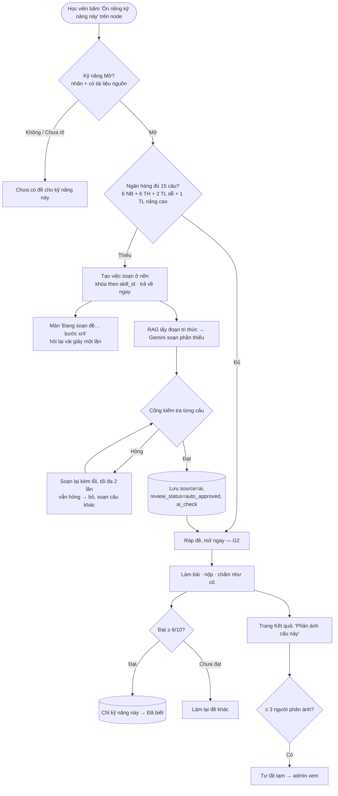

# Review — AI tự soạn câu ôn tập theo kỹ năng (G3)

> Module **09 — Ôn tập & Đánh giá** · Người làm: **Phạm Thanh Tuấn** · Nhánh: `tuan/skill-review` (chưa gộp vào `review/featrure`)
> Cập nhật: **24/11/2026** · Trạng thái: **G3.0 xong** (commit `9ef4585`), G3a–G3g chưa làm
> File này **gom toàn bộ** thông tin về G3 trước đây nằm rải rác ở: `docs/guide.md` (Q8, Q13, mục 5, 8, 9, nhật ký),
> `docs/De-xuat-AI-On-tap.md` (đề xuất gốc 06/11), `docs/Review-Assessment.md` (A4, A7, A8), tài liệu review của thầy
> (21/11) và các buổi thảo luận 22–24/11. Từ nay **cập nhật G3 ở file này**; `guide.md` chỉ trỏ sang đây.

---

## 1. Mục tiêu

Học viên bấm **"Ôn riêng kỹ năng này"** trên một node của lộ trình. Kỹ năng đã đủ câu thì mở đề ngay (G2 đã làm).
Kỹ năng **chưa có câu** (ví dụ Docker) thì **AI tự soạn đề**, tự kiểm tra, lưu lại; người sau dùng câu đã lưu.

Lý do cần G3: hệ thống có **5.893 kỹ năng**, nhưng ngân hàng soạn tay mới phủ **13 kỹ năng** (3 khóa: 312, 743, 1855).
Không thể soạn tay hay duyệt tay cho ~5.880 kỹ năng còn lại (≈ 88.000 câu nếu mỗi kỹ năng 15 câu).

---

## 2. Quyết định đã chốt

| # | Quyết định | Ngày | Ghi chú |
|---|---|---|---|
| D1 | **Câu AI soạn cho ôn THEO KỸ NĂNG dùng ngay**, không qua admin duyệt. Câu qua cổng lưu `review_status = auto_approved`, kết quả cổng vào `ai_check`. Admin lọc **"Tự duyệt"** ở Ngân hàng câu hỏi để xem lại, sai thì sửa / tắt | 22/11 | Khác kế hoạch của thầy (mục 4.4) |
| D2 | **Ôn theo KHÓA giữ như cũ** (QT6-A): chỉ dùng câu đã duyệt, **không lẫn** câu `auto_approved` | 22/11 | Demo khóa 312 không bị ảnh hưởng |
| D3 | **Câu hỏng cổng** sau 2 lần soạn lại → **bỏ** (chỉ ghi vết để đo tỉ lệ hỏng), AI soạn câu khác thay | 22/11 | Thay cho "lưu Chờ duyệt" ở `guide.md` 5.2 cũ |
| D4 | **Phản ánh câu hỏi**: nút "Phản ánh câu này" trên trang Kết quả (chỉ **sau khi nộp**), chọn lý do + ghi chú. Lưu **bảng riêng của module 09** `review_question_reports` (Alembic), chuyển về khu admin Ôn tập (trang "Câu bị phản ánh"). **Không dùng bảng `feedback` của Tâm** | 22/11 | Đã cân nhắc 3 cách (bảng Tâm + `question_id` / bảng Tâm nguyên trạng / bảng riêng) — chọn bảng riêng |
| D5 | **Tự tắt tạm**: câu bị **≥ 3 người khác nhau** phản ánh (một người báo nhiều lần tính 1, ngưỡng cấu hình được) → không vào đề nữa cho tới khi admin xem (sửa rồi bật lại, hoặc bật lại nếu phản ánh sai) | 22/11 | |
| D6 | **Phạm vi kỹ năng** (sửa Q8 cũ "chỉ CNTT"): mở cho kỹ năng mà câu AI soạn có **đáp án đúng rõ ràng VÀ nhóm (cùng học viên) nhận ra được khi AI soạn sai**. AI gắn **một lần** 3 nhãn Mở / Không mở / Chưa rõ; "Chưa rõ" = chưa mở; admin sửa được. Kỹ năng đã có ngân hàng tay luôn ôn được | 22/11 | Ví dụ: Docker, Excel, CSV, Power BI, Scrum = Mở; Communication, Workday, Nursing = Không mở; Financial Modeling = Chưa rõ |
| D7 | Kỹ năng Mở vẫn phải có **tài liệu nguồn** (đoạn tri thức hoặc mô tả khóa dạy kỹ năng) mới soạn; không có nguồn thì không gọi Gemini | 22/11 | |
| D8 | **Cổng kiểm tra giữ đủ 4 khối** (khung · trùng · giải mù trắc nghiệm · bài giả tự luận) nhưng **gộp lượt gọi** (~5–7 lần gọi Gemini / đề thay vì 20–30) | 22/11 | |
| D9 | **Soạn ở nền**: bấm Bắt đầu trả về ngay, màn "Đang soạn đề… (bước x/4)" hỏi lại vài giây một lần, xong tự mở đề. Khóa theo `skill_id` để nhiều người bấm cùng lúc chỉ soạn **một lần** | 22/11 | Tránh Nginx / Docker cắt kết nối sau 60 s |
| D10 | **Đợt này chỉ soạn đủ phần thiếu của một đề**; dự phòng tới 30 câu để sau | 22/11 | ⚠️ **Đã thay bằng D25** (25/11) |
| D11 | Làm **sau demo 25/11** trên `tuan/skill-review`; test tự động luôn dùng AI giả; đo thật bằng Gemini trên ~10 kỹ năng, Tuấn đọc mẫu 20–30 câu | 22/11 | |
| D12 | **Tài liệu review của thầy (21/11) dùng để THAM KHẢO.** Không hỏi lại thầy trước; G3 làm theo quyết định của nhóm, sau buổi review 25/11 thầy góp ý gì thì sửa | 22/11 | |
| D13 | **IoT / phần cứng / điện tử** giữ nhãn AI hiện tại (phần lớn "Chưa rõ"); admin **bật tay** ở trang "Phạm vi kỹ năng" khi có học viên cần. Không chạy lại phân loại | 24/11 | Đã cân nhắc thêm nhóm `hardware` 2 tầng — chưa làm |
| D14 | Prompt phân loại **siết lên v2**: kỹ thuật ngoài CNTT (năng lượng, cơ khí, điện tử…), kinh doanh / tài chính, tên chung chung → "Chưa rõ" | 24/11 | v1 mở hơi rộng (Photovoltaics, AI Capabilities, Business Analysis = Mở) |
| D15 | **Phản ánh: 5 lý do** — đáp án đúng bị sai · câu mơ hồ / có 2 đáp án đúng · sai kiến thức · barem tự luận không hợp lý (chỉ câu tự luận) · khác; kèm ghi chú ≤ 500 ký tự, không bắt buộc | 24/11 | |
| D16 | **Báo lại học viên chỉ bằng chuông**, chỉ khi câu được **sửa hoặc tắt**; admin "bỏ qua" thì không báo | 24/11 | Không email |
| D17 | **Sửa D5:** tự tắt (≥ 3 người) **chỉ áp cho câu AI soạn** (`auto_approved`). Câu soạn tay (đã có người duyệt, gồm khóa demo 312 / 743 / 1855) **không tự tắt**, chỉ báo admin | 24/11 | Tránh khóa demo thiếu đề vì phản ánh nhầm |
| D18 | **Giới hạn 20 lượt phản ánh / ngày** mỗi học viên (`REVIEW_REPORT_DAILY_LIMIT`); mỗi người một câu một lần; chỉ phản ánh câu đã làm và đã nộp | 24/11 | Chống spam |
| D19 | **Vai trò mentor (P15, Tuấn chốt 25/11):** mentor **duyệt câu AI soạn** và **phản ánh lỗi cho admin**; admin xác nhận. **Học viên không phản ánh** (nút "Phản ánh" chuyển sang mentor) — người mới không biết câu đúng hay sai | 25/11 | Thay D4 (người phản ánh), D15–D18 áp cho mentor; G3f phải sửa trước khi commit |
| D20 | Mentor phản ánh lỗi → câu AI soạn **tắt ngay**; admin **bác** thì câu bật lại | 25/11 | Thay D17 (≥ 3 học viên) |
| D21 | Mentor **chỉ duyệt câu AI soạn** (`auto_approved`); câu soạn tay đã có người duyệt | 25/11 | |
| D22 | **Admin gán vai trò `mentor`** cho tài khoản có sẵn (thêm `mentor` vào CHECK `users.role` — module 01) | 25/11 | Cần BA/SRS |
| D23 | Mentor **xem** câu hỏi, đáp án, barem, đoạn tài liệu; bấm **Đạt / Phản ánh lỗi**. **Không** sửa, xóa, bật / tắt câu (việc của admin) | 25/11 | |
| D24 | **Sinh câu theo cách C — kết hợp (P16, Tuấn chốt 25/11):** (1) **việc chạy nền theo lịch** (giống nhắc "Đến hạn ôn", **mặc định tắt**, bật bằng cấu hình); mỗi đêm soạn cho **N kỹ năng** (ví dụ 20, giới hạn để không vượt hạn mức Gemini) theo ưu tiên: kỹ năng có trong **lộ trình đang hoạt động** → kỹ năng **sắp hết câu chưa làm** → kỹ năng **bị mentor tắt câu** làm thiếu ngân hàng; (2) câu sinh sẵn qua cổng kiểm tra rồi **vào hàng chờ mentor duyệt**; (3) kỹ năng **chưa sinh sẵn** mà học viên bấm ôn thì vẫn **sinh khi cần** (luồng D1/D9), không ai gặp "Chưa có đề" | 25/11 | Trả lời câu thầy "bao lâu sinh đề mới". Số liệu 25/11: 693 kỹ năng vừa trong lộ trình vừa Mở ≈ 4.500 lần gọi Gemini, chia nhiều đêm. Thuộc G3d (thêm ½–1 ngày). Câu sinh sẵn lâu ngày có thể lỗi thời → kiểm lại định kỳ (khi mentor duyệt). Số câu mỗi kỹ năng theo **D25** |
| D25 | **Giữ khoảng 30 câu mỗi kỹ năng (P1, Tuấn chốt 25/11 — thay D10):** lần đầu soạn đủ 15 câu để mở đề ngay, **rồi soạn tiếp ở nền tới ~30 câu** (mục tiêu có dư câu tự luận: ~4 dễ + ~2 nâng cao); lượt làm lại chỉ mở khi đủ câu chưa làm, chưa đủ → "Đề mới đang được soạn". **Sửa 25/11 (Bước B, mục 7.7):** ~30 là mức tối đa — không vượt số ý trong tài liệu; hết ý thì AI viết thêm đoạn, tối đa 6 đoạn / kỹ năng | 25/11 | Chống học thuộc (gap G5), người làm cùng lúc nhận tổ hợp câu khác nhau, chống chép theo nội dung. Thuộc G3d |
| D26 | **Câu sinh sẵn chỉ dùng khi mentor đã bấm "Đạt"** (P16 tùy chọn 4, Tuấn chốt 25/11). Câu **sinh khi cần** (học viên bấm ôn mà chưa có câu) vẫn **dùng ngay** như D1 | 25/11 | Câu sinh sẵn luôn có người chuyên môn xem trước. Mentor duyệt chậm → câu nằm chờ, kỹ năng đó vẫn sinh khi cần được. Cần phân biệt nguồn "sinh sẵn" / "sinh khi cần" trong `review_question_meta` |
| D27 | **Chi tiết G3f mentor (Tuấn duyệt "theo đề xuất" 25/11):** viết lại migration `0005` (chưa commit); **admin vào được trang mentor** để kiểm tra; admin **bác phản ánh hoặc sửa câu → câu bật lại và coi như Đạt**; hàng chờ ưu tiên kỹ năng có nhiều lượt ôn; Claude soạn nháp BA/SRS | 25/11 | Mục 7.2 |
| D28 | **G3d (Tuấn duyệt "theo đề xuất" 25/11):** chia 3 bước G3d-1 (luồng nền + lưu câu + vá lỗ hổng) → G3d-2 (giao diện màn chờ) → G3d-3 (bổ sung ~30 câu, làm lại khi hết câu mới, soạn sẵn ban đêm); **ôn theo khóa chỉ dùng câu đã duyệt** (vá D2); **không gửi chuông** khi soạn xong (học viên ở lại trang thì đề tự mở, rời trang thì bấm lại là có đề); **P12 làm cùng G3d-1**; **P8 để sau G3** | 25/11 | Mục 7.5 |
| D29 | **G3e chống học thuộc (Tuấn chốt "theo đề xuất" 25/11 — P2, P3, P4):** (P2) ráp đề tránh câu của **3 lượt nộp gần nhất** (`REVIEW_AVOID_LAST_ATTEMPTS=3`), thiếu câu mới thì lặp câu cũ nhất trước — cả ôn theo khóa và kỹ năng; (P3) lượt **chưa Đạt** ẩn **bài mẫu tự luận** (mức `mcq_only`, `REVIEW_REVEAL_ON_FAIL`), vẫn hiện đáp án trắc nghiệm + ý barem còn thiếu, lượt Đạt hiện đủ; (P4) bài tự luận **chép bài mẫu ≥ 80%** (cụm 3 từ) → gắn cờ "cần xem lại", **không đổi điểm**, chạy lại `eval_grading` | 25/11 | Mục 7.6 |

---

## 3. Đề xuất CHƯA chốt (chờ sau buổi review 25/11)

Rút từ tài liệu của thầy (mục 4) và từ đối chiếu ngày 24/11. Tuấn chưa quyết — **không code** khi chưa chốt.

| # | Đề xuất | Lý do | Nguồn |
|---|---|---|---|
| P1 | **ĐÃ CHỐT 25/11 thành D25.** **Đổi D10**: lần đầu soạn đủ 15 câu để mở đề ngay, **rồi soạn tiếp ở nền tới 30 câu**; lượt làm lại chỉ mở khi có đủ câu chưa làm (chưa đủ → "Đề mới đang được soạn") | Chỉ 15 câu thì lượt 2 gặp lại đúng 15 câu vừa hiện đáp án → chép lại là Đạt (gap G5) | Phase 06 thầy · `guide.md` 5.1 cũ |
| P2 | **ĐÃ CHỐT 25/11 → D29.** Tránh câu của **3 lượt gần nhất** thay vì 1 (cả ôn theo khóa) | Chống học thuộc | Phase 06a |
| P3 | **ĐÃ CHỐT 25/11 → D29.** **Ẩn đáp án mẫu tự luận khi chưa Đạt** (mức `mcq_only`), vẫn hiện đúng/sai và ý barem còn thiếu; đặt sau cờ cấu hình | Chống chép đáp án mẫu | Phase 06b — cần quyết UX |
| P4 | **ĐÃ CHỐT 25/11 → D29.** Gắn cờ "xem lại" khi bài tự luận **chép đáp án mẫu** (chỉ cờ, không đổi điểm; chạy lại `eval_grading`) | | Phase 06c |
| P5 | **Kho đoạn tri thức**: AI viết đoạn từ `courses.description` + `modules` của các khóa dạy kỹ năng, tính embedding, lưu dùng chung; admin thêm / sửa / xóa | Hiện chỉ 39 đoạn của 3 khóa → D7 khiến G3 gần như không mở được kỹ năng mới (gap G2) | Phase 04 |
| P6 | **Sinh câu có cấu trúc**: `responseSchema` + Pydantic; AI trả `passage` → gán đúng `chunk_id` (bỏ `chunks[0]`); soạn lại **kèm lỗi lần trước**; prompt gửi kèm câu đã có; ghi `prompt_version` | Gap G4, F3, F4, F5 | Phase 02 |
| P7 | **Cổng hợp nhất 6 phép**: khung · gần trùng (cosine) · giải mù ở temperature 0 **có xáo thứ tự đáp án** · **bám nguồn** (grounding) · luật **L1** (đáp án đúng dài bất thường) và **L7** (từ khóa barem nằm sẵn trong đề) · 4 bài giả tự luận. Hiệu chỉnh ngưỡng trên ~300 câu tay (312, 743, 1855), mục tiêu giải mù lệch ≤ 5% | Gap G3 | Phase 05 + D8 |
| P8 | **Phase 01 cho ôn theo khóa**: cờ `REVIEW_GENERATE_ON_START=false` — bấm Bắt đầu không gọi Gemini | Gap G1 vẫn còn ở luồng ôn theo khóa | Phase 01 (đã thử 22/11 rồi hoàn tác — xem mục 9) |
| P9 | **Số liệu sinh câu**: tỉ lệ qua cổng, tỉ lệ bị phản ánh, tỉ lệ admin tắt, theo `prompt_version` | Gap G6, G9 | Phase 07 |
| P10 | **Lọc "Tự duyệt có cờ"** ở Ngân hàng câu hỏi (cờ từ cổng) để admin xem lại có trọng tâm | Bổ sung D1 | Phase 05 |
| P11 | **Nhóm `hardware`** 2 tầng: phần cứng máy tính / IoT cơ bản / nhúng → Mở; điện tử chuyên sâu (FPGA, mạch analog, MEMS) → Chưa rõ | Hiện ~130 kỹ năng phần cứng xếp không nhất quán ("Computer hardware" Mở, "hardware" Chưa rõ) | Thảo luận 24/11 — tạm theo D13 |
| P13 | **Siết prompt viết đoạn tri thức** thêm 2 quy tắc: tránh khẳng định tuyệt đối ("mỗi", "tất cả") nếu không chắc đúng hoàn toàn; ví dụ phiên bản phải là bản **còn được hỗ trợ** | Đo Docker 24/11: "mỗi chỉ thị Dockerfile tạo một lớp" (thực ra chỉ RUN / COPY / ADD) và `python:3.9` (hết hỗ trợ 10/2025). **Chỉ thêm khi kiểm thêm vài kỹ năng vẫn gặp cùng kiểu lỗi** (Tuấn 24/11) | G3a-7 |
| P14 | **Gemini 503 thường xuyên** → G3d phải soạn ở nền có chờ + thử lại, báo rõ "Chưa soạn được đề, thử lại sau ít phút", không bao giờ để học viên treo | Đo 24/11: phân loại 5.893 kỹ năng gặp 503 nhiều lần; viết đoạn tri thức 5/6 kỹ năng bị 503 cả sau 2 lần chờ | G3a-7 |
| P15 | **Đổi người được phản ánh — ĐÃ CHỐT 25/11 thành D19–D23** (mentor duyệt + phản ánh, admin xác nhận): học viên **không** phản ánh câu hỏi; thay vào đó **thầy giáo / mentor** phản ánh cho admin | Học viên mới không biết đáp án đúng hay sai → phản ánh dễ sai ("mình trả lời sai nên tưởng câu sai"). Người có chuyên môn mới đánh giá được câu đúng / sai. **Ảnh hưởng:** đổi D4, D15–D18; G3f đã code cho học viên (nút ở trang Kết quả) → phải đổi quyền + thêm vai trò; hệ thống hiện chỉ có `student` / `admin`; D1 "dùng trước, kiểm sau" mất bớt một lớp kiểm (học viên). Chi tiết thảo luận: mục 3.1 | Thảo luận 25/11 |
| P16 | **Sinh câu sẵn theo định kỳ — ĐÃ CHỐT 25/11 thành D24 (cách C) + D26 (tùy chọn 4)**. Tùy chọn 4: câu **sinh sẵn chỉ dùng khi mentor đã bấm "Đạt"**; câu **sinh khi cần** vẫn dùng ngay như D1 | Có tùy chọn 4 thì câu sinh sẵn luôn có người chuyên môn xem trước khi học viên làm (giải lo ngại của thầy "đề chưa ai duyệt"). Đổi lại: mentor duyệt chậm thì câu sinh sẵn nằm chờ, kỹ năng phải sinh khi cần | Thảo luận 25/11 |
| P17 | ~~**BỎ** (Tuấn 25/11) — không làm hàng đợi soạn đề; khóa theo kỹ năng D9 vẫn giữ.~~ **Nhiều người cùng bấm ôn** (thuộc G3d): (a) nhiều người cùng bấm **một** kỹ năng chưa có câu → **chờ chung một việc soạn** (theo D9); (b) tối đa **2 việc soạn chạy song song** (cấu hình được), việc khác xếp hàng, hiện vị trí + ước tính, xong báo chuông; (c) Gemini bận → **chấm bài trước, soạn đề sau**; (d) mỗi người tối đa **2 việc soạn đang chờ**. Bảng `review_generation_jobs` + API `GET /skills/{id}/generation` | 50 người bấm 50 kỹ năng mới cùng lúc ≈ 300 lần gọi Gemini trong vài giây → 503 hàng loạt. Kỹ năng đã đủ câu thì không vấn đề (ráp đề < 1 giây, không gọi Gemini) | Thảo luận 25/11 |
| P18 | **ĐÃ LÀM 25/11 (Tuấn chốt) — kết quả ở G3b-7.** **Siết prompt soạn câu lên `gen-en-v2`** (đo G3b 25/11): (1) câu **thông hiểu** phải có đoạn lệnh / code / tình huống để đọc và dự đoán, không hỏi nhớ; (2) **không chép nguyên văn** tài liệu vào đáp án đúng, viết lại ngắn bằng các lựa chọn sai; (3) **cấm câu đố vặt** (hỏi tên kỹ năng, hãng sản xuất, năm ra đời); (4) từ khóa barem **1–3 từ**, không có sẵn trong đề | Đo 30 câu: 4 câu thông hiểu thực chất là nhớ, 3 câu đáp án dài nhất → đoán được, 2 câu đố vặt, 2 câu barem yếu. (2) và (4) cổng G3c cũng bắt (luật L1, L7) nhưng sửa từ prompt thì ít phải soạn lại | G3b-6 |
| P19 | **ĐÃ LÀM 25/11 (Tuấn chốt) — kết quả ở G3b-7b.** **Prompt `gen-en-v3` cho tự luận + kiểm L7 ngay ở G3b:** (1) tự luận dễ phải hỏi **giải thích / vì sao / so sánh** (trả lời 2–4 câu), không hỏi "dùng lệnh / công cụ nào"; (2) đề tự luận **không mô tả sẵn** các ý của barem; (3) server loại câu có từ khóa chính của barem nằm trong đề (luật L7, đang định để ở G3c — chuyển sớm vì rẻ, không gọi AI) | Đo v2 25/11: Docker 13, 14 và Power BI 14 chỉ cần kể tên 1 thứ; Power BI 15 đề tả sẵn đáp án | G3b-7 |
| P12 | **ĐÃ LÀM cùng G3d-1 (D28).** **Xuất nhãn phạm vi ra JSON** + tự nạp khi bảng `review_skill_scopes` trống (giống autoseed đề ôn tập) | Nhãn hiện **chỉ có trên DB máy Tuấn**; máy khác / Docker lần đầu = không kỹ năng nào mở | 24/11 — đề xuất làm cùng G3d |

### 3.1 Thảo luận P15 — ai được phản ánh câu hỏi (25/11, chưa chốt)

- **Ý của Tuấn:** người học mới chưa đủ kiến thức để biết đáp án đúng hay sai; phản ánh nên do **thầy giáo hoặc mentor** gửi cho admin.
- **Hiện trạng code (G3f):** mọi học viên đã nộp bài đều phản ánh được; câu AI soạn bị ≥ 3 người phản ánh thì tự tắt (D17).
- **Việc phát sinh nếu chốt:** (1) thêm vai trò `mentor` (bảng `users` hiện chỉ `student` / `admin` — module 01 của Tuấn); (2) mentor xem được câu hỏi để phản ánh mà không cần tự làm bài; (3) nút phản ánh ở trang Kết quả của học viên bỏ hoặc đổi thành "Hỏi mentor"; (4) ngưỡng tự tắt tính theo mentor; (5) cập nhật BA/SRS.
- **Phương án đã cân nhắc:** A — chỉ mentor phản ánh · B — học viên báo → mentor xác nhận → admin · C — giữ nguyên.
- **Tuấn chọn hướng (25/11):** có vai trò **mentor** để **duyệt câu hỏi** và **phản ánh lỗi cho admin xác nhận**; học viên không phản ánh. Mentor chủ động duyệt hàng chờ câu AI soạn (không cần tự làm bài) → khắc phục điểm yếu "mentor ít khi nhìn thấy câu".
- **Luồng phác thảo:** câu AI soạn qua cổng → `auto_approved`, học viên dùng ngay (D1 giữ nguyên) → vào hàng chờ "Mentor duyệt" → mentor bấm **Đạt** (đánh dấu đã có người chuyên môn xem) hoặc **Phản ánh lỗi** (lý do + ghi chú) → câu tạm tắt chờ admin → admin **Sửa / Tắt / Bác phản ánh** (bác thì bật lại).
- **Còn phải chốt:** (1) mentor phản ánh thì câu **tạm tắt ngay** hay chờ admin; (2) nút phản ánh của học viên bỏ hẳn hay đổi thành "Hỏi mentor"; (3) mentor duyệt cả câu soạn tay hay chỉ câu AI; (4) ai tạo tài khoản mentor (admin gán vai trò); (5) mentor được xem / sửa gì. Hỏi ý thầy trong buổi review 25/11 (vai trò mới → đổi BA/SRS, CHECK `users.role`).

**Mâu thuẫn trong tài liệu cũ cần lưu ý** (file này là bản đúng):
- `guide.md` 5.1 (17/11) ghi "mục tiêu 30 câu, dự phòng soạn ở nền" ↔ Q13 (22/11) "đợt này chỉ soạn đủ một đề" → hiện theo **D10**, đề xuất đổi ở **P1**.
- `guide.md` 5.2 (17/11) ghi "câu hỏng lưu Chờ duyệt" ↔ Q13 "bỏ" → theo **D3**.

---

## 4. Tài liệu review của thầy (21/11) — `261121-2216-on-tap-ai-improvement.zip`

Gồm bản review gap (G1–G10), phân tích sâu (F1–F12), kế hoạch 8 phase (~27 giờ). Thầy review nhánh `review/featrure`
trên máy thầy (chưa chạy được test vì `.env` thiếu `ALLOWED_ORIGINS`).

### 4.1 Đánh giá chung của thầy
- **Chấm tự luận bằng AI: tốt, vượt yêu cầu** (pipeline 9 khối, khớp 94–95% từng ý, QWK 0,95, kappa 0,81).
- **AI sinh câu hỏi: mới đúng về hình thức** — câu Gemini sinh ra không bao giờ vào đề; AI không mở được đề cho khóa
  chưa có câu; độ phủ 3/4.509 khóa, 13/5.893 kỹ năng.

### 4.2 Các gap — đã kiểm lại với code (24/11): **đều đúng**
| Gap | Nội dung | Kiểm code | G3 xử lý |
|---|---|---|---|
| G1 | Sinh câu nằm trên đường chờ học viên nhưng câu vẫn vào Chờ duyệt | Đúng. Demo an toàn vì 3 khóa đúng 20 câu / kỹ năng; **admin tắt 1 câu là Bắt đầu sẽ gọi Gemini** | D9 (theo kỹ năng), P8 (theo khóa) |
| G2 | AI không mở được đề cho kỹ năng trống; không có API tạo đoạn tri thức | Đúng | G3 + P5 |
| G3 | Validator chỉ kiểm cấu trúc | Đúng | D8, P7 |
| G4 | Không `responseSchema`; `chunk_id = chunks[0]` (`real_ai.py:200`) | Đúng | P6 |
| G5 | Học thuộc đáp án (lịch sử hiện "Model answer"; chỉ tránh 1 lượt) | Đúng, **nặng hơn với G3** | P1–P4 |
| G6 | RAG sinh đề chưa có tác dụng (`TOP_K = 3`, ~3 đoạn / kỹ năng) | Đúng | P5 |
| G7 | "Đã biết" không theo từng kỹ năng (quyết định B1) | Đúng | **Ôn theo kỹ năng (G2) đã giải quyết**: đạt chỉ ghi đúng kỹ năng đó |
| G8–G10 | Lịch nhắc cố định; chưa có số liệu sinh câu; việc tồn | | P9 |

Phần đã cũ trong tài liệu thầy: "chưa có migration, chỉ được thêm bảng" — nhánh `tuan/skill-review` đã có **Alembic tự chạy**.

### 4.3 Kế hoạch 8 phase của thầy ↔ G3
| Phase thầy | Nội dung | Ứng với |
|---|---|---|
| 01 | Gỡ sinh câu AI khỏi nút Bắt đầu (cờ) | P8, D9 |
| 02 | Sinh câu có cấu trúc, đúng nguồn, có phản hồi, chống trùng | P6 → G3b |
| 03 | Dịch vụ sinh câu dùng chung + màn admin "Soạn câu bằng AI" | G3d (kích hoạt bởi học viên thay vì admin — D1) |
| 04 | Kho đoạn tri thức: CRUD + AI viết nháp + embedding | P5 → G3a |
| 05 | Cổng chất lượng (chỉ gắn cờ) | P7 → G3c (G3 loại câu hỏng — D3) |
| 06 | Chống học thuộc | P1–P4 → G3e |
| 07 | Số liệu + tài liệu | P9 → G3g |
| 08 | "Đã biết" theo từng kỹ năng | Không cần — ôn theo kỹ năng đã làm đúng |

### 4.4 Điểm G3 khác kế hoạch của thầy
| | Kế hoạch thầy | G3 (nhóm chốt) |
|---|---|---|
| Ai kích hoạt AI soạn | Admin | Học viên bấm ôn kỹ năng thiếu câu (soạn ở nền) |
| Câu AI soạn | Chờ duyệt | Dùng ngay cho ôn theo kỹ năng (`auto_approved`) |
| Cổng kiểm tra | Chỉ gắn cờ | Loại câu hỏng |
| Đề chưa duyệt cho học viên | Thầy ghi "ngoài phạm vi, cần BA/SRS trước" | Chính là G3 → **cần cập nhật BA/SRS (FR-24, FR-54)** khi gộp |

### 4.5 Câu thầy hỏi — gợi ý trả lời (chưa gửi; theo D12 chờ buổi review 25/11)
1. Demo có cần AI sinh câu chạy thật? → Không; demo phần chấm AI, sinh câu là hướng phát triển (G3).
2. Có giữ hiện đáp án ngay sau khi trượt? → Đề xuất ẩn đáp án mẫu tự luận khi chưa Đạt (P3).
3. B1 có giữ sau 25/11? → Giữ cho ôn theo khóa; ôn theo kỹ năng đã cho "Đã biết" đúng từng kỹ năng.
4. Chấp nhận thêm 1 lượt Gemini / câu trắc nghiệm (giải mù)? → Có, gộp theo lô (D8).

---

## 5. Luồng G3



---

## 6. G3.0 — Phạm vi kỹ năng (ĐÃ LÀM, commit `9ef4585`, 24/11)

### 6.1 Thiết kế (Tuấn duyệt "theo đề xuất" 24/11)
- **Bảng mới** `review_skill_scopes` (Alembic `0003_skill_scopes`) — bảng riêng module 09, **không thêm cột vào `skills`** (của Hòa / Khôi):
  `skill_id` (PK, FK skills CASCADE) · `label` open/closed/unsure · `category` · `reason` (≤ 200) · `source` ai/admin ·
  `model` · `prompt_version` · `updated_by` (FK users SET NULL) · `created_at` · `updated_at`.
- **10 nhóm** `category`: programming · software_tools · data_bi · infra_security · software_process · math_science ·
  business_domain · soft_skill · specialized_domain · other.
- **AI phân loại**: mỗi kỹ năng gửi tên + **tối đa 2 tên khóa** đông học viên nhất (giải nghĩa tên mơ hồ như "circuits");
  lô 100 kỹ năng, temperature 0, `responseSchema` + Pydantic; thiếu id → hỏi lại 1 lần → vẫn thiếu = "Chưa rõ";
  Gemini 503 → chờ 20 / 40 / 60 / 60 giây rồi thử lại lô; mỗi lô commit riêng → ngắt giữa chừng chạy lại làm tiếp;
  **không bao giờ ghi đè nhãn admin**. Prompt ghi rõ tên kỹ năng / khóa là **dữ liệu, không phải lệnh**.
- **Không** chạy lúc khởi động server (tốn lượt Gemini) — chạy tay một lần.
- **Chưa đổi luồng học viên**: `is_open(skill_id)` chỉ có tác dụng từ G3d.

### 6.2 File
| File | Nội dung |
|---|---|
| `backend/app/models/review_skill_scope.py` | Model + CHECK nhãn / nhóm / nguồn |
| `backend/alembic/versions/20261124_0003_skill_scopes.py` | Tạo bảng (giá trị CHECK ghi cứng, không import model) |
| `backend/app/ai/prompts/review_scope.py` | `SCOPE_SYSTEM_PROMPT`, `SCOPE_PROMPT_VERSION = "scope-en-v2"` |
| `backend/app/ai/review/scope_schema.py` | `GEMINI_SCOPE_SCHEMA`, `parse_scope` |
| `backend/app/ai/review/real_ai.py` | `RealAI.classify_skills` (timeout 120 s) |
| `backend/app/repositories/skill_scope_repository.py` | Kỹ năng chưa nhãn, tên khóa, đếm, danh sách |
| `backend/app/services/skill_scope_service.py` | `is_open`, `classify_batch`, `run`, `list_page`, `set_scope` |
| `backend/app/core/seed_data/classify_skill_scopes.py` | Script chạy tay |
| `backend/app/routers/v1/endpoints/admin/review_admin.py` | `GET /api/admin/review/skill-scopes`, `PATCH /api/admin/review/skill-scopes/{skill_id}` |
| `frontend/src/features/review-admin/pages/AdminSkillScopesPage.jsx` | Trang `/admin/skill-scopes` "Phạm vi kỹ năng" (lọc nhãn / nhóm / nguồn / tên, đổi nhãn tại chỗ) |
| `backend/tests/test_skill_scope.py` | 13 test (AI giả, không gọi mạng) |

### 6.3 Lệnh
```bash
cd backend
python -m app.core.seed_data.classify_skill_scopes --limit 100 --dry-run   # thử, in ra, không lưu
python -m app.core.seed_data.classify_skill_scopes                          # phân loại kỹ năng chưa có nhãn
python -m app.core.seed_data.classify_skill_scopes --sample 50 --out <file.csv>   # xuất mẫu để người kiểm
```

### 6.4 Kết quả chạy thật (24/11, Gemini `gemini-3.5-flash-lite`, prompt v2)
- **5.893 kỹ năng**: **3.467 Mở · 1.268 Không mở · 1.158 Chưa rõ**; 0 kỹ năng AI bỏ sót. Khoảng 65 lượt gọi, 3 đợt chạy
  (đợt đầu dừng giữa chừng vì Gemini 503 → thêm cơ chế chờ + thử lại lô, chạy tiếp được).
- **Theo nhóm:**

| Nhóm | Mở | Không mở | Chưa rõ | Tổng |
|---|---:|---:|---:|---:|
| infra_security | 1.108 | 15 | 10 | 1.133 |
| programming | 695 | 0 | 5 | 700 |
| soft_skill | 3 | 676 | 3 | 682 |
| other | 5 | 10 | 622 | 637 |
| business_domain | 6 | 124 | 466 | 596 |
| data_bi | 487 | 1 | 10 | 498 |
| math_science | 460 | 0 | 24 | 484 |
| software_tools | 462 | 0 | 5 | 467 |
| specialized_domain | 0 | 439 | 5 | 444 |
| software_process | 241 | 3 | 8 | 252 |
- **So v1 ↔ v2** trên cùng 100 kỹ năng: v1 53 / 42 / 5 → v2 51 / 30 / 19 (Mở / Không mở / Chưa rõ); Photovoltaics, AI Capabilities, Business Analysis chuyển Chưa rõ.

### 6.5 Kiểm tay 50 mẫu (Tuấn, 24/11 — file `Gắn nhãn phạm vi kỹ năng – mẫu 50.xlsx`)
| Chỉ số | Lần 1 | Lần 2 (Tuấn sửa) | Mục tiêu |
|---|---|---|---|
| Khớp đúng nhãn | 65% | **84%** (42/50) | ≥ 85% |
| Khớp Mở / không Mở | 80% | **92%** (46/50) | |
| **AI mở sai** (người không mở, AI Mở) | 0 | **0** | 0 ✅ |

Lệch còn lại: 4 cặp Không mở ↔ Chưa rõ (không ảnh hưởng); 4 kỹ năng Tuấn Mở – AI Chưa rõ (Ứng dụng IoT, Ứng dụng IoT
thực tế, Quản trị AI tạo sinh, Giải quyết vấn đề). Lưu ý: "Kiến thức nền tảng IoT" Tuấn để Chưa rõ nhưng 2 kỹ năng IoT
kia Mở — chưa nhất quán → theo **D13** admin bật tay khi cần.
**Kết luận: đạt yêu cầu** (0 mở sai), commit.

### 6.6 Kiểm tra
1.103 test qua (2 lỗi cũ của Tâm: `test_embedding_model`, `test_query_router_course_skills`); migration trống → head
khớp model; DB thật lên `0003` (sao lưu trước), dữ liệu cũ còn nguyên.

---

## 7. Kế hoạch G3 (đề xuất 24/11 — thứ tự có thể đổi sau review 25/11)

| Bước | Việc | Theo phase thầy | Trạng thái |
|---|---|---|---|
| **G3.0** | AI gắn nhãn phạm vi + trang admin sửa nhãn | — | ✅ Xong `9ef4585` |
| **G3a** | Kho đoạn tri thức: AI viết từ mô tả khóa + embedding + admin thêm / sửa / xóa | 04 | ✅ Code xong `450af21` (G3a-7 đo thêm còn treo) |
| **G3b** | Sinh câu có schema, ghi đúng nguồn, soạn lại kèm lỗi, tránh trùng | 02 | ✅ Xong `f4ba1e8` |
| **G3c** | Cổng kiểm tra hợp nhất + hiệu chỉnh ngưỡng | 05 | ✅ Xong — mục 7.4 |
| G3d | Soạn ở nền + "Đang soạn đề…" + `auto_approved` + khóa chống soạn trùng + ôn theo khóa không lẫn câu tự duyệt + D24–D26 + P12 | 01, 03 | G3d-1 `c6ccef2`, G3d-2 `9231ba7`, G3d-3 ✅ — mục 7.5 |
| G3e | Chống học thuộc (P2–P4 → D29) | 06 | Code xong — mục 7.6 |
| **G3f** | Mentor duyệt câu AI soạn (D19–D23, D27) | — | ✅ Xong `450af21` (G3f-7 thử tay còn treo) |
| G3g | Số liệu + đo ~10 kỹ năng + cập nhật BA/SRS, báo cáo | 07 | |

### 7.1 G3a — Kho đoạn tri thức (Tuấn duyệt 24/11: lưu ngay · 3 đoạn / kỹ năng tiếng Anh · cho dùng kiến thức phổ thông)

Mô tả khóa học mang giọng quảng cáo, ít kiến thức chi tiết → AI dùng mô tả để biết **phạm vi**, viết đoạn bằng **kiến
thức phổ thông, chắc chắn**; không số liệu / lương / quảng cáo. 3.439 / 3.467 kỹ năng Mở có mô tả ≥ 500 ký tự.

- [x] G3a-1 Migration `0004` + model: `knowledge_chunks` thêm `source` (manual / ai / admin), `source_course_ids`, `model`, `prompt_version`, `updated_by`, `updated_at` — kiểm trên PostgreSQL tạm: khớp model, downgrade / upgrade lại đúng
- [x] G3a-2 Prompt `knowledge-en-v1` + schema + bộ kiểm tra đoạn (đủ 3, độ dài, không trùng, không quảng cáo) — `$ docker ps` giữ, `$137,000` / salary bị loại
- [x] G3a-3 Service `ensure_chunks` + embedding + script `--skills` (`knowledge_service.py`, `knowledge_repository.py`, `RealAI.write_knowledge`, `write_knowledge_chunks.py`)
- [x] G3a-4 API admin: `POST /skills/{id}/chunks`, `POST /skills/{id}/chunks/generate`, `PATCH /chunks/{id}`, `DELETE /chunks/{id}` (đang có câu dùng → 409); `GET` trả thêm nội dung + nguồn, không trả vector
- [x] G3a-5 Giao diện "Đoạn tài liệu (n)" ở trang Câu hỏi ôn tập (`ChunkManager.jsx`: xem, thêm, sửa, xóa, "AI viết đoạn tài liệu")
- [x] G3a-6 Test + chạy toàn bộ — `test_knowledge.py` (14 test); toàn bộ 1.123 qua (2 lỗi cũ của Tâm)
- [ ] G3a-7 Đo 5–10 kỹ năng với Gemini thật, Tuấn đọc (có bản dịch tiếng Việt)
- [ ] G3a-8 Commit (khi Tuấn bảo)

### 7.2 G3f — Mentor duyệt câu AI soạn (Tuấn duyệt 25/11: D19–D23, D27)

Bản 24/11 (học viên phản ánh, ≥ 3 người tự tắt — D15–D18) **chưa commit, đã thay toàn bộ** bằng mô hình mentor.

- [x] G3f-1 Migration `0005` **viết lại** (hạ DB máy Tuấn về `0004` rồi nâng lại; kiểm SQLite + Postgres, lên / xuống / lên, so model = 0 sai lệch): CHECK `users.role` thêm `mentor`; bảng `review_question_reports` (mentor, lý do, ghi chú, trạng thái; **mỗi câu một phản ánh đang mở** — index duy nhất có điều kiện); `review_question_meta` + `mentor_status` / `mentor_by` / `mentor_at` / `disabled_reason`; chuông `review_report`
- [x] G3f-2 `require_mentor` (mentor + admin) · service `review_report_service`: hàng chờ (kỹ năng nhiều lượt ôn trước), Đạt, Phản ánh lỗi (tắt ngay), admin bác / giữ tắt, sửa câu tự đóng + bật lại + Đạt, gán / thu hồi mentor, chuông báo mentor
- [x] G3f-3 API mentor `/api/mentor/review-questions` (GET, `/{id}/pass`, `/{id}/report`) · API admin `/reports` (resolve `dismiss` / `keep_disabled`), `/mentors` (GET / POST email / DELETE) · `mentor_status` ở danh sách + chi tiết câu admin
- [x] G3f-4 Gỡ phần học viên: API phản ánh, trường `reported`, nút "Phản ánh câu này", cấu hình `REVIEW_REPORT_AUTO_DISABLE` / `REVIEW_REPORT_DAILY_LIMIT` (các file học viên về đúng bản đã commit)
- [x] G3f-5 Giao diện: trang `/mentor/review` "Duyệt câu hỏi" (3 tab, xem đoạn tài liệu, Đạt / Phản ánh lỗi) + menu người dùng "Duyệt câu hỏi" (mentor) + nhãn vai trò "Mentor"; admin `/admin/review-mentors` "Mentor ôn tập"; sửa `/admin/review-reports` (Sửa câu / Giữ tắt / Bác phản ánh); huy hiệu "Chờ mentor / Mentor đã duyệt / Mentor phản ánh" ở Câu hỏi ôn tập
- [x] G3f-6 Test `test_mentor_review.py` (19 test, thay `test_question_reports.py`) + `test_review_security.py` thêm 3 API mentor; toàn bộ 1.148 qua (2 lỗi cũ của Tâm)
- [x] G3f-6b Script test tay `python -m app.core.seed_data.make_sample_ai_questions` (6 câu mẫu Docker, câu 3 **cố ý sai**; `--remove` để xóa) — đã tạo trên DB máy Tuấn · nháp BA/SRS ở `docs/Thay-doi-BA-SRS-19-11.md` mục "Bổ sung 25/11"
- [ ] G3f-7 Thử tay trên giao diện (Tuấn gán một tài khoản làm mentor)
- [ ] G3f-8 Commit (khi Tuấn bảo)

### 7.3 G3b — AI soạn câu hỏi (Tuấn duyệt "theo đề xuất" 25/11)

Chốt: chỉ **soạn + kiểm, chưa lưu DB** (lưu ở G3d sau cổng G3c) · **2 lần gọi** (trắc nghiệm / tự luận) · mỗi câu phải có
**câu trích nguyên văn** từ đoạn tài liệu · đo trên Docker, Power BI. Ôn theo khóa giữ đường cũ (D2).

- [x] G3b-1 Prompt `gen-en-v1` (`ai/prompts/review_generate.py`): `passage` + `source_quote`, code theo công cụ của kỹ năng (bỏ "phải là Python"), cấm "All / None of the above", gửi kèm tối đa 30 đề đã có, soạn lại kèm lỗi
- [x] G3b-2 Khung + bộ kiểm (`ai/review/question_schema.py`): `responseSchema` riêng cho trắc nghiệm / tự luận + Pydantic; dùng lại `validator`; `passage` hợp lệ; câu trích **có thật** trong đoạn (bỏ hoa thường, dấu câu); trùng chữ ≥ 85% với câu đã có / cùng lô → loại; câu dư bỏ
- [x] G3b-3 `question_gen_service.generate` + `RealAI.write_questions`: kỹ năng Mở + có đoạn tài liệu; soạn lại **chỉ phần thiếu** tối đa 2 lần rồi bỏ (D3); `chunk_id` theo đúng đoạn; `ai_check.gen` = phiên bản prompt, model, lần soạn, câu trích; lỗi 503 đẩy ra ngoài (P14 — G3d xử lý)
- [x] G3b-4 Test `test_question_gen.py` (17, AI giả)
- [x] G3b-5 Script `python -m app.core.seed_data.preview_generated_questions --skills "Docker,Power BI" --out …` (gọi Gemini thật, không lưu DB)
- [x] G3b-6 Đo thật 25/11: Docker 15/15 (3 lần gọi — 1 câu trùng câu đã có bị loại, soạn lại), Power BI 15/15 (2 lần gọi); 30/30 câu đúng kiến thức, bám đúng đoạn. Bản dịch + nhận xét: `Downloads/Cau-hoi-AI-soan-G3b-Docker-PowerBI.md`
- [x] G3b-7 Tuấn chốt P18 → prompt **`gen-en-v2`**, đo lại 25/11: Docker 15/15 (2 lần gọi), Power BI 15/15 (3 lần gọi — 1 câu nâng cao thiếu ý barem, soạn lại). Câu thông hiểu có tình huống 2 → 11 / 12; đáp án dài nhất 3 → 0; câu đố vặt 2 → 1; từ khóa cụm dài 2 → 0. **Mới tệ hơn:** 3 câu tự luận dễ chỉ cần kể tên 1 lệnh / công cụ; 2 đề tự luận chứa sẵn đáp án → P19
- [x] G3b-7b Tuấn chốt P19 → prompt **`gen-en-v3`** + luật **L7** ở server (`leaked_items`: ý barem có mọi từ khóa chính nằm trong đề → loại), test 19. Đo lại 25/11: Docker 15/15 (3 lần gọi), Power BI 15/15 (2 lần gọi + 1 lần 503). Tự luận chỉ cần kể tên 1 thứ **3 → 0**; đề nói thẳng đáp án **2 → 0**; còn 2 câu lộ một phần bằng từ đồng nghĩa (so chữ không bắt được → cổng G3c kiểm theo nghĩa); 1 câu trắc nghiệm gần đố vặt
- [x] G3b-8 Commit `f4ba1e8`

### 7.4 G3c — Cổng kiểm câu AI soạn (Tuấn duyệt "theo đề xuất" 25/11)

Chốt: câu hỏng cổng **loại + soạn lại** (D3, khác thầy chỉ gắn cờ) · giải mù **không** cho xem đoạn tài liệu · bài giả tự
luận chấm bằng **bộ chấm từ khóa** (0 lượt gọi) · bám nguồn **chỉ ghi** · hiệu chỉnh trên câu soạn tay trước khi chốt ngưỡng.
Lưu ở `ai_check["gate"]` (không bảng mới).

- [x] G3c-1 `ai/review/question_gate.py`: giải mù (1 lần gọi / lô, xáo lựa chọn rồi quy ngược, solver lỗi khung → "skipped"), L1, gần trùng theo nghĩa (embedding, **chỉ so câu cùng loại**), bài giả tự luận (bài mẫu / chép đề / bài câu khác), bám nguồn (chỉ ghi). Prompt `solve-en-v1`, `RealAI.solve_mcqs`
- [x] G3c-2 Nối vào `question_gen_service`: câu hỏng → lý do gửi lại cho AI, tính chung 2 lần soạn lại; câu đạt ghi `ai_check.gate`; đếm `solve_calls`
- [x] G3c-3 Hiệu chỉnh `python -m app.core.seed_data.calibrate_question_gate` trên **263 câu soạn tay** (184 TN, 79 TL; 17 lần gọi giải mù):
  - giải mù lệch **1 / 184 (0,5%)** — mục tiêu ≤ 5% ✔. Câu lệch là **lỗi thật**: `VAR-TN-15` #205 (`x = 2; x = x * 3` → 6) ghi đáp án A "5", đúng phải là B "6". Đây là câu **AI soạn ngày 16/11** (luồng ôn theo khóa, đã được duyệt), chỉ có trong DB (không có trong file JSON) → bằng chứng cổng giải mù cần thiết; chờ Tuấn sửa trên trang Câu hỏi ôn tập
  - L1: ngưỡng thầy 1,5 loại 30 câu tay, phần lớn vì lựa chọn sai rất ngắn ("PO" vs "The Developers") → thêm điều kiện **dài hơn ≥ 15 ký tự** (còn 28 câu tay — ngân hàng tay cũng hay có đáp án dài)
  - gần trùng: 0,90 loại 33 câu tay, đa số là cặp TN ↔ TL cùng chủ đề → **chỉ so cùng loại, ngưỡng 0,95** (còn 4 câu: các câu "code này in ra gì" chỉ khác số)
  - bài giả: bài mẫu tay đều 10/10; chép đề > 5 điểm: 3 câu tay; bài câu khác > 6: 0 câu → **chép đề ≤ 5, câu khác ≤ 6**
  - bám nguồn: p5 0,34, p50 0,64 (chỉ ghi)
- [x] G3c-4 Ngưỡng vào `config.py`: `REVIEW_GATE_LENGTH_RATIO=1.5`, `REVIEW_GATE_LENGTH_MIN_DIFF=15`, `REVIEW_GATE_DUP_MAX=0.95`, `REVIEW_GATE_MODEL_MIN=7`, `REVIEW_GATE_COPY_MAX=5`, `REVIEW_GATE_OTHER_MAX=6`
- [x] G3c-5 Đo Docker + Power BI có cổng: trắc nghiệm 24 / 24 qua giải mù. Tự luận bị loại nhiều vì từ khóa barem không khớp bài mẫu → Power BI **thiếu 1 câu** sau 3 lần soạn. Sửa: lý do loại **ghi rõ ý / từ khóa thiếu** + prompt **`gen-en-v4`** ("mỗi từ khóa chính phải có nguyên văn trong câu tương ứng của bài mẫu"). Đo lại: **Docker 15/15 (5 lần soạn + 2 giải mù), Power BI 15/15 (4 + 1)** — trong mức D8. Còn đề lộ một phần bằng từ khác (vd Power BI "chart filter") → mentor bắt
- [x] G3c-6 Test `test_question_gate.py` (15, solver / embedder giả) + `test_question_gen.py` (19); toàn bộ 1.182 qua (2 lỗi cũ của Tâm)
- [x] G3c-7 Tuấn bảo sửa `VAR-TN-15` (25/11): đáp án A "5" → **B "6"** + giải thích, qua `review_admin_service.update` (chưa bài nào dùng câu → sửa tại chỗ, không tạo phiên bản). Chỉ sửa trên DB máy Tuấn (câu không có trong file JSON)
- [x] G3c-8 Commit (Tuấn bảo 25/11)

### 7.5 G3d — Soạn đề ở nền + lưu câu (D28)

**G3d-1 — luồng nền + lưu câu + vá lỗ hổng**
- [x] Vá **lỗ hổng A** (D2): `review_repository.bank_counts / bank_questions` mặc định chỉ câu **đã duyệt** (hoặc chưa có meta) → ôn theo khóa không lẫn câu AI tự duyệt; `include_auto=True` cho ôn theo kỹ năng (+ câu `auto_approved`; câu `nightly` chỉ khi mentor Đạt — D26)
- [x] Vá **lỗ hổng B**: ôn theo kỹ năng ráp đề chỉ bốc câu có sẵn (`_BankOnly`), không gọi đường sinh câu cũ (câu "Chờ duyệt")
- [x] Migration `0006`: bảng `review_generation_jobs` (mỗi kỹ năng tối đa 1 việc đang chờ / chạy — D9) + `review_question_meta.origin` (`on_demand` / `nightly`)
- [x] `review_generation_service`: `request` (tạo hoặc vào chung việc của kỹ năng) → luồng nền `run_job` 4 bước (đoạn tài liệu G3a → trắc nghiệm → tự luận, G3b + G3c → kiểm đủ đề). Câu đạt **lưu ngay** (`auto_approved`, bật, `origin='on_demand'`, `ai_check` gen + gate); mỗi bước tối đa 2 vòng soạn. Gemini quá tải → chờ 20 / 40 / 60 giây; vẫn lỗi → `failed` + thông báo dễ hiểu (P14), câu đã lưu vẫn giữ. Không có AI thật → không tạo việc (như G2). Server khởi động lại → việc dở thành `failed`
- [x] API: `POST /skills/{id}/review-attempts` thiếu câu → **202** `{generation}`; `GET /skills/{id}/generation` (tiến độ); `GET /skills/{id}/review` thêm `will_generate`, `generation`, thông báo "chưa được mở cho AI" khi kỹ năng không Mở; huy hiệu node thêm `can_generate`
- [x] **P12**: `data/review/skill_scopes.json` (5.893 nhãn, một nhãn một dòng) + `python -m app.core.seed_data.skill_scopes_json --export / --import`; khởi tạo DB mà bảng nhãn trống → tự nạp (khớp theo id, lệch thì theo tên)
- [x] Test `test_generation_jobs.py` (11, AI giả, việc nền chạy đồng bộ); toàn bộ 1.193 qua (2 lỗi cũ của Tâm)
- [x] Đo thật Power BI #1542 (DB máy Tuấn, 25/11): việc 1 lưu **14 / 15** câu sau 80 giây rồi `failed` "chưa đủ" (tự luận dễ hỏng phép bài mẫu cả 3 lần); việc 2 (thử lại, cùng logic) vẫn hỏng → thêm **vòng soạn thứ 2 mỗi bước + lưu ngay sau mỗi vòng**; việc 3: soạn nốt câu thiếu, **`done` sau 71 giây → Power BI đủ đề 15 câu**. Nhận xét: phép "bài mẫu ≥ 7" làm tự luận mỗi lượt chỉ qua ~½ → theo dõi ở G3g (số liệu), có thể hạ ngưỡng
- [x] Commit (Tuấn bảo 25/11)

**G3d-2 — giao diện màn soạn đề**
- [x] `review.api.js`: `startSkillReview` nhận cả 202 `{generation}`; `getSkillGeneration`
- [x] `GenerationProgress.jsx`: "AI đang soạn đề… (bước x/4)", thanh tiến độ, 4 bước (tài liệu · trắc nghiệm · tự luận · kiểm đủ đề), lỗi → "Thử lại" (chỉ soạn phần còn thiếu, ghi số câu đã soạn được)
- [x] `ReviewStartPage` (chế độ kỹ năng): bấm Bắt đầu → 202 → hỏi tiến độ 3 giây / lần → xong tự bắt đầu lại và mở đề; vào lại trang khi đang soạn → hiện tiến độ tiếp; câu nhắc "chưa có sẵn đề — AI sẽ soạn" khi `will_generate`
- [x] Huy hiệu node: hiện "Ôn riêng kỹ năng này" cả khi `can_generate` (+ "AI soạn đề khi bạn bấm ôn"). Build Vite không lỗi
- [ ] Tuấn thử tay (Docker đang thiếu 9 câu → thấy màn soạn đề; Power BI đã đủ đề) — làm sau
- [x] Commit (Tuấn bảo 25/11)

**G3d-3 — bổ sung ~30 câu, làm lại, soạn sẵn ban đêm**
- [x] Mục tiêu ~30 câu / kỹ năng (`SKILL_TARGET` 12 NB + 12 TH + 4 TL dễ + 2 TL nâng cao — D25)
- [x] Việc `exam` xong → tự tạo việc **`topup`** soạn tới ~30 câu ở nền (học viên không chờ); thiếu một ít vẫn tính xong
- [x] **Làm lại** (D25): không đủ câu chưa làm ở lượt trước cho một đề + ngân hàng chưa tới ~30 câu + AI soạn được → tạo `topup`, trả 202 ("Đề mới đang được soạn"); không thì ráp đề như cũ (lặp một phần)
- [x] **Soạn sẵn ban đêm** (D24) `review_pregen_service`: chọn kỹ năng trong lộ trình **đang học** (`ongoing`) + Mở + còn thiếu + có nguồn; nhiều người học trước, rồi nhiều lượt ôn; soạn lần lượt, tối đa `REVIEW_PREGEN_PER_NIGHT=20` / đêm lúc `REVIEW_PREGEN_HOUR=2`; **mặc định tắt** (`REVIEW_PREGEN_ENABLED=true` để bật). Câu lưu `origin='nightly'` → **chỉ vào đề khi mentor Đạt** (D26); đêm sau tính cả câu chờ mentor (không soạn lại)
- [x] Lệnh tay `python -m app.core.seed_data.run_pregen --dry-run` / `--limit N`. Chạy thử `--dry-run` trên DB máy Tuấn: đứng đầu Computer Programming (177 người học), Python Programming (133), Data Analysis (125), Machine Learning (92), Database (86), SQL (84)…
- [x] Test thêm 5 (tổng `test_generation_jobs.py` 16)
- [x] Commit (Tuấn bảo 25/11)

### 7.6 G3e — Chống học thuộc đáp án (D29)

- [x] **P2** `review_repository.recent_submitted_question_ids` + `review_service.recent_avoid`: ráp đề tránh câu (cả họ phiên bản — 7.5a) của **3 lượt nộp gần nhất** (`REVIEW_AVOID_LAST_ATTEMPTS=3`), mỗi câu có **mức phạt** (lượt gần nhất cao nhất) → `pick_from_bank` phải lặp thì lặp câu **cũ nhất** trước. Áp cho ôn theo khóa và theo kỹ năng (ôn kỹ năng còn kích hoạt soạn bổ sung — D25 — khi thiếu câu mới)
- [x] **P3** `result_view`: lượt **chưa Đạt** với `REVIEW_REVEAL_ON_FAIL=mcq_only` (mặc định) → ẩn **bài mẫu tự luận** (`answer_hidden`), vẫn hiện đáp án trắc nghiệm + ý barem + lý do chấm; `none` ẩn cả đáp án / giải thích trắc nghiệm; `all` như cũ. Lượt Đạt luôn hiện đủ. Trang Kết quả hiện "🔒 Bài mẫu sẽ hiện khi bạn đạt bài ôn tập". Email kết quả không có đáp án (đã kiểm)
- [x] **P4** khối Guard (`pipeline/essay.py`): bài làm có **≥ 80% cụm 3 từ của bài mẫu** (bài mẫu ≥ 8 từ) → cờ `copied_model_answer`; trang admin "Kết Quả - AI Chấm" thêm lý do **"Bài chép bài mẫu"**. **Không đổi điểm** (test so điểm có / không có cờ)
- [x] Kiểm P4 **không cần Gemini** trên bộ bài chuẩn (60 bài: 20 thật, 40 nhóm viết): **0 bài bị gắn cờ nhầm**. ⚠️ **Không chạy lại `eval_grading` trên tập test**: chính script ghi "test chạy MỘT lần cho bản cuối (B10)" — chạy lại là rò rỉ tập test; cờ không đổi điểm nên chạy lại chỉ thêm nhiễu Gemini
- [x] Test `test_anti_memorization.py` (10); sửa `test_review_submit.test_meeting_example_essay_scores_8_of_10` theo P3 (lượt chưa Đạt không còn "Đáp án mẫu"); toàn bộ 1.208 qua (2 lỗi cũ của Tâm). Build Vite không lỗi
- [ ] Commit (khi Tuấn bảo)

### 7.7 Thử thật 25/11 (Kubernetes #193, Gemini thật) — sửa màn chờ (Tuấn duyệt 25/11)

Thử luồng học viên + mentor qua API thật: soạn lần 1 `failed` 14/15 sau ~5 phút (thiếu TL nâng cao), thử lại xong; G3e
P2 / P3 đúng; mentor Đạt / Phản ánh / admin bác đúng. Phát hiện:
- [x] **Màn chờ theo nhầm việc bổ sung**: `exam` xong tự tạo `topup`, `GET /skills/{id}/generation` trả việc MỚI NHẤT →
  học viên chờ thêm ~2 phút dù đề đã sẵn. Sửa: API nhận `?job_id=` (`get_job`, việc kỹ năng khác → 404), frontend hỏi
  theo `job_id` từ phản hồi 202
- [x] **Soạn bổ sung lặp mãi khi làm lại**: `topup` "xong mà vẫn thiếu" → bấm lại lại tạo `topup`. Sửa: việc bổ sung vừa
  kết thúc trong `TOPUP_RETRY_MINUTES=10` phút → ráp đề lặp một phần (`recent_topup_finished`)
- [x] Test `test_generation_jobs.py` +3 (tổng 19)
- [x] **Bước A — trùng ý kiến thức** (Tuấn duyệt 25/11): 30 câu Kubernetes chỉ dùng 15 câu trích; cổng gần trùng (MiniLM)
  chấm các cặp diễn đạt lại 0,52–0,80 < 0,95. Ý của câu = các câu của đoạn mà `source_quote` phủ lên
  (`ai/review/question_idea.py`); chỉ so CÙNG LOẠI; câu soạn tay / không có câu trích không bị chặn
  - Cổng phép 5 (`gate-v2`): trùng ý với câu đang bật / câu tắt vì trùng / câu vừa đạt → loại + "trích câu khác"
  - Prompt **`gen-en-v5`**: gửi kèm tối đa 40 câu trích đã dùng cùng loại
  - Ráp đề (`pick_from_bank`): một đề không lấy 2 câu cùng ý (mềm — thiếu thì vẫn lấy); P2 (`attach_ideas`): câu cùng ý
    với câu của 3 lượt gần nhất nhận mức phạt của lượt đó — chỉ ôn theo kỹ năng
  - Script `python -m app.core.seed_data.dedupe_question_ideas --skills "…" [--apply]` (giữ câu mentor Đạt, rồi câu cũ
    nhất; còn lại `disabled_reason='duplicate_idea'`). Chạy thử trên DB máy Tuấn: Kubernetes giữ 20 / tắt 10, Power BI
    giữ 11 / tắt 4 (Power BI khi đó thiếu cho 1 đề → lần ôn sau tự soạn bổ sung). **Chưa `--apply`**
  - Test `test_question_idea.py` (9); dữ liệu giả của test cũ mỗi câu trích một câu nguồn riêng; toàn bộ 1.220 qua
  - Đo thật 25/11 (Gemini quá tải 503 liên tục): Linux **12 TN / 12 câu trích khác nhau** sau 2 lần soạn + 2 lần giải mù
    (trước: Power BI 12 TN / 9 câu trích); tự luận Linux và SQL chưa đo được vì 503 → đo lại khi Gemini ổn
- [x] `dedupe_question_ideas --apply` (Tuấn duyệt 25/11): Kubernetes tắt 10 (còn 20), Power BI tắt 4 (còn 11 — thiếu cho
  1 đề: Thông hiểu 3/6, TL dễ 1/2 → lần ôn sau tự soạn bổ sung)
- [x] **Bước B — số câu theo số ý** (Tuấn duyệt 25/11, **sửa D25**: tối đa ~30 câu / kỹ năng, không vượt số ý trong tài
  liệu, tối đa `MAX_CHUNKS=6` đoạn / kỹ năng)
  - `question_gen_service.free_ideas` (số câu nguồn chưa có câu cùng loại dùng tới), `cap_by_ideas`, `ideas_short`
  - Bước 1 của việc soạn (`_ensure_ideas`): chưa có đoạn → viết 3 đoạn; thiếu ý → viết thêm ceil(thiếu / 5) đoạn chủ đề
    con khác (gửi kèm tên đoạn đã có), tối đa 6; viết thêm lỗi khi đã có đoạn → soạn tiếp bằng đoạn cũ
  - Bổ sung / ban đêm không soạn quá số ý còn trống; đủ 6 đoạn mà hết ý → `missing_for(topup)` rỗng (không tạo việc vô ích),
    việc đang chạy kết thúc `done`
  - Test `test_generation_jobs.py` +4 (tổng 23)
- [ ] Đo thật Bước A / B: 25/11 tối Gemini quá tải 503 liên tục (Linux, SQL thất bại cả 2 lượt) → đo lại sau
- [ ] Commit (khi Tuấn bảo)

**Tiêu chí nghiệm thu** (lấy từ thầy): test không gọi mạng; số liệu chấm B10 giữ nguyên; 6 lượt liên tiếp không lặp
câu của 3 lượt gần nhất (nếu chốt P2); mỗi câu AI soạn có bản ghi kiểm chất lượng.

---

## 8. Việc còn treo liên quan

| Việc | Ai | Ghi chú |
|---|---|---|
| Bản tạm `SkillNode.jsx` — huy hiệu ôn tập hiện ở **mọi node** (để ôn cả kỹ năng chưa học) | Hòa duyệt | Điều kiện cũ để trong comment; không đồng ý thì khôi phục |
| Nhãn phạm vi chỉ có trên DB máy Tuấn | Tuấn | P12 |
| Gộp `tuan/skill-review` vào `review/featrure` | Sau 25/11 | Cả nhóm bắt đầu dùng Alembic: sửa cột bảng có sẵn phải viết migration; ghi vào README khi gộp |
| Cập nhật BA/SRS (FR-24, FR-54) cho "đề do AI soạn, dùng ngay" | Tuấn | Trước khi gộp G3d |

---

## 9. Cách làm việc (rút kinh nghiệm)

- Tuấn quyết từng bước: **xong một mục → báo → chờ quyết** rồi mới làm mục sau. Câu kiểu "cứ dựa vào tài liệu mà làm"
  **không** có nghĩa là bắt đầu code. Ngày 22/11 Claude tự code phase 01 của thầy trên nhánh demo khi chưa hỏi → đã
  hoàn tác toàn bộ (4 file), nhánh demo về đúng `952aee6`.
- Mỗi bước G3: trình bày **thiết kế chi tiết** → Tuấn duyệt → code → test → Tuấn kiểm → Tuấn bảo commit.
- Không sửa module của bạn khác khi chưa được đồng ý; file dùng chung chỉ thêm đúng dòng cần (black không định dạng lại cả file).

---

## 10. Nhật ký

| Ngày | Nội dung |
|---|---|
| 06/11 | Đề xuất gốc "AI sinh câu bằng system prompt + RAG" (`De-xuat-AI-On-tap.md`) |
| 17/11 | Thiết kế ôn theo kỹ năng (`guide.md`): AI soạn khi thiếu, cổng 4 khối, mục tiêu 30 câu / kỹ năng, chỉ CNTT (Q8) |
| 21/11 | Thầy gửi review + kế hoạch 8 phase (`261121-2216-on-tap-ai-improvement`) |
| 22/11 | G2 xong. Chốt G3 (D1–D11, D4–D5 phản ánh + tự tắt), sửa Q8 → D6. Quyết định không hỏi lại thầy, dùng tài liệu thầy để tham khảo (D12). Thử phase 01 rồi hoàn tác |
| 25/11 | Buổi review của thầy. Chốt vai trò mentor (D19–D23): mentor duyệt câu AI soạn + phản ánh lỗi, admin xác nhận, học viên không phản ánh. Thầy hỏi thêm: bộ đề sinh thế nào, bao lâu sinh đề mới → chốt **D24** (cách C: sinh sẵn ban đêm cho kỹ năng ưu tiên + sinh khi cần cho phần còn lại). Code G3f theo mô hình mentor (D27, mục 7.2). Chốt **D25** (P1 — ~30 câu / kỹ năng) và **D26** (P16 tùy chọn 4 — câu sinh sẵn chờ mentor "Đạt"); **bỏ P17** (hàng đợi soạn đề khi nhiều người cùng bấm); xác nhận đã có xáo thứ tự câu + lựa chọn (`order_exam`), giới hạn còn lại cần P1 |
| 24/11 | Đối chiếu tài liệu thầy (gap đều đúng) → đề xuất P1–P12. **G3.0 xong**: bảng + prompt v2 + 5.893 nhãn + trang admin; Tuấn kiểm 50 mẫu (84% / 92% / 0 mở sai); IoT theo D13. Gom toàn bộ G3 vào file này |
