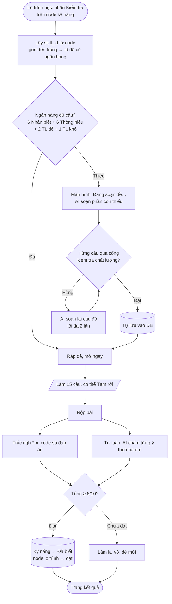
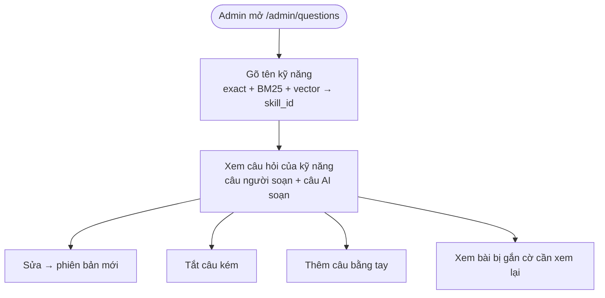

# Guide: Kiểm tra theo kỹ năng, AI soạn đề khi thiếu, chấm theo barem

> Module 09 (Ôn tập) · phụ trách: Tuấn · cập nhật 17/11/2026 · trạng thái: **thiết kế đã thống nhất, chưa code**
> Tài liệu liên quan: tìm kỹ năng theo tên → [Review-Skill-Search.md](Review-Skill-Search.md) · pipeline chấm tự luận → [Review-AI-Grading.md](Review-AI-Grading.md)

## 0. Quyết định

| # | Nội dung | Trạng thái |
|---|---|---|
| Q1 | Thang 10: **trắc nghiệm 60%** (12 × 0,5), **tự luận 40%** (2 dễ × 1 + 1 khó × 2). Đạt từ 6/10 | ✅ Chốt |
| Q2 | **Kiểm tra theo kỹ năng.** Người học nhấn **Kiểm tra** trên **node của đồ thị lộ trình** (node là một kỹ năng), làm bài gồm câu hỏi của đúng kỹ năng đó | ✅ Chốt |
| Q3 | Người học **làm bài ngay**, không chờ admin. Thiếu câu thì AI tự soạn, tự kiểm tra, tự lưu DB | ✅ Chốt |
| Q4 | Barem tự luận: mỗi ý **Đạt** = trọn điểm ý, **Không đạt** = 0. Đúng hết các ý thì trọn điểm câu | ✅ Chốt |
| Q5 | Ngân hàng câu hỏi dùng **bảng hiện có** (`review_questions`), chỉ thêm cột, **không tạo bảng mới** | ✅ Chốt |
| Q6 | **Giữ ôn tập theo khóa học song song.** Theo khóa (Khóa học của tôi) → xác nhận hoàn thành khóa; theo kỹ năng (node lộ trình) → xác nhận nắm kỹ năng. Dùng chung ngân hàng câu hỏi, cách chấm, màn kết quả | ✅ Chốt |
| Q7 | Thay đổi database (D1–D7) áp dụng bằng **Alembic** (dự án bắt đầu dùng Alembic từ lần này) | ✅ Chốt |
| Q8 | **Chỉ kỹ năng CNTT** được kiểm tra theo kỹ năng ở bản đầu. Node kỹ năng ngoài CNTT không hiện huy hiệu ôn tập (gọi API thì trả lý do `skill_not_supported`). Cách phân loại CNTT: xem mục 8 | ✅ Chốt |
| Q9 | Làm trước 25/11, hay sau khi xong đánh giá AI chấm bài (B10)? | ❓ Chưa chốt |
| Q10 | Giao diện theo **mẫu Ôn tập trên đồ thị** (Tuấn + Hòa thống nhất 17/11): [proposals/review-on-graph](EduMentor-UI-design/proposals/review-on-graph/README.md). Ba điểm lệch xử lý **theo guide**: thẻ ôn tập theo kỹ năng (không chọn khóa học), đạt từ 6/10. Chấm "đến hạn ôn" **để sau 25/11** | ✅ Chốt |

## 1. Luồng người học (tự động hoàn toàn)



- **Node là một kỹ năng**, nên đã có `skill_id`: không tìm kiếm, không nhập gì. Các id trùng tên ("JavaScript" / "Javascript"…) dùng chung ngân hàng của id có nhiều câu nhất.
- **Đủ câu** → đề mở ngay. **Thiếu câu** (kỹ năng mới) → chờ "Đang soạn đề…" khoảng 20–60 giây, **một lần cho mỗi kỹ năng**. Người vào sau dùng câu đã lưu.
- **Không mở được đề** chỉ khi Gemini không phản hồi (mất mạng hoặc hết lượt). Khi đó báo "Chưa soạn được đề, thử lại sau ít phút", không tạo đề dở dang.
- **Chia việc:** trang lộ trình là của **Hòa** (đã có từ 17/11: `LearningPathDetailPage`, node `SkillNode.jsx` mang sẵn `skillId`). Hòa thêm **huy hiệu ôn tập** trên node theo [mẫu](EduMentor-UI-design/proposals/review-on-graph/ReviewOnGraph.png), dẫn tới `/skills/{skill_id}/review?path={path_id}`. Toàn bộ logic ôn tập ở module 09 (Tuấn).

## 2. Luồng admin (công cụ quản lý, không chặn người học)



- Ô tìm kỹ năng theo tên **chỉ dùng ở trang admin**, để tìm nhanh trong 5.893 kỹ năng. Thiết kế chi tiết ở [Review-Skill-Search.md](Review-Skill-Search.md).
- Admin kiểm tra chất lượng câu AI **sau khi** câu đã được dùng. Việc của admin không phải điều kiện để người học làm bài.

## 3. Đề và thang điểm

Đề gồm 15 câu, **cùng một kỹ năng**:

| Loại | Số câu | Mức độ | Điểm / câu | Cộng |
|---|---|---|---|---|
| Trắc nghiệm (4 đáp án, 1 đúng) | 12 | 6 Nhận biết + 6 Thông hiểu | 0,5 | **6 (60%)** |
| Tự luận dễ | 2 | Dễ | 1 | 2 |
| Tự luận khó | 1 | Nâng cao | 2 | 2 |
| **Tổng** | **15** | | | **10** — đạt từ 6 |

- **Trắc nghiệm:** chọn đúng đáp án lưu sẵn thì được 0,5; sai hoặc bỏ trống thì 0. Thứ tự đáp án được xáo cho từng lượt, code tự đổi về vị trí gốc khi chấm.
- Thang điểm trùng `MAX_POINTS` hiện có trong `exam_builder.py`, không phải sửa.

## 4. Barem tự luận

### 4.1 Quy tắc chấm
- Barem gồm các **ý**; điểm các ý cộng lại = 10 (thang nội bộ của câu).
- Mỗi ý: **Đạt** = trọn điểm ý; **Không đạt** = 0 (sai, thiếu, nói ngược, dài dòng mà không trúng ý). Không có nửa điểm.
- **Điểm câu** = (tổng điểm các ý Đạt / 10) × điểm câu.
- Ý "Đạt" phải có **câu trích nguyên văn trong bài làm**. AI trích không có thật thì ý đó thành Không đạt (khối Verifier).

### 4.2 Ví dụ
**Câu dễ (1 điểm):** *"Phân biệt break và continue."*

| Ý | Nội dung | Điểm ý |
|---|---|---|
| 1 | break thoát hẳn vòng lặp | 5 |
| 2 | continue bỏ qua lần lặp hiện tại, sang lần kế | 5 |

Đúng ý 1: 5/10 × 1 = **0,5**. Đúng cả hai: **1**. Nói ngược cả hai ý: **0**.

**Câu khó (2 điểm):** *"Chương trình tính trung bình in sai… Lỗi gì, vì sao, sửa thế nào, debug ra sao?"*

| Ý | Nội dung | Điểm ý |
|---|---|---|
| 1 | Là lỗi logic | 2 |
| 2 | Vì phép chia làm trước phép cộng | 3 |
| 3 | Sửa: `avg = (a + b) / 2` | 3 |
| 4 | Một cách debug: in giá trị biến / chạy từng bước | 2 |

Thiếu ý 4: 8/10 × 2 = **1,6**. Đây là kết quả chấm thật bằng Gemini ngày 17/11 (lượt 63, câu 15).

### 4.3 Yêu cầu khi AI soạn barem
- Câu dễ **2–3 ý**, câu khó **4–5 ý**, tổng đúng 10 (validator `RUBRIC_SIZE` đang kiểm).
- Mỗi ý mô tả **một** điều cần có; kèm `main_keywords` / `sub_keywords` cho bộ chấm từ khóa dự phòng.
- Ý dạng phủ định viết kèm "not" và thêm cách người học hay viết. Lượt chấm ngày 17/11: bài viết "cannot start with a digit" bị bộ chấm từ khóa hiểu ngược.
- Kèm **đáp án mẫu** (hiện cho người học sau khi nộp).

## 5. AI soạn câu khi ngân hàng thiếu

### 5.1 Số lượng và nguồn
- **Tối thiểu cho một đề:** 6 Nhận biết + 6 Thông hiểu + 2 TL dễ + 1 TL khó.
- **Mục tiêu mỗi kỹ năng: 30 câu** (12 + 12 + 4 + 2), để làm lại có đề khác. Phải nâng `REVIEW_BANK_TARGET_PER_SKILL` từ 20 lên 30.
- Lần đầu: soạn **đủ phần thiếu của đề này** để người học làm ngay; phần dự phòng tới 30 câu soạn **ở nền**.
- **Nguồn kiến thức** để AI không bịa, theo thứ tự:
  1. `knowledge_chunks` của kỹ năng;
  2. mô tả các khóa học dạy kỹ năng đó (tra thẳng `skill_id → course_skill → courses.description`);
  3. câu đã có của kỹ năng (để tránh trùng).

### 5.2 Cổng kiểm tra chất lượng
Pipeline kiểu n8n trên `app/ai/review/pipeline/runner.py` có sẵn:

| Khối | Kiểm tra | Hỏng thì |
|---|---|---|
| 1 Khung | Validator: đủ trường; trắc nghiệm 4 đáp án khác nhau, `correct_index` 0–3; barem đúng số ý, tổng 10 | Soạn lại |
| 2 Trùng | Không trùng (gần trùng) câu đã có | Bỏ câu |
| 3 Đáp án trắc nghiệm | AI **giải mù** câu vừa soạn; chọn khác `correct_index` thì câu sai hoặc mơ hồ | Soạn lại |
| 4 Barem tự luận | AI viết 4 bài giả (**đúng đủ / thiếu 1 ý / nói ngược / lạc đề**) kèm nhãn mong đợi; pipeline chấm thật phải ra **đúng nhãn** | Soạn lại |
| 5 Lưu | `review_questions` (`source = ai`) + `review_question_meta` (`review_status = auto_approved`, kết quả cổng vào `ai_check`) | — |

- Một câu hỏng thì AI soạn lại câu đó, **tối đa 2 lần**.
- Vẫn hỏng thì bỏ và soạn câu khác thay thế, để đề vẫn đủ 15 câu. Câu bị bỏ lưu ở **Chờ duyệt** cho admin xem sau.

### 5.3 Vận hành
- **Nhiều người cùng nhấn một kỹ năng mới:** khóa theo `skill_id` (`pg_advisory_xact_lock`) để chỉ soạn **một lần**.
- **Gemini lỗi tạm thời (5xx):** tự gọi lại (đã có, commit `5a41ec9`).
- **Chi phí:** chỉ soạn khi có người học thật sự nhấn Kiểm tra, không soạn trước cho cả 5.893 kỹ năng.

## 6. Chấm bài

- **Trắc nghiệm:** code so đáp án.
- **Tự luận:** pipeline 9 khối (`app/ai/review/pipeline/essay.py`, đã có):
  - Input → Tiền xử lý → Guard → Ngữ cảnh → **Gemini chấm từng ý** (JSON schema, nhiệt độ 0) → Verifier → Đối chiếu với chấm từ khóa → Tổng hợp → Trace.
  - Gemini lỗi thì chấm bằng từ khóa. Quá 20 giây thì chấm nốt ở nền, báo kết quả qua chuông và email.

**Dữ liệu chuyển cho AI:** tra thẳng database theo `question_id`, không dùng RAG.

```
review_answers.text_answer  (bài làm) ─┐
review_questions.content    (đề)       ├─→ Gemini → mỗi ý: {evidence, reason, result}
review_questions.rubric     (barem)    │           + feedback
review_questions.explanation(đáp án mẫu)┘
        ↓
review_answers.rubric_result · review_answers.points (code tính) · review_attempts.score / passed / trace
```

- AI **chỉ trả** Đạt / Không đạt cho từng ý, kèm câu trích và lý do. **Điểm do code tính.**
- Không gửi email hay tên người học cho AI.

## 7. Database

### 7.1 Đã có (không tạo bảng mới)

| Bảng | Vai trò | Cột chính |
|---|---|---|
| `review_questions` | Ngân hàng câu hỏi, **2 loại** | `type` (`mcq` / `essay`) · `level` · `skill_id` · `content` · `options` + `correct_index` (mcq) · **`rubric` JSON (essay)** · `explanation` (giải thích / đáp án mẫu) · `source` (`bank` / `ai`) · `is_active` |
| `review_question_meta` | Phiên bản + duyệt (1:1) | `family_id` · `version` · `review_status` · `created_by`, `reviewed_by` |
| `review_attempts` | Một lượt làm bài | `user_id` · `course_id` · `status` · `score` · `passed` · `trace` |
| `review_answers` | 15 câu trả lời | `question_id` (RESTRICT) · `selected_index` / `text_answer` · `max_points` · `points` · **`rubric_result` JSON** |

- **Ràng buộc đã có (CHECK):** `mcq` phải có 4 đáp án và không có barem; `essay` phải có barem; `points` từ 0 đến `max_points`.
- **Barem gắn với phiên bản câu hỏi:** sửa barem thì tạo phiên bản mới; câu cũ bị khóa xóa, nên bài cũ luôn chấm theo đúng barem lúc làm.
- **Barem để dạng JSON** (không tách bảng `rubric_items`) vì luôn đọc trọn bộ và gắn với phiên bản. Ví dụ:

```json
[{"text": "= assigns a value to a variable", "max_points": 4, "main_keywords": ["assign", "store"], "sub_keywords": ["="]},
 {"text": "== compares two values and gives True or False", "max_points": 4, "main_keywords": ["compare", "equal"], "sub_keywords": ["=="]},
 {"text": "A correct example of each", "max_points": 2, "main_keywords": ["x = 5", "x == 5", "example"], "sub_keywords": []}]
```

### 7.2 Thay đổi (một migration Alembic)

| # | Bảng | Thay đổi | Lý do |
|---|---|---|---|
| D1 | `review_attempts` | + `skill_id` NULL FK→skills (CASCADE) | Lượt kiểm tra theo kỹ năng |
| D2 | `review_attempts` | + `path_id` NULL FK→learning_paths (SET NULL) | Quay lại đúng node lộ trình |
| D3 | `review_attempts` | `course_id` cho phép NULL + CHECK chỉ một trong `course_id` / `skill_id` | Lượt theo khóa **hoặc** theo kỹ năng |
| D4 | `review_attempts` | Index `skill_id`; UNIQUE `(user_id, skill_id) WHERE status = 'in_progress'` | Mỗi người một lượt dở cho mỗi kỹ năng |
| D5 | `review_questions` | Index `(skill_id, type, level) WHERE is_active` | Đếm "đủ câu chưa" mỗi lần nhấn node |
| D6 | `review_question_meta` | + `ai_check` JSON NULL | Lưu kết quả cổng kiểm tra |
| D7 | `review_question_meta` | Thêm `auto_approved` vào CHECK `review_status` | Phân biệt câu AI tự duyệt với câu admin duyệt |

**Cách áp dụng: bắt đầu dùng Alembic (Q7).**
- Hiện bảng được tạo bằng `Base.metadata.create_all` lúc khởi động. Lệnh này chỉ **tạo bảng mới**, không thêm cột vào bảng đã có, nên D1–D7 sẽ không tự áp dụng.
- **Bước 1:** khởi tạo Alembic, tạo revision **mốc** (baseline) mô tả đúng 23 bảng hiện có. Mỗi máy chạy `alembic stamp head` một lần, không đổi dữ liệu.
- **Bước 2:** revision D1–D7. Từ đây cả nhóm cập nhật database bằng `alembic upgrade head` (ghi vào README và Docker).
- Giữ `create_all` cho môi trường test (pytest) để test không phụ thuộc Alembic.

**Bảng khác trong DB:** từ 17/11 có thêm bảng `feedback` (phản hồi, module của **Tâm**), nên database có **23 bảng**. Bảng này không liên quan tới ngân hàng câu hỏi và không bị D1–D7 thay đổi; chỉ cần có mặt trong baseline.

**Rủi ro:**
- Không mất dữ liệu: chỉ thêm cột và nới ràng buộc.
- Code đang đọc `attempt.course_id` (lịch sử, email, thông báo) phải xử lý trường hợp NULL.
- Downgrade lỗi nếu đã có lượt theo kỹ năng.
- Báo Hòa: `path_id` trỏ vào bảng `learning_paths`.

## 8. Mở rộng ra 5.893 kỹ năng

**AI chấm dựa vào barem của từng câu, không dựa vào kỹ năng.** Bộ chấm làm một việc giống nhau ở mọi kỹ năng: đối chiếu bài làm với barem. Thêm kỹ năng mới thì **bộ chấm giữ nguyên**, chỉ cần thêm câu hỏi và barem (do AI soạn theo mục 5).

Độ chính xác gồm hai phần, kiểm chứng bằng **4 lớp**:

| Lớp | Kiểm chứng | Phủ |
|---|---|---|
| L1 Gold set | Người chấm 60 bài khóa 312, so với AI | **Bộ chấm**: dùng chung mọi kỹ năng |
| L2 Cổng kiểm tra (mục 5.2) | Tự động, từng câu | **Barem**: 100% câu AI soạn |
| L3 Gold set theo lĩnh vực | Gom kỹ năng thành 10–20 lĩnh vực; mỗi lĩnh vực người chấm khoảng 20 bài | Ước lượng độ chính xác theo lĩnh vực (200–400 bài, không phải theo từng kỹ năng) |
| L4 Theo dõi khi chạy | Tỉ lệ gắn cờ "xem lại", chấm lại, câu có điểm bất thường | Phát hiện barem hỏng sau khi dùng |

- **Điểm yếu cần ghi trung thực:** ở L2, bài giả và bài chấm đều do AI làm. Giảm rủi ro bằng cách dùng prompt hoặc model khác để viết bài giả, và cho người xem mẫu định kỳ.
- **Kỹ năng ngoài CNTT** (ví dụ "Workday Terminology"): cổng chỉ kiểm barem **rõ ràng**, không kiểm barem **đúng kiến thức**. Nhóm cũng không có chuyên môn để kiểm chứng. Vì vậy **bản đầu chỉ mở cho kỹ năng CNTT** (Q8).
- **Phân loại CNTT** (làm một lần, lưu kết quả, admin sửa được): AI gắn nhãn lĩnh vực cho 5.893 tên kỹ năng, đối chiếu thêm với lĩnh vực các khóa học chứa kỹ năng đó. Trường hợp mơ hồ thì mặc định **không** mở. Nơi lưu nhãn (cột mới hay bảng riêng, vì bảng `skills` là của Hòa/Khôi) sẽ chốt khi làm G1.
- **Khối lượng thật nhỏ hơn 5.893:** 70% kỹ năng (4.156) chỉ có trong 1 khóa, và câu hỏi chỉ được soạn khi người học thật sự nhấn Kiểm tra.

## 9. Kế hoạch

| Bước | Việc | Ước lượng |
|---|---|---|
| G1 | Service tìm kỹ năng cho admin ([Review-Skill-Search.md](Review-Skill-Search.md)) | 1 ngày |
| G2a | Khởi tạo Alembic + baseline 23 bảng + hướng dẫn `alembic upgrade head` cho nhóm | 0,5 ngày |
| G2 | Migration D1–D7 + API `POST /skills/{skill_id}/review-attempts` + ráp đề 12 + 3 cho một kỹ năng + xử lý `course_id` NULL | 1 ngày |
| G3 | Pipeline soạn câu + cổng kiểm tra + lưu DB + khóa chống soạn trùng + soạn dự phòng ở nền | 1,5 ngày |
| G4 | Đạt bài → `user_skills` Đã biết; cập nhật SRS (FR-11, FR-12) và báo cáo | 0,5 ngày |
| G5 | Giao diện `/skills/{skill_id}/review` ("Đang soạn đề…" → làm bài → kết quả, dùng lại màn hiện có). Hòa thêm nút Kiểm tra trên node | 1 ngày |
| G6 | Test + đo: tỉ lệ câu qua cổng, thời gian soạn, độ chính xác chấm trên câu AI soạn | 0,5 ngày |

## Nhật ký

| Ngày | Nội dung |
|---|---|
| 17/11/2026 | Thống nhất thiết kế: kiểm tra theo kỹ năng từ node lộ trình, người học làm ngay, AI soạn và kiểm tra khi thiếu câu, thang 60/40, barem Đạt / Không đạt, dùng bảng ngân hàng hiện có (+ D1–D7), cách mở rộng ra 5.893 kỹ năng. Rút gọn tài liệu, bỏ phần trùng lặp |
| 17/11/2026 | Sau khi gộp `review/featrure`: trang lộ trình của Hòa đã có, nên bỏ ý nút tạm. Chốt dùng **Alembic** cho D1–D7 (Q7). Ghi bảng `feedback` mới (23 bảng). Lưu mẫu "Ôn tập trên đồ thị" vào `EduMentor-UI-design/proposals/review-on-graph` và ghi 3 điểm lệch với guide (Q10) |
| 17/11/2026 | Chốt Q6 (giữ ôn tập theo khóa song song), Q8 (chỉ kỹ năng CNTT), Q10 (theo guide; "đến hạn ôn" để sau 25/11). Q9 (thời điểm) đề xuất làm sau 25/11, chờ Tuấn xác nhận |
